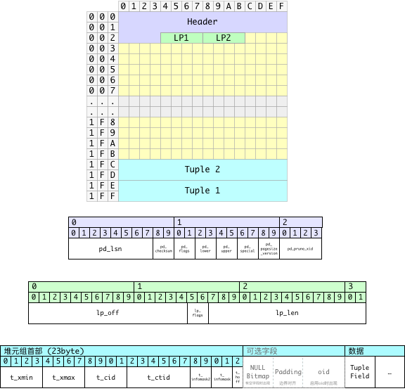

This article was written in 2018. It explains statistics-based bloat estimates and maintenance practices from that period.

PostgreSQL uses MVCC to let transactions work with different row versions. Old versions can leave tables and indexes larger than their live data requires. Routine vacuum makes space reusable; a rewrite can return excess space to the filesystem. This article explains how to measure bloat and choose when to reorganize a relation.

---------------------

## Relation Bloat Overview

If a relation occupies 100 GB and a compact copy would occupy 60 GB, its estimated bloat rate is `(100 - 60) / 100 = 40%`.

Regular `VACUUM` reclaims dead-tuple space for reuse within the table. It can also truncate empty pages at the end of the file. It does not compact live rows across the whole table, so free space between live pages usually remains allocated.

`VACUUM FULL` copies live tuples to a new file to compact the table. It holds an `AccessExclusiveLock` for the operation, blocking reads and writes. `pg_repack` allows most reads and writes to continue, but needs brief exclusive locks during setup and the final swap.

Measure bloat before choosing which relations to rewrite. Set the threshold and schedule from workload, available disk space, and maintenance windows.

---------------------

## Measuring Relation Bloat

Estimate the bloat rate with `1 - compact_size / actual_size`. The compact size includes live tuples and necessary page, tuple, and alignment overhead.

Relation size is available from PostgreSQL. The next step is to measure or estimate the space that live tuples need.

### Measuring Tuple and Free Space

`pgstattuple` scans a relation and reports live tuples, dead tuples, and free space.
`tuple_percent` uses a 0–100 scale. Thus `1 - tuple_percent / 100` is the share
outside live tuples, including necessary storage overhead. The sample calls this
value `bloat`, but it is not the exact fraction a rewrite can reclaim.

```text
vonng@[local]:5432/bench# select *,
                          1.0 - tuple_len::numeric / table_len as bloat
                          from pgstattuple('pgbench_accounts');
┌─[ RECORD 1 ]───────┬────────────────────────┐
│ table_len          │ 136642560              │
│ tuple_count        │ 1000000                │
│ tuple_len          │ 121000000              │
│ tuple_percent      │ 88.55                  │
│ dead_tuple_count   │ 16418                  │
│ dead_tuple_len     │ 1986578                │
│ dead_tuple_percent │ 1.45                   │
│ free_space         │ 1674768                │
│ free_percent       │ 1.23                   │
│ bloat              │ 0.11447794889088729017 │
└────────────────────┴────────────────────────┘
```

See the [PostgreSQL 10 `pgstattuple` reference](https://www.postgresql.org/docs/10/pgstattuple.html) for field definitions and the `pgstatindex` function for B-tree indexes.

Two other supplied extensions help inspect relation storage:

- [pg_freespacemap](https://www.postgresql.org/docs/10/pgfreespacemap.html) reports recorded free space in each page.
- [pageinspect](https://www.postgresql.org/docs/10/pageinspect.html) reads the contents of individual pages.

For routine monitoring, an estimate is usually enough to identify relations for closer inspection. Measuring every live tuple requires a full relation scan, which can add substantial I/O when repeated across many tables.

PostgreSQL 9.5 added `pgstattuple_approx` to the `pgstattuple` extension. It estimates some values to reduce the amount of data scanned. Its cost depends on how much of the relation must be read.

Use statistics-based estimates for frequent monitoring across many tables. Scan selected relations when you need a more precise measurement.

---------------------

## Estimating Bloat Rate

The estimate uses three values from table and column statistics:

* Average tuple width `avgwidth`: calculated from column-level statistical data, used to estimate space occupied in compact state
* Tuple count: `pg_class.reltuples`: used to estimate space occupied in compact state
* Page count: `pg_class.relpages`: used to measure actually used space

The estimate is:

```c
1 - (reltuples * avgwidth) / (block_size - pageheader) / relpages
```

Here `block_size` is page size, default 8192, `pageheader` is header overhead, default 24 bytes. Page size minus header size gives actual space available for tuple storage. Therefore, `(reltuples * avgwidth)` gives estimated total tuple size, and dividing by the former gives expected pages needed to compactly store all tuples. Finally, expected page count divided by actual page count gives **utilization rate**, and 1 minus utilization rate gives bloat rate.

### Difficulties

Estimating average tuple length requires accounting for:

* When tuples contain null values, headers will have null bitmaps
* There's padding between headers and data sections, requiring boundary alignment consideration
* Some field types also have alignment requirements

### Calculating Average Tuple Length

The diagram shows the PostgreSQL tuple layout used to estimate average tuple length.



Space occupied by a tuple can be divided into three parts:

* Fixed-length line pointer (4 bytes, strictly speaking this isn't part of the tuple, but it corresponds one-to-one with tuples)
* Variable-length header
  * Fixed-length part 23 bytes
  * When tuples contain null values, a null bitmap appears, with each field occupying one bit, so its length is the number of fields divided by 8, rounded up
  * After the null bitmap, padding is needed to `MAXALIGN`, usually 8
  * If the table has the `WITH OIDS` option enabled, tuples also have a 4-byte OID, but we don't consider this case here
* Data section

Therefore, a tuple's average length (including corresponding line pointer) can be calculated as:

```c
avg_size_tuple = 4 + avg_size_hdr + avg_size_data
```

The key is finding **average header length** and **average data section length**.

### Calculating Average Header Length

The main variables in average header length are **null bitmap** and **padding alignment**. To estimate average tuple header length, we need several parameters:

* Average header length without null bitmap (with padding): `normhdr`
* Average header length with null bitmap (with padding): `nullhdr`
* Proportion of tuples with null values: `nullfrac`

Estimate average header length with:

```python
avg_size_hdr =  nullhdr * nullfrac + normhdr * (1 - nullfrac)
```

Since headers without null bitmaps are 23 bytes long, aligned to 8-byte boundaries gives 24 bytes, the above formula becomes:

```python
avg_size_hdr =  nullhdr * nullfrac +  24 * (1 - nullfrac)
```

To round a length up to an 8-byte boundary, use:

```python
padding = lambda x: ((x + 7) >> 3) << 3
```

### Calculating Average Data Section Length

Average data section length mainly depends on each field's average width and null rate, plus trailing alignment.

The following SQL can calculate average tuple data section width for all tables using statistical information:

```sql
SELECT schemaname, tablename, sum((1 - null_frac) * avg_width)
FROM pg_stats GROUP BY (schemaname, tablename);
```

For example, this SQL can get average tuple length for table `app.apple` from the `pg_stats` system statistics view:

```sql
SELECT
  count(*),                        -- number of fields
  ceil(count(*) / 8.0),            -- bytes occupied by null bitmap
  max(null_frac),                  -- maximum null rate
  sum((1 - null_frac) * avg_width) -- average width of data section
FROM pg_stats
where schemaname = 'app' and tablename = 'apple';

-[ RECORD 1 ]-----------
count | 47
ceil  | 6
max   | 1
sum   | 1733.76873471724
```

`max(null_frac)` is an approximation for the fraction of rows with any NULL.
Column statistics do not describe how NULL values overlap across columns.

### Integration

The function below combines those estimates. It assumes 8-byte alignment and
uses the server’s block size. It returns NULL when statistics are unavailable.
It estimates heap space only; TOAST, fillfactor, and column alignment can affect
the result.

```sql
CREATE OR REPLACE FUNCTION public.pg_table_bloat(relation regclass)
RETURNS double precision
LANGUAGE plpgsql
AS $function$
DECLARE
  _schemaname text;
  _tablename  text;
  tuples      double precision;
  pages       integer;
  nullheader  double precision;
  nullfrac    double precision;
  datawidth   double precision;
  avgtuplelen double precision;
  blocksize   integer := current_setting('block_size')::integer;
BEGIN
  SELECT n.nspname, c.relname, c.reltuples, c.relpages
    INTO _schemaname, _tablename, tuples, pages
    FROM pg_class c JOIN pg_namespace n ON n.oid = c.relnamespace
    WHERE c.oid = relation;

  IF pages = 0 THEN RETURN 0; END IF;
  IF pages IS NULL OR tuples < 0 THEN RETURN NULL; END IF;

  SELECT 23 + ceil(count(*) / 8.0),
         max(null_frac),
         sum((1 - null_frac) * avg_width)
    INTO nullheader, nullfrac, datawidth
    FROM pg_stats
    WHERE schemaname = _schemaname AND tablename = _tablename
      AND NOT inherited;

  IF datawidth IS NULL THEN RETURN NULL; END IF;

  avgtuplelen := 4 + ceil(datawidth / 8.0) * 8
    + (1 - nullfrac) * 24 + nullfrac * ceil(nullheader / 8.0) * 8;

  RETURN greatest(0, 1 - ceil(tuples * avgtuplelen / (blocksize - 24)) / pages);
END;
$function$;
```

### Batch Calculation

For database-wide monitoring, a view can estimate many relations from catalog
statistics. This separate example estimates B-tree index bloat:

```sql
CREATE SCHEMA IF NOT EXISTS monitor;
CREATE OR REPLACE VIEW monitor.pg_bloat_indexes AS
  WITH btree_index_atts AS (
      SELECT
        pg_namespace.nspname,
        indexclass.relname                                                          AS index_name,
        indexclass.reltuples,
        indexclass.relpages,
        pg_index.indrelid,
        pg_index.indexrelid,
        indexclass.relam,
        tableclass.relname                                                          AS tablename,
        generate_series(1, pg_index.indnatts)                                        AS attnum,
        pg_index.indexrelid                                                         AS index_oid
      FROM ((((pg_index
        JOIN pg_class indexclass ON ((pg_index.indexrelid = indexclass.oid)))
        JOIN pg_class tableclass ON ((pg_index.indrelid = tableclass.oid)))
        JOIN pg_namespace ON ((pg_namespace.oid = indexclass.relnamespace)))
        JOIN pg_am ON ((indexclass.relam = pg_am.oid)))
      WHERE ((pg_am.amname = 'btree' :: NAME) AND (indexclass.relpages > 0))
  ), index_item_sizes AS (
      SELECT
        ind_atts.nspname,
        ind_atts.index_name,
        ind_atts.reltuples,
        ind_atts.relpages,
        ind_atts.relam,
        ind_atts.indrelid                                    AS table_oid,
        ind_atts.index_oid,
        (current_setting('block_size' :: TEXT)) :: NUMERIC   AS bs,
        8                                                    AS maxalign,
        24                                                   AS pagehdr,
        CASE
        WHEN (max(COALESCE(pg_stats.null_frac, (0) :: REAL)) = (0) :: FLOAT)
          THEN 2
        ELSE 6
        END                                                  AS index_tuple_hdr,
        sum((((1) :: FLOAT - COALESCE(pg_stats.null_frac, (0) :: REAL)) *
             (COALESCE(pg_stats.avg_width, 1024)) :: FLOAT)) AS nulldatawidth
      FROM ((pg_attribute
        JOIN btree_index_atts ind_atts
          ON (((pg_attribute.attrelid = ind_atts.indexrelid) AND (pg_attribute.attnum = ind_atts.attnum))))
        JOIN pg_stats ON (((pg_stats.schemaname = ind_atts.nspname) AND (((pg_stats.tablename = ind_atts.tablename) AND
                                                                          ((pg_stats.attname) :: TEXT =
                                                                           pg_get_indexdef(pg_attribute.attrelid,
                                                                                           (pg_attribute.attnum) :: INTEGER,
                                                                                           TRUE))) OR
                                                                         ((pg_stats.tablename = ind_atts.index_name) AND
                                                                          (pg_stats.attname = pg_attribute.attname))))))
      WHERE (pg_attribute.attnum > 0)
      GROUP BY ind_atts.nspname, ind_atts.index_name, ind_atts.reltuples, ind_atts.relpages, ind_atts.relam,
        ind_atts.indrelid, ind_atts.index_oid, (current_setting('block_size' :: TEXT)) :: NUMERIC, 8 :: INTEGER
  ), index_aligned_est AS (
      SELECT
        index_item_sizes.maxalign,
        index_item_sizes.bs,
        index_item_sizes.nspname,
        index_item_sizes.index_name,
        index_item_sizes.reltuples,
        index_item_sizes.relpages,
        index_item_sizes.relam,
        index_item_sizes.table_oid,
        index_item_sizes.index_oid,
        COALESCE(ceil((((index_item_sizes.reltuples * ((((((((6 + index_item_sizes.maxalign) -
                                                             CASE
                                                             WHEN ((index_item_sizes.index_tuple_hdr %
                                                                    index_item_sizes.maxalign) = 0)
                                                               THEN index_item_sizes.maxalign
                                                             ELSE (index_item_sizes.index_tuple_hdr %
                                                                   index_item_sizes.maxalign)
                                                             END)) :: FLOAT + index_item_sizes.nulldatawidth)
                                                          + (index_item_sizes.maxalign) :: FLOAT) - (
                                                           CASE
                                                           WHEN (((index_item_sizes.nulldatawidth) :: INTEGER %
                                                                  index_item_sizes.maxalign) = 0)
                                                             THEN index_item_sizes.maxalign
                                                           ELSE ((index_item_sizes.nulldatawidth) :: INTEGER %
                                                                 index_item_sizes.maxalign)
                                                           END) :: FLOAT)) :: NUMERIC) :: FLOAT) /
                        ((index_item_sizes.bs - (index_item_sizes.pagehdr) :: NUMERIC)) :: FLOAT) +
                       (1) :: FLOAT)), (0) :: FLOAT) AS expected
      FROM index_item_sizes
  ), raw_bloat AS (
      SELECT
        current_database()                                                           AS dbname,
        index_aligned_est.nspname,
        pg_class.relname                                                             AS table_name,
        index_aligned_est.index_name,
        (index_aligned_est.bs * ((index_aligned_est.relpages) :: BIGINT) :: NUMERIC) AS totalbytes,
        index_aligned_est.expected,
        CASE
        WHEN ((index_aligned_est.relpages) :: FLOAT <= index_aligned_est.expected)
          THEN (0) :: NUMERIC
        ELSE (index_aligned_est.bs *
              ((((index_aligned_est.relpages) :: FLOAT - index_aligned_est.expected)) :: BIGINT) :: NUMERIC)
        END                                                                          AS wastedbytes,
        CASE
        WHEN ((index_aligned_est.relpages) :: FLOAT <= index_aligned_est.expected)
          THEN (0) :: NUMERIC
        ELSE (((index_aligned_est.bs * ((((index_aligned_est.relpages) :: FLOAT -
                                          index_aligned_est.expected)) :: BIGINT) :: NUMERIC) * (100) :: NUMERIC) /
              (index_aligned_est.bs * ((index_aligned_est.relpages) :: BIGINT) :: NUMERIC))
        END                                                                          AS realbloat,
        pg_relation_size((index_aligned_est.table_oid) :: REGCLASS)                  AS table_bytes,
        stat.idx_scan                                                                AS index_scans
      FROM ((index_aligned_est
        JOIN pg_class ON ((pg_class.oid = index_aligned_est.table_oid)))
        JOIN pg_stat_user_indexes stat ON ((index_aligned_est.index_oid = stat.indexrelid)))
  ), format_bloat AS (
      SELECT
        raw_bloat.dbname                                             AS database_name,
        raw_bloat.nspname                                            AS schema_name,
        raw_bloat.table_name,
        raw_bloat.index_name,
        round(
            raw_bloat.realbloat)                                     AS bloat_pct,
        round((raw_bloat.wastedbytes / (((1024) :: FLOAT ^
                                         (2) :: FLOAT)) :: NUMERIC)) AS bloat_mb,
        round((raw_bloat.totalbytes / (((1024) :: FLOAT ^ (2) :: FLOAT)) :: NUMERIC),
              3)                                                     AS index_mb,
        round(
            ((raw_bloat.table_bytes) :: NUMERIC / (((1024) :: FLOAT ^ (2) :: FLOAT)) :: NUMERIC),
            3)                                                       AS table_mb,
        raw_bloat.index_scans
      FROM raw_bloat
  )
  SELECT
    format_bloat.database_name                    as datname,
    format_bloat.schema_name                      as nspname,
    format_bloat.table_name                       as relname,
    format_bloat.index_name                       as idxname,
    format_bloat.index_scans                      as idx_scans,
    format_bloat.bloat_pct                        as bloat_pct,
    format_bloat.table_mb,
    format_bloat.index_mb - format_bloat.bloat_mb as actual_mb,
    format_bloat.bloat_mb,
    format_bloat.index_mb                         as total_mb
  FROM format_bloat
  ORDER BY format_bloat.bloat_mb DESC;

COMMENT ON VIEW monitor.pg_bloat_indexes IS 'index bloat monitor';
```

In the original 3 TB database, this view took about 50 ms. It reads catalog
statistics rather than scanning every index page. Catalog access and relation-size
lookups still have a cost, and stale or incomplete statistics affect the estimate.
The result is a screening tool for candidate indexes.

---------------------

## Handling Table Bloat

Use `VACUUM FULL` when a maintenance window allows exclusive table access. For
online reorganization, `pg_repack` reduces the duration of exclusive locking.

* [pg_repack documentation](https://reorg.github.io/pg_repack/)

The original PostgreSQL 10 environment used the PGDG package below. Select the
package built for your PostgreSQL major version:

```bash
yum install pg_repack10
```

---------------------

### Using `pg_repack`

`pg_repack` uses the usual PostgreSQL client connection parameters.

Before using `pg_repack`, you need to create the `pg_repack` extension in the database to be reorganized:

```sql
CREATE EXTENSION pg_repack;
```

Example commands:

```bash
# Repack mydb; use 5 workers for index builds and wait up to 10 seconds for locks
pg_repack -d mydb -j 5 -T 10 --no-kill-backend

# Repack one table; skip it if conflicting locks remain after 10 seconds
pg_repack mydb -t public.mytable -T 10 --no-kill-backend

# Clean specific index myschema.myindex, must use full name with schema
pg_repack mydb -i myschema.myindex --no-kill-backend
```

`-T` controls lock waiting, not total runtime. Without `--no-kill-backend`,
`pg_repack` can cancel and later terminate conflicting sessions. A full-table
repack needs a primary key or a suitable unique index on NOT NULL columns. See
the [option reference](https://reorg.github.io/pg_repack/#options).

---------------------

### `pg_repack` Strategy

Schedule `pg_repack` during low-traffic periods. It consumes CPU, disk I/O, and extra storage, and can increase query latency and replication lag.

For example, select candidate tables during a low-traffic period. The following
view supplies the columns used by the scheduling example; `total_mb` measures
current disk usage in MiB, including indexes and TOAST:

```sql
CREATE OR REPLACE VIEW monitor.pg_bloat_tables AS
SELECT current_database() AS datname,
       n.nspname,
       c.relname,
       pg_total_relation_size(c.oid) / 1048576.0 AS total_mb,
       b.ratio * 100 AS bloat_pct
FROM pg_class c
JOIN pg_namespace n ON n.oid = c.relnamespace
CROSS JOIN LATERAL (SELECT public.pg_table_bloat(c.oid) AS ratio) b
WHERE c.relkind = 'r'
  AND n.nspname NOT IN ('pg_catalog', 'information_schema')
  AND n.nspname NOT LIKE 'pg_toast%';
```

The shell functions return one table name per line and accept table names as
separate quoted arguments:

```bash
repack_tables() {
    local db=$1 relname old_size new_size
    shift
    for relname in "$@"; do
        old_size=$(psql -X -d "$db" -v ON_ERROR_STOP=1 -v relation="$relname" -At <<'SQL'
SELECT pg_size_pretty(pg_total_relation_size(:'relation'::regclass));
SQL
) || return
        printf 'Repack %s: %s before\n' "$relname" "$old_size"
        pg_repack --dbname="$db" --table="$relname" --wait-timeout=10 --no-kill-backend || return
        new_size=$(psql -X -d "$db" -v ON_ERROR_STOP=1 -v relation="$relname" -At <<'SQL'
SELECT pg_size_pretty(pg_total_relation_size(:'relation'::regclass));
SQL
) || return
        printf 'Repack %s: %s -> %s\n' "$relname" "$old_size" "$new_size"
    done
}

get_bloat_tables() {
    psql -X -d "$1" -v ON_ERROR_STOP=1 -At <<'SQL'
WITH bloat_tables AS (
    SELECT format('%I.%I', nspname, relname) AS relname,
           total_mb, bloat_pct
    FROM monitor.pg_bloat_tables
    WHERE nspname NOT IN ('dba', 'monitor', 'trash')
)
(SELECT relname FROM bloat_tables
 WHERE total_mb < 256 AND bloat_pct > 40
 ORDER BY bloat_pct DESC LIMIT 64)
UNION
(SELECT relname FROM bloat_tables
 WHERE total_mb >= 256 AND total_mb < 1024 AND bloat_pct > 30
 ORDER BY bloat_pct DESC LIMIT 16)
UNION
(SELECT relname FROM bloat_tables
 WHERE total_mb >= 1024 AND total_mb <= 4096 AND bloat_pct > 20
 ORDER BY bloat_pct DESC LIMIT 4);
SQL
}
```

These size thresholds use current disk usage, including the table, indexes, and TOAST:

* From small tables < 256 MiB with bloat rate > 40%, select TOP64
* From medium tables 256 MiB to 1 GiB with bloat rate > 30%, select TOP16
* From large tables 1 GiB to 4 GiB with bloat rate > 20%, select TOP4

This example reorganizes selected tables during the early-morning low-traffic period and handles tables whose total disk usage exceeds 4 GiB manually. Adjust the schedule to your workload.

---------------------

### `pg_repack` Principles

`pg_repack` builds a compact copy and records concurrent changes with a trigger.
After replaying those changes, it swaps storage through the system catalogs.
Index-only repacks build a replacement index concurrently, then swap and drop the
old index.

**Reorganizing Tables**

1. Create an empty table with the same schema as the original table but without indexes
2. Create a log table corresponding to the original table to record changes that occur on that table during `pg_repack` operation
3. Add a row trigger to the original table to record all `INSERT`, `DELETE`, `UPDATE` operations in the corresponding log table
4. Copy data from the old table to the new empty table
5. Create the same indexes on the new table
6. Apply incremental changes from the log table to the new table
7. Swap table, index, and TOAST storage through the system catalogs
8. Drop the old storage

**Reorganizing Indexes**

1. Use `CREATE INDEX CONCURRENTLY` to create a new index on the original table, maintaining the same definition as the old index
2. Swap the old and new indexes in the system catalogs
3. Delete the old index

---------------------

### `pg_repack` Operating Checks

- Schedule around long transactions and conflicting maintenance. Inspect lock waits before deciding whether to cancel a session.
- Budget disk for the replacement table, indexes, and change log. The project recommends free space of about twice the table-and-index size for a full repack.
- Monitor WAL volume, replica replay lag, and free disk space throughout the copy and index build. WAL is generated during the operation, not just at the final swap.
- After interruption, inspect the installed version’s cleanup guidance and the remaining objects before retrying. Temporary-object names and cleanup behavior vary by version.

See the [pg_repack requirements and implementation notes](https://reorg.github.io/pg_repack/) when planning the operation.
