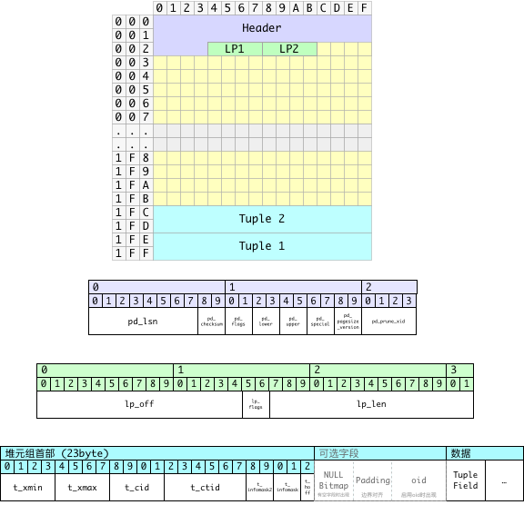

本文写于 2018 年，介绍当时基于统计信息估算膨胀及安排维护的方法。

PostgreSQL 使用 MVCC，让事务读取不同的行版本。旧版本可能使表和索引占用的空间超过活数据所需。日常清理让空间可以复用，重写关系则能将多余空间归还文件系统。本文介绍如何衡量膨胀，并选择重整时机。

---------------------

## 关系膨胀概述

若一个关系占用 100 GB，压实后的副本只需 60 GB，则估算膨胀率为 `(100 - 60) / 100 = 40%`。

普通 `VACUUM` 会回收死元组占用的空间，让表内后续写入复用，也可能截断文件末尾的空页。它不会跨整张表压紧活元组，因此活页之间的空闲空间通常仍留在关系文件中。

`VACUUM FULL` 将活元组复制到新文件中，把表压实。操作期间持有 `AccessExclusiveLock`，阻塞读写。`pg_repack` 允许大部分读写继续进行，但在初始化和最终切换时仍需短暂获取排他锁。

先测量膨胀程度，再选择需要重写的关系。根据负载、可用磁盘和维护窗口设定处理阈值与时间。

---------------------

## 关系膨胀的度量

用 `1 - 紧实大小 / 实际大小` 估算膨胀率。紧实大小包括活元组，以及必需的页面、元组和对齐开销。

PostgreSQL 可以提供关系的实际大小。下一步是测量或估算活元组所需的空间。

### 测量元组与空闲空间

`pgstattuple` 扫描关系，报告活元组、死元组和空闲空间。`tuple_percent` 的范围是 0–100，所以 `1 - tuple_percent / 100` 才是活元组以外空间的比例，其中还包含必需的存储开销。下方样例将其命名为 `bloat`，但它不等于重写后能回收的精确比例。

```text
vonng@[local]:5432/bench# select *,
                          1.0 - tuple_len::numeric / table_len as bloat
                          from pgstattuple('pgbench_accounts');
┌─[ RECORD 1 ]───────┬────────────────────────┐
│ table_len          │ 136642560              │
│ tuple_count        │ 1000000                │
│ tuple_len          │ 121000000              │
│ tuple_percent      │ 88.55                  │
│ dead_tuple_count   │ 16418                  │
│ dead_tuple_len     │ 1986578                │
│ dead_tuple_percent │ 1.45                   │
│ free_space         │ 1674768                │
│ free_percent       │ 1.23                   │
│ bloat              │ 0.11447794889088729017 │
└────────────────────┴────────────────────────┘
```

字段定义见 [PostgreSQL 10 的 `pgstattuple` 文档](https://www.postgresql.org/docs/10/pgstattuple.html)。B-tree 索引还可以使用该扩展中的 `pgstatindex` 函数。

另外两个随 PostgreSQL 提供的扩展可用于检查关系存储：

- [pg_freespacemap](https://www.postgresql.org/docs/10/pgfreespacemap.html)：查看各页记录的空闲空间。
- [pageinspect](https://www.postgresql.org/docs/10/pageinspect.html)：读取单个页面的内容。

日常监控通常用估算值筛选需要进一步检查的关系。精确测量活元组需要扫描整个关系，对大量表重复扫描会增加 I/O 开销。

PostgreSQL 9.5 在 `pgstattuple` 扩展中加入了 `pgstattuple_approx` 函数，通过估算部分数值减少扫描量。实际开销取决于需要读取多少页面。

频繁监控大量表时，使用基于统计信息的估算；需要精确测量时，再扫描选定的关系。

---------------------

## 膨胀率的估算

估算使用表和列统计中的三个值：

* 元组的平均宽度 `avgwidth`：从列级统计数据计算而来，用于估计紧实状态占用的空间。
* 元组数：`pg_class.reltuples`：用于估计紧实状态占用的空间
* 页面数：`pg_class.relpages`：用于测算实际使用的空间

估算公式为：

```c
1 - (reltuples * avgwidth) / (block_size - pageheader) / relpages
```

这里 `block_size` 是页面大小，默认为8192，`pageheader` 是首部占用的大小，默认为24字节。页面大小减去首部大小就是可以用于元组存储的实际空间，因此 `(reltuples * avgwidth)` 给出了元组的估计总大小，而除以前者后，就可以得到预计需要多少个页面才能紧实地存下所有的元组。最后，期待使用的页面数量，除以实际使用的页面数量，就是 **利用率**，而1减去利用率，就是膨胀率。

### 难点

估算元组平均长度时，需要考虑：

* 当元组中存在空值时，首部会带有空值位图。
* 首部与数据部分存在Padding，需要考虑边界对齐。
* 一些字段类型也存在对齐要求

### 计算元组的平均长度

下图展示 PostgreSQL 的元组布局，用于估算元组的平均长度。



一条元组占用的空间可以分为三个部分：

* 定长的行指针（4字节，严格来说这不算元组的一部分，但它与元组一一对应）
* 变长的首部
  * 固定长度部分23字节
  * 当元组中存在空值时，会出现空值位图，每个字段占一位，故其字节数为字段数除以 8 后向上取整。
  * 在空值位图后需要填充至 `MAXALIGN`，通常为8。
  * 如果表启用了 `WITH OIDS` 选项，元组还会有一个4字节的OID，但这里我们不考虑该情况。
* 数据部分

因此，一条元组（包括相应的行指针）的平均长度可以这样计算：

```c
avg_size_tuple = 4 + avg_size_hdr + avg_size_data
```

关键在于求出 **首部的平均长度** 与 **数据部分的平均长度**。

### 计算首部的平均长度

首部平均长度主要的变数在于 **空值位图** 与 **填充对齐**。为了估算元组首部的平均长度，我们需要知道几个参数：

* 不带空值位图的首部平均长度（带有填充）：`normhdr`
* 带有空值位图的首部平均长度（带有填充）：`nullhdr`
* 带有空值的元组比例：`nullfrac`

首部平均长度的估算公式为：

```python
avg_size_hdr =  nullhdr * nullfrac + normhdr * (1 - nullfrac)
```

因为不带空值位图的首部，其长度是23字节，对齐至8字节的边界，长度为24字节，上式可以改为：

```python
avg_size_hdr =  nullhdr * nullfrac +  24 * (1 - nullfrac)
```

将长度向上取整至 8 字节的倍数，可用：

```python
padding = lambda x: ((x + 7) >> 3) << 3
```

### 计算数据部分的平均长度

数据部分的平均长度主要取决于每个字段的平均宽度与空值率，加上末尾的对齐。

以下SQL可以利用统计信息算出所有表的平均元组数据部分宽度。

```sql
SELECT schemaname, tablename, sum((1 - null_frac) * avg_width)
FROM pg_stats GROUP BY (schemaname, tablename);
```

例如，以下SQL能够从 `pg_stats` 系统统计视图中获取 `app.apple` 表上一条元组的平均长度。

```sql
SELECT
  count(*),                        -- 字段数目
  ceil(count(*) / 8.0),            -- 空值位图占用的字节数
  max(null_frac),                  -- 最大空值率
  sum((1 - null_frac) * avg_width) -- 数据部分的平均宽度
FROM pg_stats
where schemaname = 'app' and tablename = 'apple';

-[ RECORD 1 ]-----------
count | 47
ceil  | 6
max   | 1
sum   | 1733.76873471724
```

`max(null_frac)` 只是“行内存在 NULL 的比例”的近似值。各列统计并不描述 NULL 在不同列之间的重叠关系。

### 整合

以下函数组合上述估算，假定按 8 字节对齐，并使用服务器实际块大小。缺少统计时返回 NULL。函数只估算堆表；TOAST、fillfactor 和列对齐都会影响结果。

```sql
CREATE OR REPLACE FUNCTION public.pg_table_bloat(relation regclass)
RETURNS double precision
LANGUAGE plpgsql
AS $function$
DECLARE
  _schemaname text;
  _tablename  text;
  tuples      double precision;
  pages       integer;
  nullheader  double precision;
  nullfrac    double precision;
  datawidth   double precision;
  avgtuplelen double precision;
  blocksize   integer := current_setting('block_size')::integer;
BEGIN
  SELECT n.nspname, c.relname, c.reltuples, c.relpages
    INTO _schemaname, _tablename, tuples, pages
    FROM pg_class c JOIN pg_namespace n ON n.oid = c.relnamespace
    WHERE c.oid = relation;

  IF pages = 0 THEN RETURN 0; END IF;
  IF pages IS NULL OR tuples < 0 THEN RETURN NULL; END IF;

  SELECT 23 + ceil(count(*) / 8.0),
         max(null_frac),
         sum((1 - null_frac) * avg_width)
    INTO nullheader, nullfrac, datawidth
    FROM pg_stats
    WHERE schemaname = _schemaname AND tablename = _tablename
      AND NOT inherited;

  IF datawidth IS NULL THEN RETURN NULL; END IF;

  avgtuplelen := 4 + ceil(datawidth / 8.0) * 8
    + (1 - nullfrac) * 24 + nullfrac * ceil(nullheader / 8.0) * 8;

  RETURN greatest(0, 1 - ceil(tuples * avgtuplelen / (blocksize - 24)) / pages);
END;
$function$;
```

### 批量计算

对全库监控，可将基于目录统计的批量估算定义为视图。下面是独立的 B-tree 索引膨胀估算示例：

```sql
CREATE SCHEMA IF NOT EXISTS monitor;
CREATE OR REPLACE VIEW monitor.pg_bloat_indexes AS
  WITH btree_index_atts AS (
      SELECT
        pg_namespace.nspname,
        indexclass.relname                                                          AS index_name,
        indexclass.reltuples,
        indexclass.relpages,
        pg_index.indrelid,
        pg_index.indexrelid,
        indexclass.relam,
        tableclass.relname                                                          AS tablename,
        generate_series(1, pg_index.indnatts)                                        AS attnum,
        pg_index.indexrelid                                                         AS index_oid
      FROM ((((pg_index
        JOIN pg_class indexclass ON ((pg_index.indexrelid = indexclass.oid)))
        JOIN pg_class tableclass ON ((pg_index.indrelid = tableclass.oid)))
        JOIN pg_namespace ON ((pg_namespace.oid = indexclass.relnamespace)))
        JOIN pg_am ON ((indexclass.relam = pg_am.oid)))
      WHERE ((pg_am.amname = 'btree' :: NAME) AND (indexclass.relpages > 0))
  ), index_item_sizes AS (
      SELECT
        ind_atts.nspname,
        ind_atts.index_name,
        ind_atts.reltuples,
        ind_atts.relpages,
        ind_atts.relam,
        ind_atts.indrelid                                    AS table_oid,
        ind_atts.index_oid,
        (current_setting('block_size' :: TEXT)) :: NUMERIC   AS bs,
        8                                                    AS maxalign,
        24                                                   AS pagehdr,
        CASE
        WHEN (max(COALESCE(pg_stats.null_frac, (0) :: REAL)) = (0) :: FLOAT)
          THEN 2
        ELSE 6
        END                                                  AS index_tuple_hdr,
        sum((((1) :: FLOAT - COALESCE(pg_stats.null_frac, (0) :: REAL)) *
             (COALESCE(pg_stats.avg_width, 1024)) :: FLOAT)) AS nulldatawidth
      FROM ((pg_attribute
        JOIN btree_index_atts ind_atts
          ON (((pg_attribute.attrelid = ind_atts.indexrelid) AND (pg_attribute.attnum = ind_atts.attnum))))
        JOIN pg_stats ON (((pg_stats.schemaname = ind_atts.nspname) AND (((pg_stats.tablename = ind_atts.tablename) AND
                                                                          ((pg_stats.attname) :: TEXT =
                                                                           pg_get_indexdef(pg_attribute.attrelid,
                                                                                           (pg_attribute.attnum) :: INTEGER,
                                                                                           TRUE))) OR
                                                                         ((pg_stats.tablename = ind_atts.index_name) AND
                                                                          (pg_stats.attname = pg_attribute.attname))))))
      WHERE (pg_attribute.attnum > 0)
      GROUP BY ind_atts.nspname, ind_atts.index_name, ind_atts.reltuples, ind_atts.relpages, ind_atts.relam,
        ind_atts.indrelid, ind_atts.index_oid, (current_setting('block_size' :: TEXT)) :: NUMERIC, 8 :: INTEGER
  ), index_aligned_est AS (
      SELECT
        index_item_sizes.maxalign,
        index_item_sizes.bs,
        index_item_sizes.nspname,
        index_item_sizes.index_name,
        index_item_sizes.reltuples,
        index_item_sizes.relpages,
        index_item_sizes.relam,
        index_item_sizes.table_oid,
        index_item_sizes.index_oid,
        COALESCE(ceil((((index_item_sizes.reltuples * ((((((((6 + index_item_sizes.maxalign) -
                                                             CASE
                                                             WHEN ((index_item_sizes.index_tuple_hdr %
                                                                    index_item_sizes.maxalign) = 0)
                                                               THEN index_item_sizes.maxalign
                                                             ELSE (index_item_sizes.index_tuple_hdr %
                                                                   index_item_sizes.maxalign)
                                                             END)) :: FLOAT + index_item_sizes.nulldatawidth)
                                                          + (index_item_sizes.maxalign) :: FLOAT) - (
                                                           CASE
                                                           WHEN (((index_item_sizes.nulldatawidth) :: INTEGER %
                                                                  index_item_sizes.maxalign) = 0)
                                                             THEN index_item_sizes.maxalign
                                                           ELSE ((index_item_sizes.nulldatawidth) :: INTEGER %
                                                                 index_item_sizes.maxalign)
                                                           END) :: FLOAT)) :: NUMERIC) :: FLOAT) /
                        ((index_item_sizes.bs - (index_item_sizes.pagehdr) :: NUMERIC)) :: FLOAT) +
                       (1) :: FLOAT)), (0) :: FLOAT) AS expected
      FROM index_item_sizes
  ), raw_bloat AS (
      SELECT
        current_database()                                                           AS dbname,
        index_aligned_est.nspname,
        pg_class.relname                                                             AS table_name,
        index_aligned_est.index_name,
        (index_aligned_est.bs * ((index_aligned_est.relpages) :: BIGINT) :: NUMERIC) AS totalbytes,
        index_aligned_est.expected,
        CASE
        WHEN ((index_aligned_est.relpages) :: FLOAT <= index_aligned_est.expected)
          THEN (0) :: NUMERIC
        ELSE (index_aligned_est.bs *
              ((((index_aligned_est.relpages) :: FLOAT - index_aligned_est.expected)) :: BIGINT) :: NUMERIC)
        END                                                                          AS wastedbytes,
        CASE
        WHEN ((index_aligned_est.relpages) :: FLOAT <= index_aligned_est.expected)
          THEN (0) :: NUMERIC
        ELSE (((index_aligned_est.bs * ((((index_aligned_est.relpages) :: FLOAT -
                                          index_aligned_est.expected)) :: BIGINT) :: NUMERIC) * (100) :: NUMERIC) /
              (index_aligned_est.bs * ((index_aligned_est.relpages) :: BIGINT) :: NUMERIC))
        END                                                                          AS realbloat,
        pg_relation_size((index_aligned_est.table_oid) :: REGCLASS)                  AS table_bytes,
        stat.idx_scan                                                                AS index_scans
      FROM ((index_aligned_est
        JOIN pg_class ON ((pg_class.oid = index_aligned_est.table_oid)))
        JOIN pg_stat_user_indexes stat ON ((index_aligned_est.index_oid = stat.indexrelid)))
  ), format_bloat AS (
      SELECT
        raw_bloat.dbname                                             AS database_name,
        raw_bloat.nspname                                            AS schema_name,
        raw_bloat.table_name,
        raw_bloat.index_name,
        round(
            raw_bloat.realbloat)                                     AS bloat_pct,
        round((raw_bloat.wastedbytes / (((1024) :: FLOAT ^
                                         (2) :: FLOAT)) :: NUMERIC)) AS bloat_mb,
        round((raw_bloat.totalbytes / (((1024) :: FLOAT ^ (2) :: FLOAT)) :: NUMERIC),
              3)                                                     AS index_mb,
        round(
            ((raw_bloat.table_bytes) :: NUMERIC / (((1024) :: FLOAT ^ (2) :: FLOAT)) :: NUMERIC),
            3)                                                       AS table_mb,
        raw_bloat.index_scans
      FROM raw_bloat
  )
  SELECT
    format_bloat.database_name                    as datname,
    format_bloat.schema_name                      as nspname,
    format_bloat.table_name                       as relname,
    format_bloat.index_name                       as idxname,
    format_bloat.index_scans                      as idx_scans,
    format_bloat.bloat_pct                        as bloat_pct,
    format_bloat.table_mb,
    format_bloat.index_mb - format_bloat.bloat_mb as actual_mb,
    format_bloat.bloat_mb,
    format_bloat.index_mb                         as total_mb
  FROM format_bloat
  ORDER BY format_bloat.bloat_mb DESC;

COMMENT ON VIEW monitor.pg_bloat_indexes IS 'index bloat monitor';

```

在原来的 3 TB 数据库中，这个视图查询约需 50 ms。它读取目录统计，而非扫描每个索引页；目录访问和关系大小查询仍有开销，过期或不完整的统计也会影响结果。此估算适合筛选需要进一步检查的索引。

---------------------

## 表膨胀的处理

维护窗口允许独占表时，可以使用 `VACUUM FULL`。需要在线重整时，`pg_repack` 可以缩短持有排他锁的时间。

* [pg_repack 文档](https://reorg.github.io/pg_repack/)

原 PostgreSQL 10 环境使用下面的 PGDG 软件包。实际安装时选择与 PostgreSQL 大版本对应的软件包：

```bash
yum install pg_repack10
```

---------------------

### `pg_repack` 的使用

`pg_repack` 使用常见的 PostgreSQL 客户端连接参数。

在使用 `pg_repack` 之前，需要在待重整的数据库中创建 `pg_repack` 扩展

```sql
CREATE EXTENSION pg_repack;
```

命令示例：

```bash
# 重整 mydb，用 5 个工作连接并行建索引，等锁最多 10 秒
pg_repack -d mydb -j 5 -T 10 --no-kill-backend

# 重整指定表；等锁 10 秒后仍有冲突则跳过
pg_repack mydb -t public.mytable -T 10 --no-kill-backend

# 清理某个特定的索引 myschema.myindex，注意必须使用带模式的全名
pg_repack mydb -i myschema.myindex --no-kill-backend
```

`-T` 控制等锁时间，不限制整个任务的执行时间。未加 `--no-kill-backend` 时，`pg_repack` 可能取消冲突查询，随后终止仍有冲突的会话。完整重整表还需要主键，或全部列均为 NOT NULL 的适用唯一索引。详见[参数说明](https://reorg.github.io/pg_repack/#options)。

---------------------

### `pg_repack` 的策略

将 `pg_repack` 安排在业务低峰期。它会消耗 CPU、磁盘 I/O 和额外存储，也可能增加查询延迟与复制延迟。

例如，可以在低峰期选择待处理表。下面的视图提供调度示例所需的列，`total_mb` 是表当前占用的磁盘空间，含索引和 TOAST，单位为 MiB：

```sql
CREATE OR REPLACE VIEW monitor.pg_bloat_tables AS
SELECT current_database() AS datname,
       n.nspname,
       c.relname,
       pg_total_relation_size(c.oid) / 1048576.0 AS total_mb,
       b.ratio * 100 AS bloat_pct
FROM pg_class c
JOIN pg_namespace n ON n.oid = c.relnamespace
CROSS JOIN LATERAL (SELECT public.pg_table_bloat(c.oid) AS ratio) b
WHERE c.relkind = 'r'
  AND n.nspname NOT IN ('pg_catalog', 'information_schema')
  AND n.nspname NOT LIKE 'pg_toast%';
```

以下 shell 函数按行返回表名，并将每个带引号的参数视为一个完整表名：

```bash
repack_tables() {
    local db=$1 relname old_size new_size
    shift
    for relname in "$@"; do
        old_size=$(psql -X -d "$db" -v ON_ERROR_STOP=1 -v relation="$relname" -At <<'SQL'
SELECT pg_size_pretty(pg_total_relation_size(:'relation'::regclass));
SQL
) || return
        printf 'Repack %s: %s before\n' "$relname" "$old_size"
        pg_repack --dbname="$db" --table="$relname" --wait-timeout=10 --no-kill-backend || return
        new_size=$(psql -X -d "$db" -v ON_ERROR_STOP=1 -v relation="$relname" -At <<'SQL'
SELECT pg_size_pretty(pg_total_relation_size(:'relation'::regclass));
SQL
) || return
        printf 'Repack %s: %s -> %s\n' "$relname" "$old_size" "$new_size"
    done
}

get_bloat_tables() {
    psql -X -d "$1" -v ON_ERROR_STOP=1 -At <<'SQL'
WITH bloat_tables AS (
    SELECT format('%I.%I', nspname, relname) AS relname,
           total_mb, bloat_pct
    FROM monitor.pg_bloat_tables
    WHERE nspname NOT IN ('dba', 'monitor', 'trash')
)
(SELECT relname FROM bloat_tables
 WHERE total_mb < 256 AND bloat_pct > 40
 ORDER BY bloat_pct DESC LIMIT 64)
UNION
(SELECT relname FROM bloat_tables
 WHERE total_mb >= 256 AND total_mb < 1024 AND bloat_pct > 30
 ORDER BY bloat_pct DESC LIMIT 16)
UNION
(SELECT relname FROM bloat_tables
 WHERE total_mb >= 1024 AND total_mb <= 4096 AND bloat_pct > 20
 ORDER BY bloat_pct DESC LIMIT 4);
SQL
}
```

以下大小门槛均指当前磁盘用量，包含表、索引和 TOAST：

* 从小于 256 MiB，且膨胀率超过40%的小表中，选出TOP64
* 从 256 MiB 到 1 GiB 之间，且膨胀率超过 30% 的中表中，选出TOP16
* 从 1 GiB 到 4 GiB 之间，且膨胀率超过20%的大表中，选出TOP4

此示例在凌晨业务低峰期自动重整选定的表，总磁盘用量超过 4 GiB 的表手工处理。请按实际负载调整执行时间。

---------------------

### `pg_repack` 的原理

`pg_repack` 创建紧实副本，并用触发器记录并发变更。重放变更后，通过系统目录交换存储。只重整索引时，先并发创建替代索引，再交换并删除旧索引。

**重整表**

1. 创建一张与原表模式相同，但不带索引的空表。
2. 创建一张与原始表对应的日志表，用于记录 `pg_repack` 工作期间该表上发生的变更。
3. 为原始表添加一个行触发器，在相应日志表中记录所有 `INSERT`,`DELETE`,`UPDATE` 操作。
4. 将老表中的数据复制到新的空表中。
5. 在新表上创建同样的索引
6. 将日志表中的增量变更应用到新表上
7. 通过系统目录交换表、索引和 TOAST 存储
8. 删除旧存储。

**重整索引**

1. 使用 `CREATE INDEX CONCURRENTLY` 在原表上创建新索引，保持与旧索引相同的定义。
2. 在系统目录中交换新旧索引。
3. 删除旧索引。

---------------------

### `pg_repack` 的运行检查

- 避开长事务和冲突的维护任务。先检查等锁情况，再决定是否取消会话。
- 为替代表、索引和变更日志预留磁盘。项目文档建议，完整重整时可用空间约为原表及其索引大小的两倍。
- 在复制和建索引的整个过程中监控 WAL、复制延迟和磁盘余量。WAL 并非只在最终切换时产生。
- 中断后，先按已安装版本的清理说明检查残留对象，再重试。临时对象名称和清理行为因版本而异。

安排维护前请查阅 [pg_repack 前置条件与实现说明](https://reorg.github.io/pg_repack/)。
