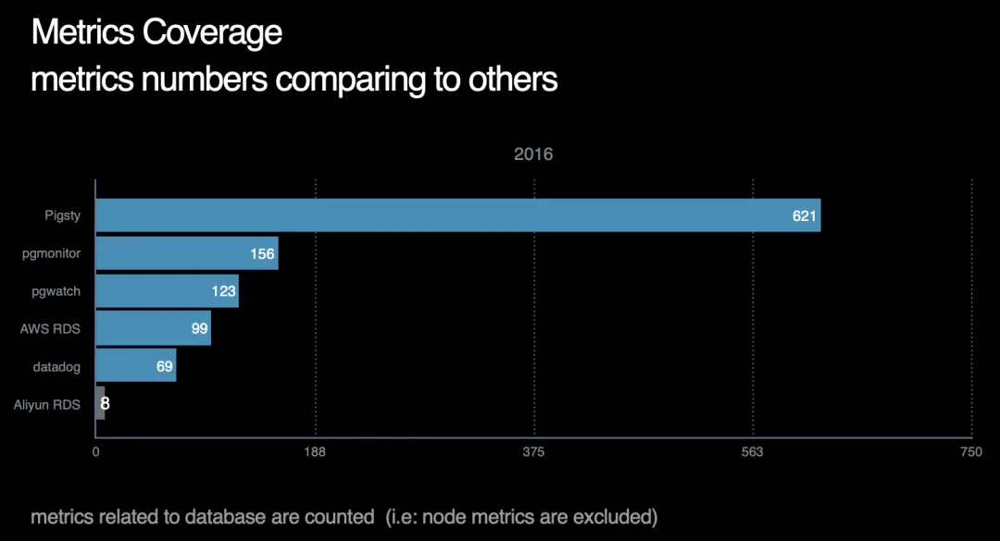
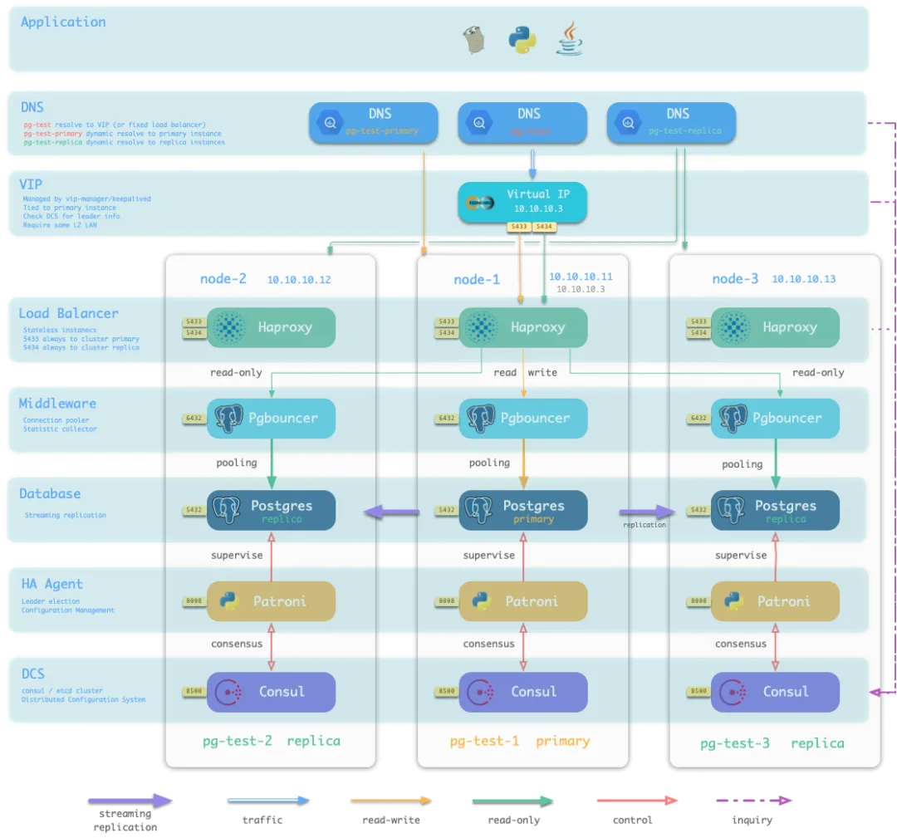
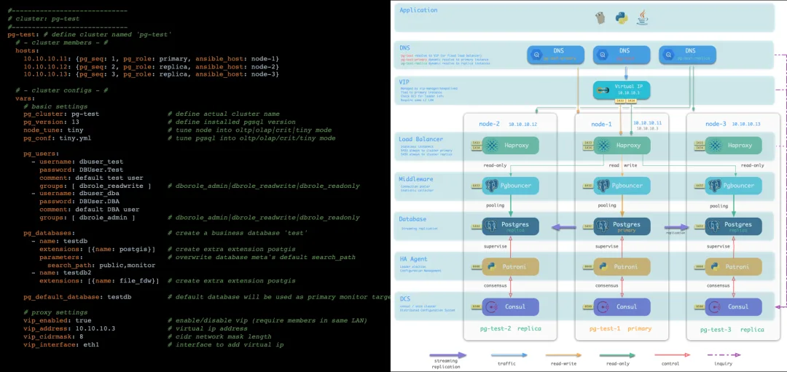
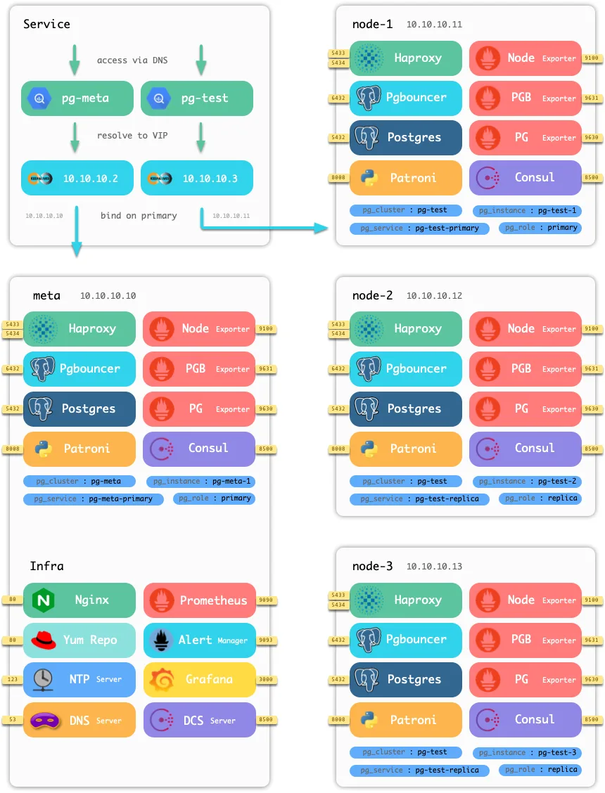
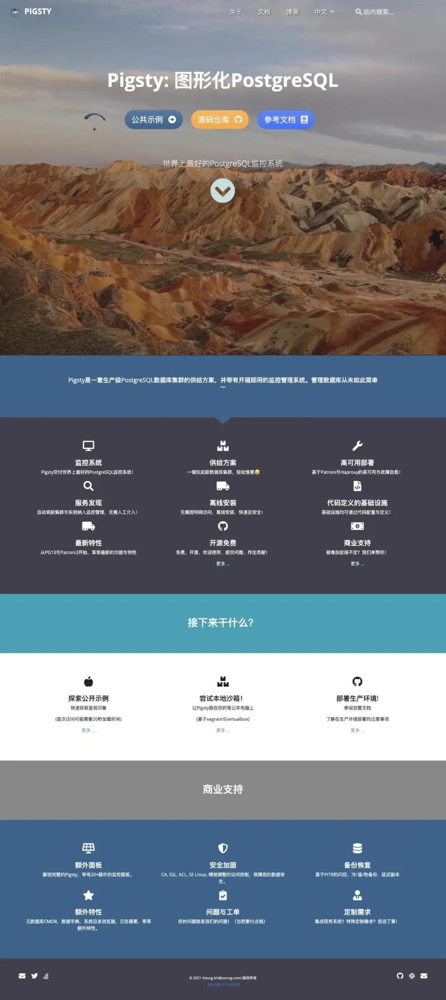

This article describes Pigsty at its January 2021 release.

Today, I released **Pigsty**.


Official website: [pigsty.cc](https://pigsty.cc)

## What is Pigsty?

Pigsty monitors large PostgreSQL fleets and automates the deployment of highly available clusters. It is free, open-source software built on open-source components.


I wanted to reduce the manual work of managing PostgreSQL through a shared monitoring interface and deployment process.

## Monitoring

I needed to manage a large PostgreSQL fleet. After trying several open-source and commercial monitoring products, I could not find one that met my needs, so I began building Pigsty.

The interface uses Grafana. At its first release, it contained more than 30 dashboards, over a thousand panels, and about 180,000 lines of JSON configuration, covering databases and infrastructure.


This version provided nearly 1,200 monitoring metrics. They show fleet-wide totals and let users inspect reads and writes on individual database objects.



## Cluster provisioning

Distributing and demonstrating a monitoring system requires a database environment. Existing installations vary, so I included database provisioning in Pigsty.

The deployment combines replication, failover, traffic proxies, connection pooling, service discovery, and basic privilege configuration. This reduces the work of configuring each component separately.



Fill in the configuration file, and Pigsty creates the database cluster it describes.



More than 130 settings describe the database and infrastructure. Declarative configuration and idempotent execution manage physical and virtual machines as infrastructure code, with a workflow similar to Kubernetes.

## Open-source components and license

This release used the **Apache 2.0** license, with a professional edition and optional commercial support also available. Issues, pull requests, donations, and sponsorship were welcome.



Monitoring uses Prometheus, Grafana, Alertmanager, and exporters. It also includes Nginx, Dnsmasq/CoreDNS, NTP/Chrony, Consul/etcd, and other infrastructure components. These can integrate with an existing monitoring environment.

Provisioning uses Ansible to deploy PostgreSQL, PgBouncer, Patroni, HAProxy, and Keepalived. Deployment logic is packaged as Ansible roles for integration and customization.

## Try Pigsty

Pigsty provides English and Chinese documentation, a public demo, and a local Vagrant sandbox. At its first release, these commands created a sandbox with database clusters and monitoring infrastructure on a laptop:

```bash
make up          # Start the Vagrant virtual machines
make ssh         # Configure SSH access to the virtual machines
make init        # Initialize Pigsty
sudo make dns    # Add static Pigsty DNS entries; optional, requires sudo
make mon-view    # Open Pigsty; sandbox default credentials: admin / admin
```

Production environments use the same deployment process, with configuration adapted to their hosts, networks, and database requirements.

## Project links

- [Chinese documentation](https://pigsty.cc)
- [English documentation](https://pigsty.io)
- [Public demo](https://demo.pigsty.cc)
- [GitHub repository](https://github.com/pgsty/pigsty)


