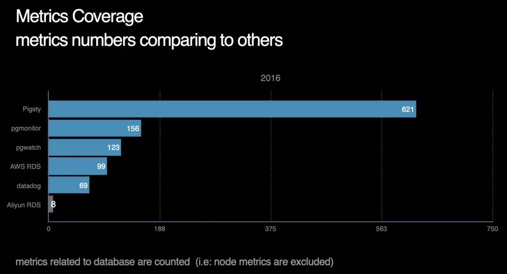
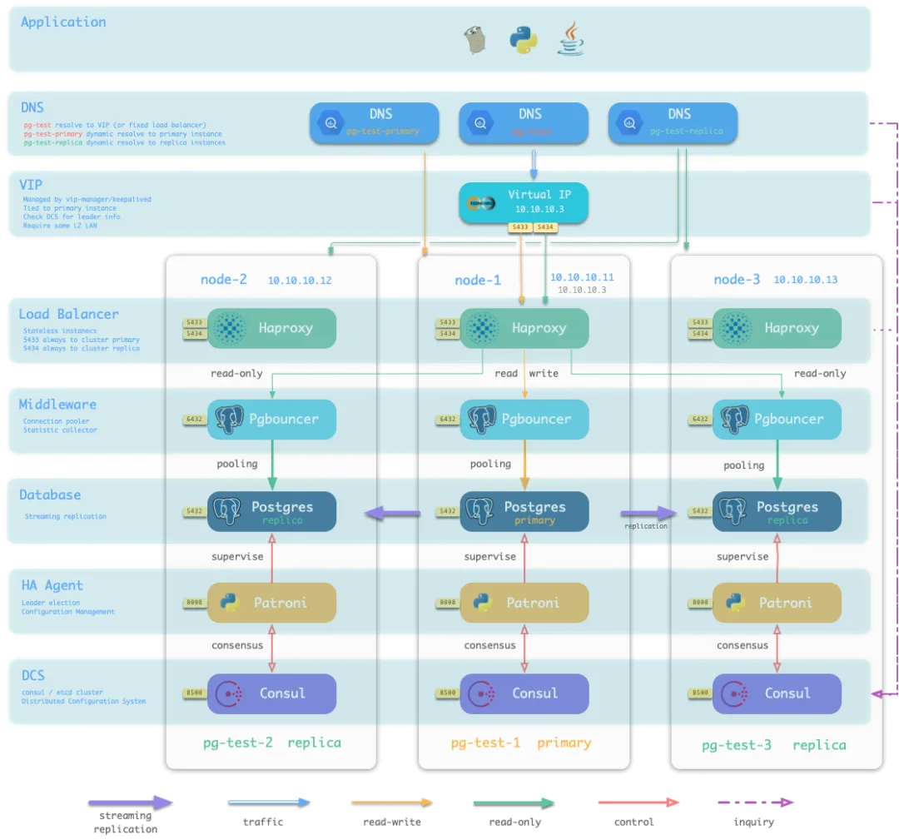
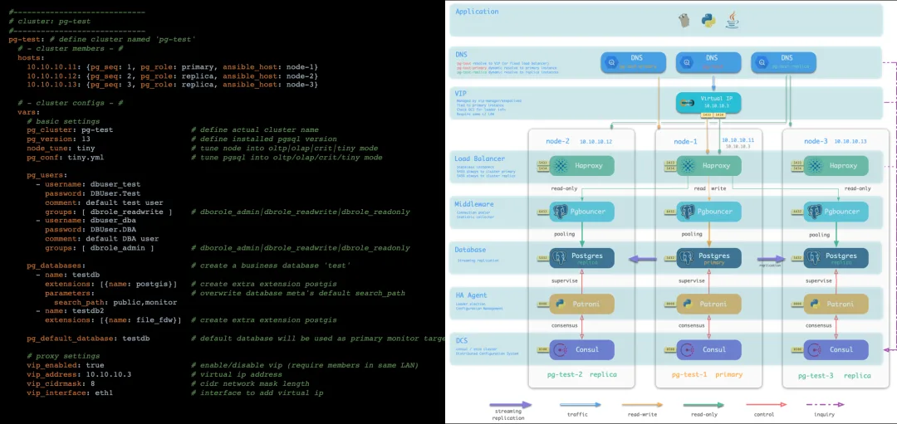
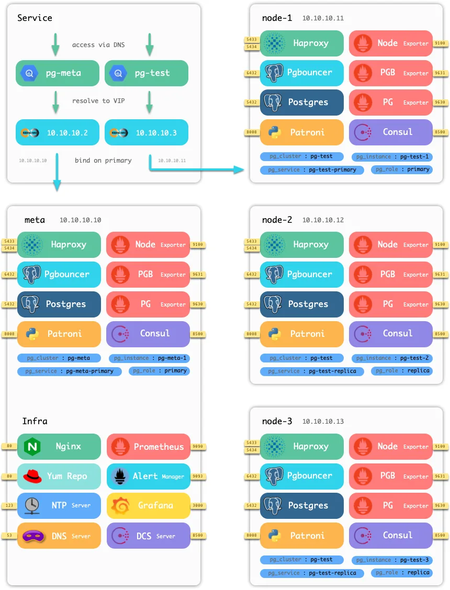
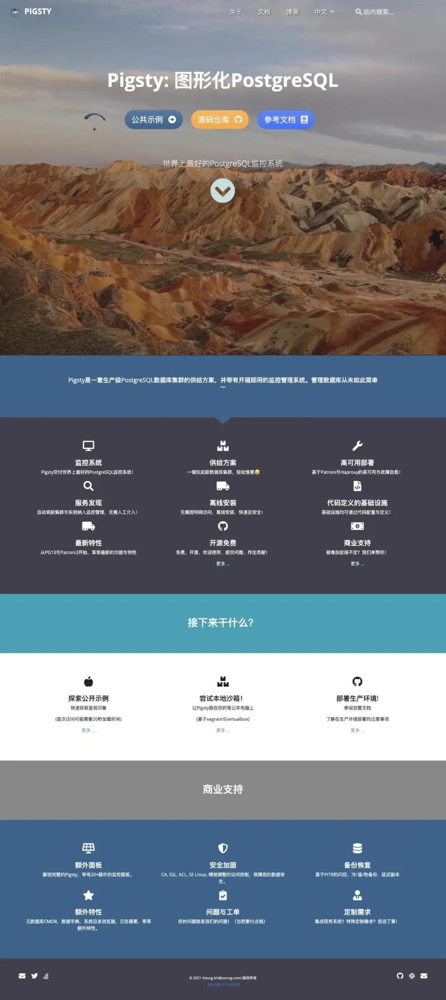

本文介绍 2021 年 1 月 Pigsty 首次发布时的产品状态。

今天，我发布了 **Pigsty**。


官方网站：[pigsty.cc](https://pigsty.cc)

## Pigsty 是什么？

Pigsty 用于监控大规模 PostgreSQL 集群，也提供高可用集群的自动部署方案。它基于开源组件构建，是免费的开源软件。


我希望通过统一的监控界面与部署流程，减少管理 PostgreSQL 集群所需的手工操作。

## 监控系统

我需要管理一个大规模 PostgreSQL 集群。在尝试一些开源与商业监控产品后，没有找到满足需求的方案，于是开始开发 Pigsty。

Pigsty 的界面基于 Grafana。首次发布时，它包含 30 多个监控看板、上千个图表面板，约 18 万行 JSON 配置，覆盖数据库与基础设施。


这个版本提供近 1200 个监控指标，可以查看整个集群的汇总数据，也可以继续查看单个数据库对象的读写活动。



## 集群供给方案

发布和演示监控系统需要可用的数据库环境。已有数据库的部署方式各不相同，因此我把数据库供给方案也纳入了 Pigsty。

这套方案组合了主从复制、故障切换、流量代理、连接池、服务发现与基本权限配置，减少逐个配置组件的工作。



填写配置文件后，Pigsty 会按配置创建数据库集群。



130 多个配置项用于定义数据库与基础设施。部署使用声明式配置和幂等执行机制，在物理机与虚拟机上通过代码管理基础设施，工作方式类似 Kubernetes。

## 开源组件与许可

此版本的 Pigsty 使用 **Apache 2.0** 许可证，同时提供专业版与可选的商业支持。欢迎提交 Issue、PR，或通过捐赠与赞助支持项目。



监控系统使用 Prometheus、Grafana、Alertmanager 与 Exporter，并包含 Nginx、Dnsmasq/CoreDNS、NTP/Chrony、Consul/etcd 等基础设施组件。这些组件可以与已有监控系统集成。

供给方案通过 Ansible 部署 PostgreSQL、PgBouncer、Patroni、HAProxy 与 Keepalived。部署逻辑写成 Ansible Role，便于集成和定制。

## 试用 Pigsty

Pigsty 提供中英文文档、公开演示站点与基于 Vagrant 的本地沙箱。首次发布时，以下命令可以在笔记本上创建包含数据库集群与监控基础设施的沙箱：

```bash
make up          # 启动 Vagrant 虚拟机
make ssh         # 配置虚拟机 SSH 访问
make init        # 初始化 Pigsty
sudo make dns    # 写入 Pigsty 静态 DNS 记录；可选，需要 sudo
make mon-view    # 打开 Pigsty 首页；沙箱默认账号：admin / admin
```

生产环境也使用这套部署流程，需要按实际主机、网络与数据库要求调整配置。

## 项目链接

- [中文文档](https://pigsty.cc)
- [英文文档](https://pigsty.io)
- [公开演示](https://demo.pigsty.cc)
- [GitHub 仓库](https://github.com/pgsty/pigsty)


