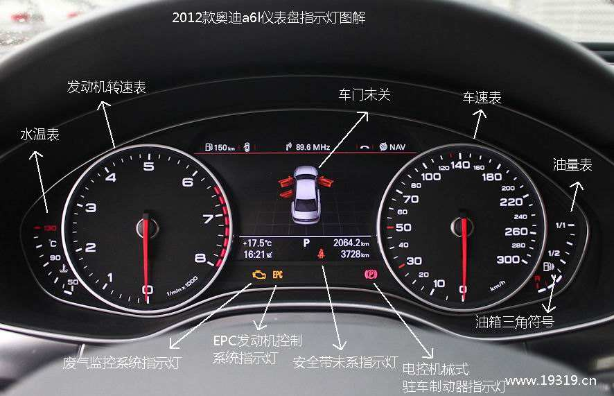

> Written in 2020. The metric counts and examples describe the deployment at that time.

----------------

## Preface

Operating a database is like driving a car: both require attention to a dashboard.

Metrics show the current state and help you decide when to act.



Cars have many metrics: speed, tire pressure, torque, brake pad wear, various temperatures, and so on - all kinds of different ones.

But human attention span is limited, and the dashboard is only so big.

So, metrics can be divided into two categories:

* **Ones you will look at**: **Golden metrics / Key metrics / Core metrics**
* **Ones you won't look at**: Black box metrics / Cold metrics

Golden metrics are those few critical core data points that need constant attention (or have an autopilot system/alarm system maintain constant attention for you), while cold metrics are usually only looked at during troubleshooting. Troubleshooting and post-mortems require restoring the scene as much as possible, so the more black box metrics the better. It's very frustrating when you need them but don't have them.

Today let's talk about PostgreSQL's core metrics. What are the core metrics for databases?

----------------

## Database Metrics

Before discussing database core metrics, let's take a look at what metrics are available.

```promql
avg(count by (ins) ({__name__=~"pg.*"}))
avg(count by (ins) ({__name__=~"node.*"}))
```

In the deployment used for this article, these queries found more than 1,000 PostgreSQL series and 2,000 host series per instance.

These series support investigation and visualization.

But for daily management, only a few core metrics are needed.

With thousands of available metrics, which ones are the core metrics?

----------------

## Core Metrics

Based on experience and usage frequency, continuously subtracting, we can filter out some core metrics:

| Metric | Abbreviation | Level | Source | Type |
|--------|-------------|-------|--------|------|
| Error Log Count | Error Count | SYS/DB/APP | Log System | Error |
| **Connection-Pool Queue** | Queue Clients | DB | Connection-Pool | Error |
| **Database Load** | PG Load | DB | Connection-Pool | Saturation |
| **Database Saturation** | PG Saturation | DB | Connection-Pool & Node | Saturation |
| **Master-Slave Replication Lag** | Repl Lag | DB | Database | Latency |
| **Average Query Response Time** | Query RT | DB | Connection-Pool | Latency |
| **Active Backend Processes** | Backends | DB | Database | Saturation |
| **Database Age** | Age | DB | Database | Saturation |
| **Queries Per Second** | QPS | **APP** | Connection-Pool | Traffic |
| **CPU Usage** | CPU Usage | SYS | Machine Node | Saturation |
{.wide .expand}

During an incident, I check errors first.

For routine application monitoring, I focus on QPS and response time.

For capacity management, I focus on database saturation.

----------------

## Why These?

### **Error Metrics**

I check **errors** first because they often affect users directly.

If you could only choose one metric to monitor, then choose **error metrics** - like the number of error log entries per second at the application, system, and DB layers might be most appropriate.

Error counts and rates show failures. They support alerting and diagnosis, but cannot by themselves show how much spare capacity remains.

A growing connection-pool queue signals contention for available connections. Queue length alone does not identify the bottleneck or measure spare capacity.

To detect pressure before users see errors, also monitor latency, resource use, and queues.

The purpose of metrics is to measure the system's operating state. We also care about other aspects of system capability: throughput/traffic, response time/latency, saturation/utilization/water level. These three represent system capability, service quality, and load level respectively.

Different focus points - backends (database users) focus on system capability and service quality, DBAs (database administrators) focus more on system load level.

### **Traffic Metrics**

Traffic-type metrics have great potential, especially metrics like QPS and TPS which are quite representative.

Traffic metrics measure current throughput, such as orders or requests completed per second.

A speedometer shows how fast a car is moving, not how much faster it could go. Throughput has the same distinction.

QPS and TPS measure completed work, not its cost. A 10-microsecond query and a 10-second query each count as one call. Compare throughput with the query mix, latency, and resource use. Load tests can establish a useful throughput baseline for a known workload.

### **Latency Metrics**

Latency is suitable for measuring system service quality.

RT (response time) measures service quality. Set a target for the workload: for example, a particular OLTP service might require a 1 ms response time. Rising latency can indicate contention, but does not measure saturation by itself. Averages can also hide slow requests, so use P99 or P99.9 when duration distributions are available.

### **Saturation Metrics**

Saturation metrics are like a car's tachometer, fuel gauge, and temperature gauge.

Saturation metrics are suitable for measuring system load.

Saturation describes pressure on a limiting resource. Utilization and queue length help identify it, but they measure different things. Set alert thresholds from workload baselines and response-time targets. Sustained pressure is a reason to review capacity, query cost, and resource limits.

| **Other Optional Metrics** | | | | |
|------------|-----------|-----|------|-----|
| Transactions Per Second | TPS | APP | Connection-Pool | Traffic |
| Disk IO Usage | Disk Usage | SYS | Machine Node | Saturation |
| Memory Usage | Mem Usage | SYS | Machine Node | Saturation |
| Network Bandwidth Usage | Net Usage | SYS | Machine Node | Saturation |
| TCP Errors: Overflow/Retransmission | TCP ERROR | SYS | Machine Node | Error |
{.wide .expand}
