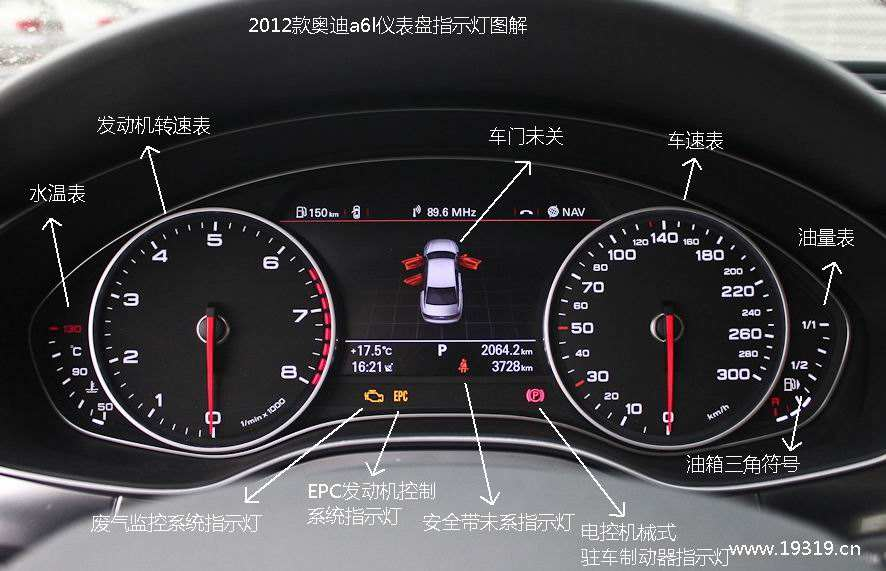

> 本文写于 2020 年，指标数量与示例对应当时的部署。

----------------

## 前言

玩数据库和玩车有一个共通之处，就是都需要经常看仪表盘。

仪表盘上的指标显示当前运行状态，帮助我们决定何时采取行动。



车有很多指标：车速，胎压，扭矩，刹车片磨损，各种温度，等等等等，各式各样。

但人的注意力有限，仪表盘空间也有限。

所以，指标可以分两类：

* **你会去看的**：**黄金指标 / 关键指标 / 核心指标**
* **你不会看的**：黑匣子指标 / 冷指标。

黄金指标就是那几个关键性的核心数据，需要时刻保持关注（或者让自动驾驶系统/报警系统替你时刻保持关注），而冷指标通常只有故障排查时才会去看，故障排查与验尸要求尽可能还原现场，黑匣子指标多多益善。需要时没有记录，就很难还原问题。

今天我们来说说PostgreSQL的核心指标，数据库的核心指标是什么？

----------------

## 数据库的指标

在讲数据库的核心指标之前，我们先来瞄一眼有哪些指标。

```promql
avg(count by (ins) ({__name__=~"pg.*"}))
avg(count by (ins) ({__name__=~"node.*"}))
```

在本文使用的部署中，这两条查询显示：每个实例有 1,000 多条 PostgreSQL 序列和 2,000 多条主机序列。

这些序列可用于排查问题和可视化分析。

但对于日常管理，只需要少数几个核心指标就可以了。

可用指标千千万，哪些才是核心指标？

----------------

## 核心指标

根据经验和使用频度，不断地做减法，可以筛选出一些核心指标：

| 指标           | 缩写            | 层次         | 来源     | 种类  |
|--------------|---------------|------------|--------|-----|
| 错误日志条数       | Error Count   | SYS/DB/APP | 日志系统   | 错误  |
| **连接池排队数**   | Queue Clients | DB         | 连接池    | 错误  |
| **数据库负载**    | PG Load       | DB         | 连接池    | 饱和度 |
| **数据库饱和度**   | PG Saturation | DB         | 连接池&节点 | 饱和度 |
| **主从复制延迟**   | Repl Lag      | DB         | 数据库    | 延迟  |
| **平均查询响应时间** | Query RT      | DB         | 连接池    | 延迟  |
| **活跃后端进程数**  | Backends      | DB         | 数据库    | 饱和度 |
| **数据库年龄**    | Age           | DB         | 数据库    | 饱和度 |
| **每秒查询数**    | QPS           | **APP**    | 连接池    | 流量  |
| **CPU使用率**   | CPU Usage     | SYS        | 机器节点   | 饱和度 |

事故发生时，我优先看错误指标。

日常应用监控重点看 QPS 与响应时间。

容量管理重点看数据库饱和度。

----------------

## 为什么是它们？

### **错误指标**

我通常先检查 **错误**，因为它们往往直接影响用户。

如果只能选一个指标进行监控，那么选 **错误指标**，比如应用，系统，DB层的每秒错误日志条数可能最合适。

错误次数和错误率可以反映故障，用于告警和诊断，但不能单独说明还有多少可用容量。

连接池队列增长，说明可用连接出现竞争。但单看队列长度，无法确定瓶颈或衡量剩余容量。

要在用户看到错误之前发现压力，还应监控延迟、资源使用和队列。

指标用于衡量系统运行状态。我们还会关注系统其他方面的能力：吞吐量/流量，响应时间/延迟，饱和度/利用率/水位线。这三者分别代表系统的能力，服务质量，负载水平。

关注点不同，后端（数据库用户）关注系统能力与服务质量，DBA（数据库管理者）更关注系统的负载水平。

### **流量指标**

流量类的指标很有潜力，特别是QPS，TPS这样的指标相当具有代表性。

流量指标衡量当前完成的工作量，例如每秒处理的订单数或请求数，不能直接表示容量上限。

车速计显示当前速度，但不表示还能加速多少。吞吐量也有同样的区别。

QPS 和 TPS 衡量完成的工作量，不衡量每次调用的成本。耗时 10 微秒和 10 秒的查询都只算一次调用。应结合查询类型、延迟和资源使用情况比较吞吐量，并通过压测为已知工作负载建立基线。

### **延迟指标**

延迟适合衡量系统的服务质量。

RT（响应时间）衡量服务质量。应按工作负载设置目标，例如某类 OLTP 服务可能要求 1 ms 的响应时间。延迟上升可能表示资源争用，但不能单独用于测量饱和度。平均值也可能掩盖慢请求；有耗时分布数据时，可结合 P99、P99.9 分析。

### **饱和度指标**

饱和度指标类似汽车的发动机转速表，油量表，水温表。

饱和度指标适合衡量系统的负载

饱和度描述受限资源承受的压力。利用率和队列长度有助于识别饱和，但衡量的是不同现象。应根据工作负载基线和响应时间目标设定告警阈值。压力长期偏高时，需要评估容量、查询成本和资源限制。

| **其他可选指标**  |            |     |      |     |
|-------------|------------|-----|------|-----|
| 每秒事务数       | TPS        | APP | 连接池  | 流量  |
| 磁盘IO使用率     | Disk Usage | SYS | 机器节点 | 饱和度 |
| 内存使用率       | Mem Usage  | SYS | 机器节点 | 饱和度 |
| 网卡带宽使用率     | Net Usage  | SYS | 机器节点 | 饱和度 |
| TCP错误：溢出重传等 | TCP ERROR  | SYS | 机器节点 | 错误  |
