This article presents Pigsty as it stood in May 2020. Metric counts and dashboard names describe that system.

I recently built a database monitoring system called Pigsty. This article describes its architecture, dashboards, and metrics.

Pigsty uses Grafana, Prometheus, and Consul. PIGSTY /pɪɡ staɪ/ stands for "Postgres in Grafana Style".

## Architecture

Node, PostgreSQL, and PgBouncer exporters collect metrics. Consul provides service discovery, Prometheus stores and processes the metrics, and Grafana displays them.

```text
┏━━━━━━━━━━━┓     ┏━━━━━━━━━━━━━━━━━━━━┓
┃   Node    ┃ --> ┃   Node    Exporter-┃┐
┃ Pgbouncer ┃ --> ┃ Pgbouncer Exporter-┃┼--> Prometheus ---> Grafana
┃ Postgres  ┃ --> ┃ Postgres  Exporter-┃┘        ↑
┃           ┃     ┗━━━━━━━━━━━━━━━━━━━━┛  (Service Discovery)
┃  Consul   ┃ ----------------------------->   Consul
┗━━━━━━━━━━━┛
```

Service discovery also supplies identity labels and the structure used to organize the targets. Prometheus recording rules calculate derived metrics before Grafana presents them.

The following sections focus on the Grafana dashboards.

### Monitoring hierarchy

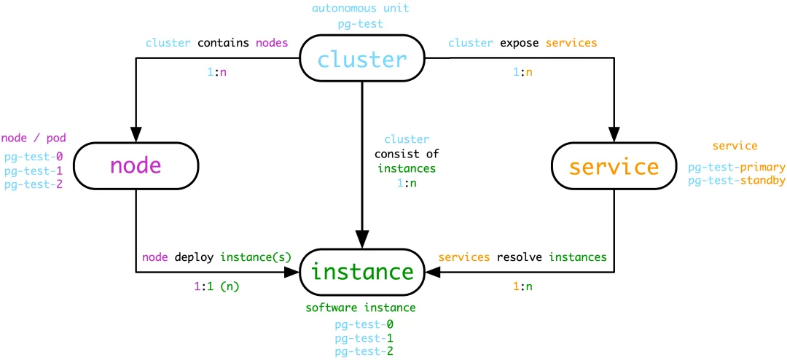

The monitoring model has five levels: cluster, service, instance, database, and node. In this version, service metrics are included in cluster dashboards, and database metrics are included in instance dashboards. The three main views are therefore cluster, instance, and node.

- `cls` identifies a cluster, for example `pg-test-tt`.
- `ins` identifies an instance, for example `pg-test-tt-0`. It combines the cluster name and an instance number. In this deployment, instance 0 was usually the primary.
- `ip` identifies a node.

There are also dashboards for the whole fleet, sharded databases, individual databases, connection pools, individual queries, and PgBouncer. I will focus on the main views here.

## Features

The system supports routine checks, fault diagnosis, and performance tuning. It includes these dashboards:

- PostgreSQL fleet overview.
- PostgreSQL shard monitoring.
- PostgreSQL cluster monitoring.
- PostgreSQL instance monitoring.
- A dedicated troubleshooting view for a PostgreSQL instance.
- PostgreSQL host monitoring.
- Slow-query analysis.
- Redis fleet overview.
- Redis cluster monitoring.
- Redis instance monitoring.
- PostgreSQL cluster health assessment.

## Home and navigation

The home page covers PostgreSQL and Redis. Global metrics appear on the left, cluster navigation on the right, and alerts and events in the middle. Use the navigation links or click a shard, cluster name, instance name, or IP address to open its dashboard.

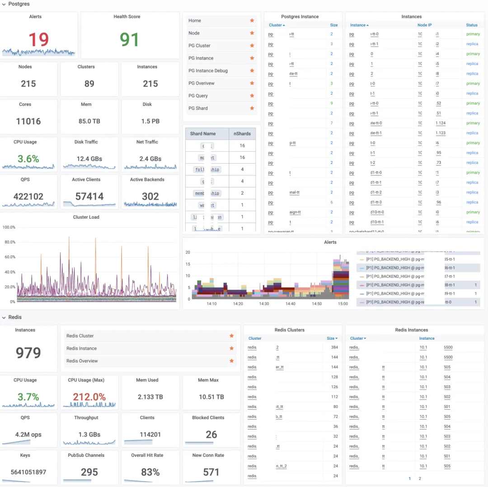

## Database metrics

### Coverage

At the time, the system exposed about 3,300 metrics per instance, including:

- About 1,000 database and connection-pool metrics, of which 250 were derived through recording rules.
- About 2,000 node metrics, of which 700 were derived through recording rules.

For example, QPS alone produced nearly 30 related metrics:

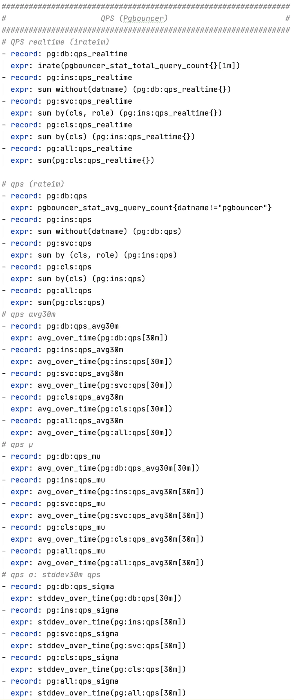

The following sections introduce some of the more useful ones.

### The four golden signals

The metrics can be grouped by the four golden signals used in Google SRE practice.

**Errors**

- Configuration checks: checksums, NUMA, transparent huge pages, synchronous commit, and other important settings.
- Memory and TCP errors, and clock drift.
- Failed hosts, databases, connection pools, or monitoring components.
- Queued clients, `idle in transaction` sessions, long transactions, deadlocks, broken replication, high rollback counts, and monitoring errors.

**Saturation**

- PostgreSQL load and node load.
- CPU, memory, disk, and network utilization; cache hit ratios; backend connection use; and connection-pool use.

**Traffic**

- QPS, TPS, and QPS by statement category.
- Connection-pool traffic, WAL generation, row reads and writes, block access, and buffer access.
- Host disk and network I/O, and memory pages swapped in and out.

**Latency**

- Average transaction response time, or Xact RT.
- Average query response time, or Query RT.
- Average response time by statement.
- Average disk read and write latency.
- Replication lag in seconds and bytes.
- Monitoring query duration.

## PostgreSQL instance monitoring

### Instance overview

The overview includes:

- Instance identity: cluster name, ID, host, software version, and other cluster members.
- Important configuration: directories, ports, and configuration file paths.
- Health and role, such as primary or standby.
- Key metrics: PostgreSQL load, replication lag, active backends, queued clients, query latency, TPS, and database age.
- Database load at the current instant and over 1, 5, and 15 minutes.
- Database alerts and events.

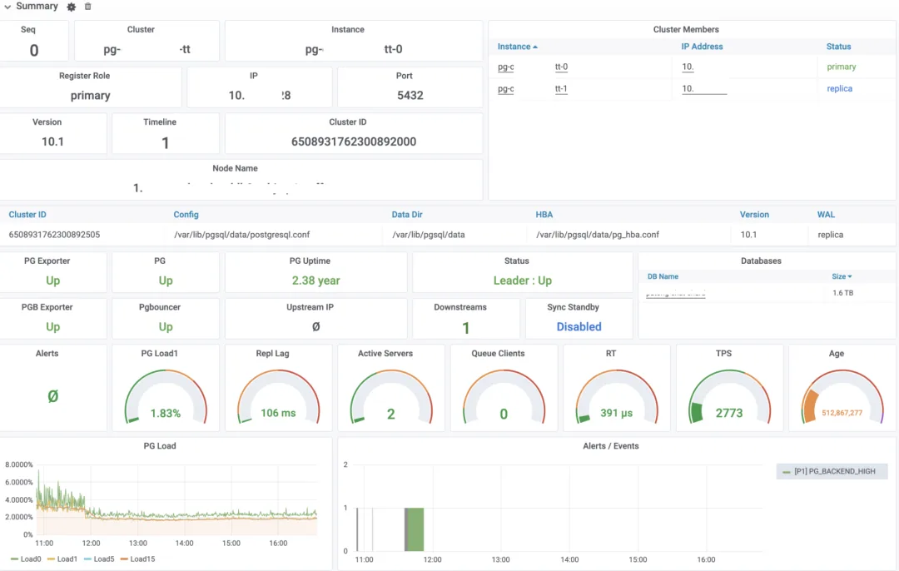

For the definition of PostgreSQL load, see my earlier article, [How to Set KPIs for PostgreSQL](/article/pg-load/).

### Node overview

The node overview shows:

- CPU, memory, disks, and network interfaces: their capacity, important settings, and core metrics.
- Disk and network-interface details on the right.

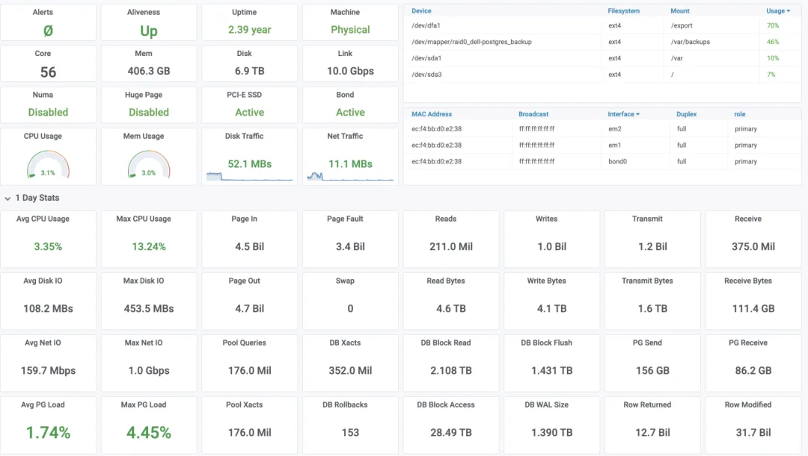

#### Daily totals

This section summarizes the preceding 24 hours, including query counts and rows returned. The first two rows contain node statistics; the next two mainly contain PostgreSQL statistics.

These totals are useful for usage accounting and capacity assessment.

#### Replication

The replication section shows:

- Replication settings on the current node.
- Lag in seconds and bytes, plus WAL retained by replication slots.
- WAL sender statistics for downstream nodes.
- LSN positions that describe replication progress and durability.
- The number of downstream nodes, which can help detect a lost replication connection.

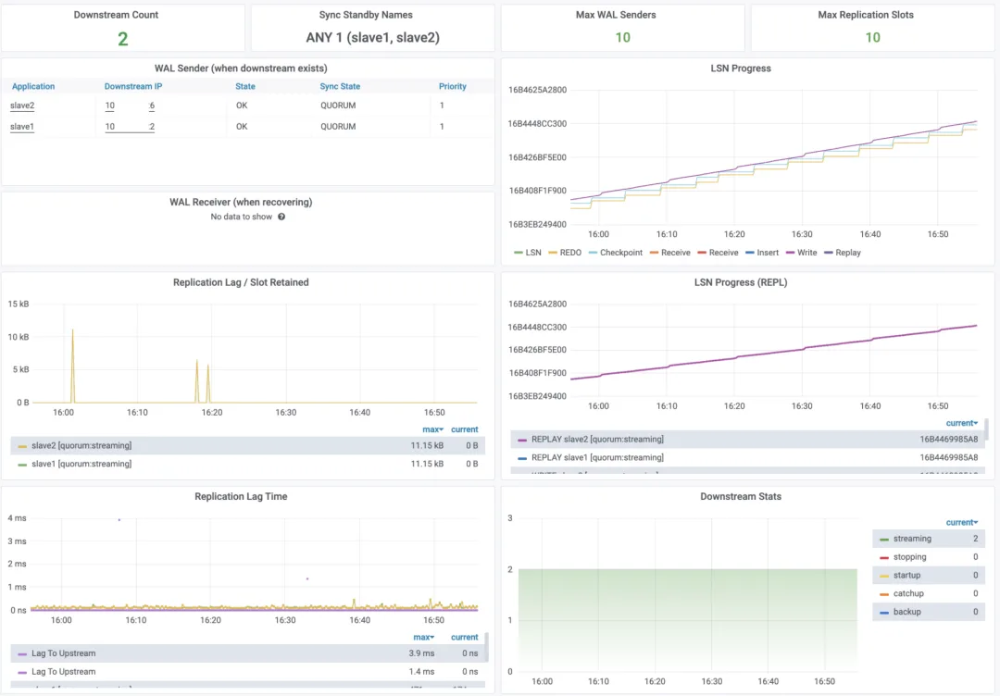

#### Transactions

The transaction section shows activity through TPS, response time, and locks:

- TPS and comparisons with the preceding two days, plus database transaction and rollback counts.
- Rollback counts and rates.
- Detailed TPS charts. Green bands show ±1 standard deviation and yellow bands show ±3, calculated from the preceding 30 minutes. Values outside the yellow band indicate an unusual change relative to that window.
- Average transaction response time from the connection pool, with the same bands.
- Relative variation of TPS and response time. A dimensionless measure such as `(σ/μ)²` grows as variation increases relative to the mean.
- TPS and transaction response time by database. Most instances in this deployment had one database, while a few had several.
- Transaction and rollback counts collected directly from PostgreSQL, alongside TPS from the connection pool.
- Lock counts grouped by the eight table-lock modes and by broader read, write, and exclusive categories.

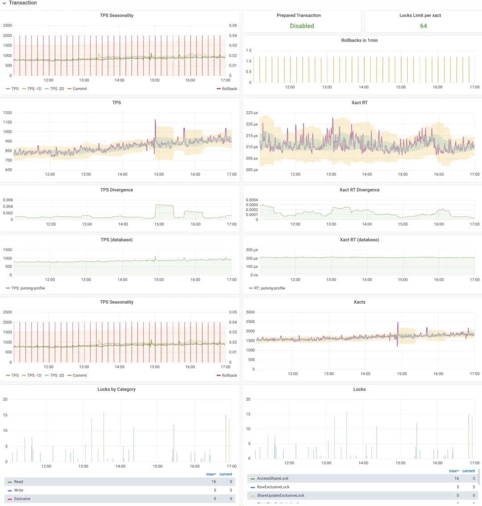

#### Queries

Query metrics resemble the transaction metrics, but count statements rather than transactions. They help locate slow queries and performance bottlenecks.

- QPS and average query response time, their variation, and comparisons with previous periods.
- This article uses 1 ms as an example warning threshold for average query response time, with closer investigation at 100 ms. Set these thresholds for the workload.

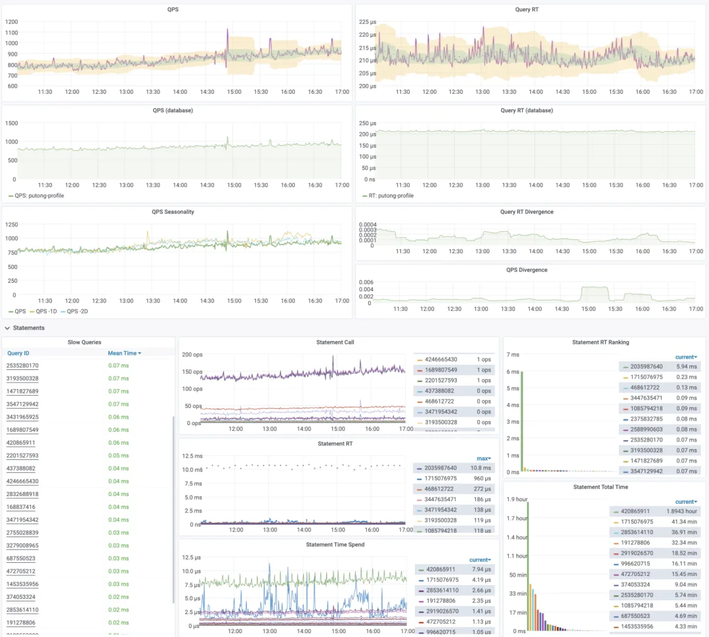

#### Statements

This section breaks query metrics down by normalized statement. Statements with the same parsed structure after constants are removed belong to the same query class and have a query ID. The slow-query view provides the SQL text and detailed statistics for that ID.

- The list on the left sorts statements by average response time from `pg_stat_statements`. Click a query ID to open its detailed view.
- The candidates are the 32 queries with the greatest total execution time, excluding monitoring queries and isolated long-running statements with very few calls.
- The right side shows current QPS and average response time for each query, with rankings by response time and total execution time.

#### Backend processes

Backend metrics describe connections to PostgreSQL. Grouping them in several ways helps diagnose connection surges, slow queries, and waits.

- Counts by backend type, state, database, and wait-event type.
- Active connections, `idle in transaction` connections, and long transactions.

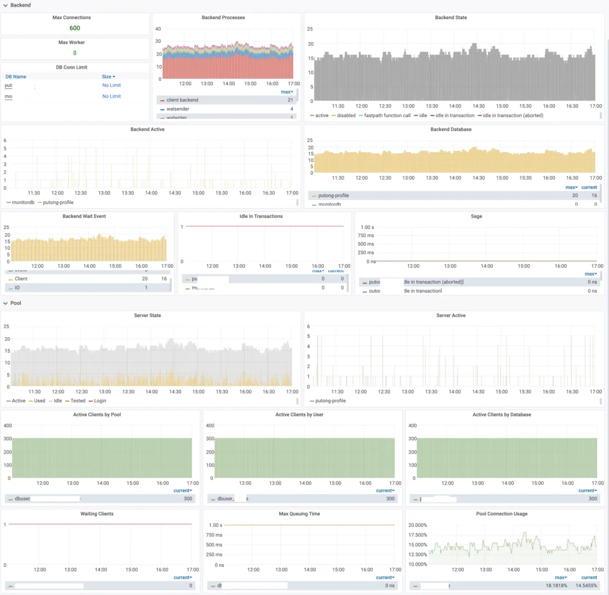

#### Connection pools

The connection-pool section is similar, but all its metrics come from PgBouncer:

- Server connection states: active, used, idle, tested, and logging in.
- Client connections grouped by user, database, and pool (`user:database`).
- Waiting clients and the wait time of the client at the head of the queue, which help identify connection backlog.
- The proportion of available pool connections in use.

#### Database overview

This section draws mainly on `pg_stat_database` and `pg_database`, with WAL measurements alongside them:

- WAL generation in bytes per second, an indicator of write activity.
- The shared-buffer hit ratio. A buffer miss can be served by the operating-system page cache or by storage.
- Rows read, inserted, updated, and deleted per second.
- Temporary-file counts and size, which help identify large-query workloads.

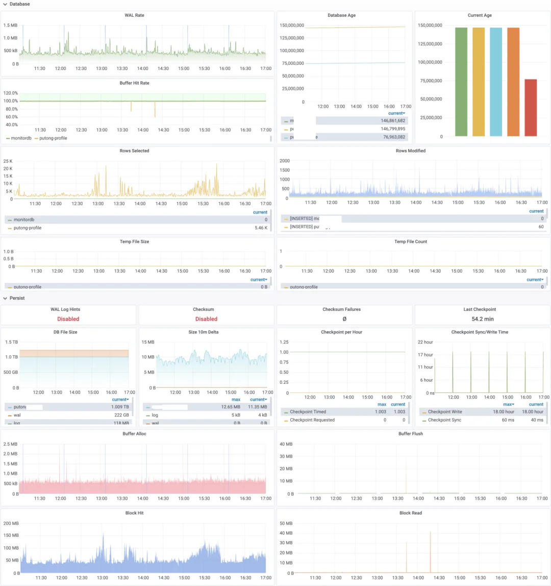

#### Persistence

Persistence metrics cover writes, checkpoints, and block access:

- Important durability settings and checksum failures, where data checksums are enabled.
- The size and growth of database files, WAL, and logs.
- Checkpoint counts and duration.
- Buffers allocated and written per second, block accesses, and storage reads, also expressed in bytes. The deployment shown here used 8,192-byte PostgreSQL pages and 4,096-byte filesystem blocks.

#### Exporters

The exporter section monitors the monitoring components themselves:

- Exporter availability, uptime, and scrapes per minute.
- Duration, emitted metric count, and error count for each monitoring query.

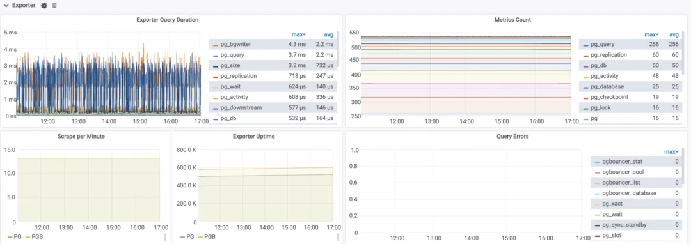

## PostgreSQL cluster monitoring

The cluster dashboard is the view I use most often. This deployment serves databases as clusters. Bringing instance and service metrics together makes it easier to check service status.

Most cluster charts extend the instance charts: they compare instances and add cluster- and service-level aggregates.

### Cluster overview

The cluster overview adds:

- Timeline and leadership. Failover or switchover changes the primary and advances the timeline.
- Replication topology, including synchronous and asynchronous links.
- Current cluster load and its 1-, 5-, and 15-minute averages, plus each node's 1-minute load.
- Cluster alerts and events.

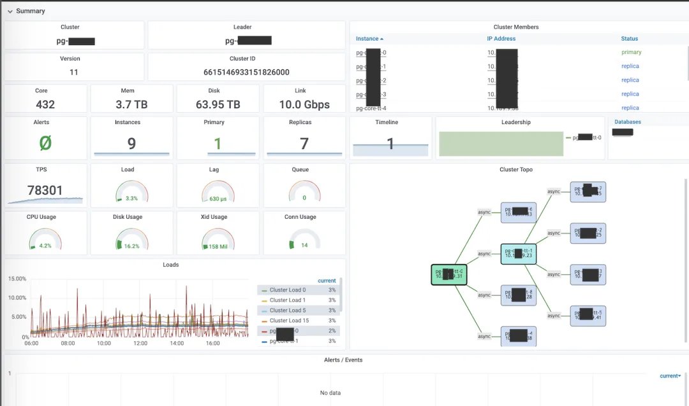

### Cluster replication

The cluster dashboard summarizes the replication topology, including:

- The primary and cascading replication nodes, synchronous-commit settings, synchronous standby names, downstream-node counts, and configured standby limits.
- Paired WAL sender and receiver entries for each replication link.
- Replication lag in seconds and bytes, and WAL retained by slots. For example, at a WAL generation rate of 10–100 MB/s, one second of lag corresponds to roughly 10–100 MB of WAL.
- Lag measured from the replica side.
- The number of replicas, useful when a backup or replica initialization changes the expected topology.
- LSN positions across the cluster, showing replication and durability progress.

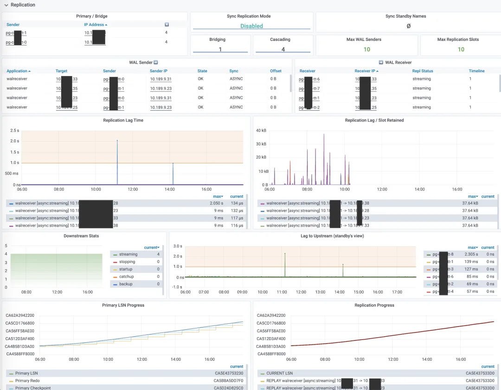

### Node metrics

Host metrics are grouped by PostgreSQL cluster.

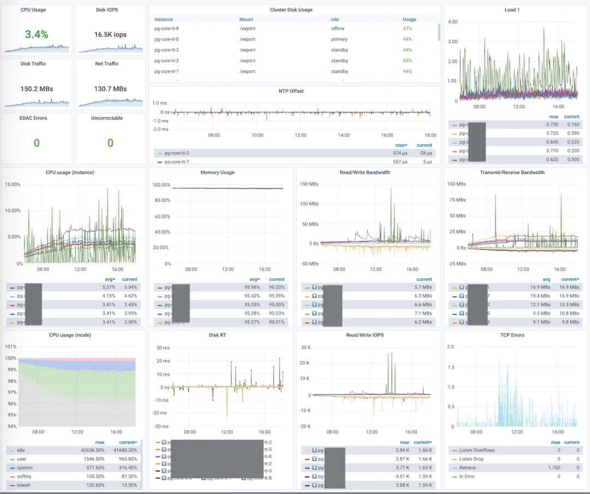

### Transactions and queries

These charts resemble the instance views, with additional service-level aggregation. A cluster in this setup usually offered `primary` and `standby` services.

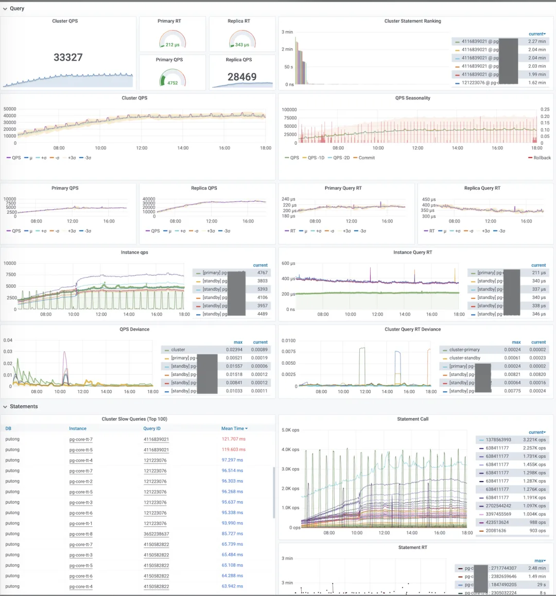

The remaining metrics are similar to those in the instance dashboard.

## Slow-query analysis

The slow-query view starts with an overview of queries on the instance. Hover over a query ID to see its SQL, or click it to open Query Detail.

The detailed view has formatted SQL on the left and key metrics on the right:

- Queries per second.
- Current average response time.
- Average rows returned per call.
- Average block I/O time per call.
- Mean, standard deviation, minimum, and maximum response time over the statistics period.
- Calls, rows returned, and execution time in the last day, plus total calls since the statistics were reset.

Charts below show these metrics over the selected time range.

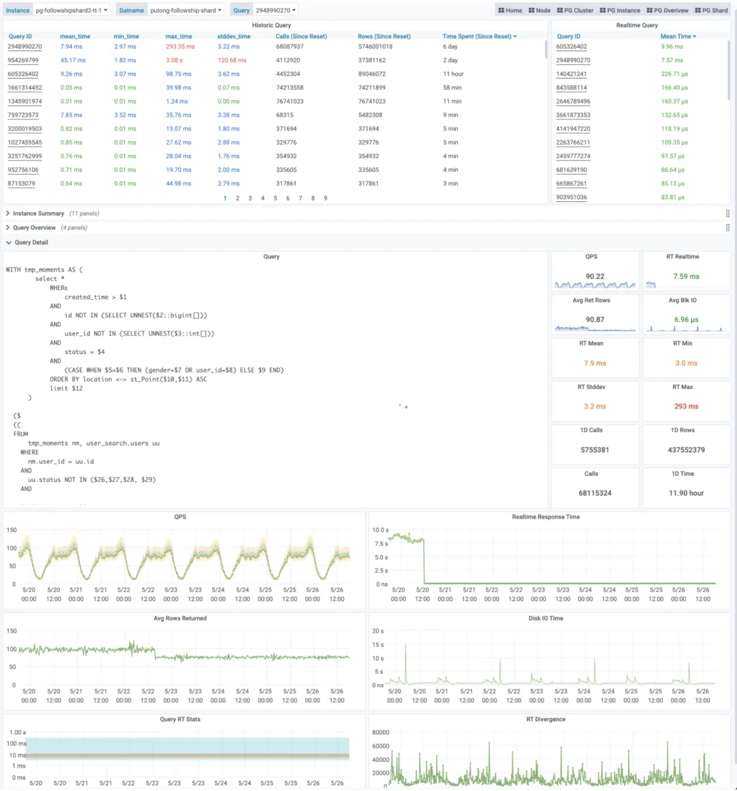
