本文介绍 2020 年 5 月的 Pigsty，指标数量与面板名称均对应当时的系统。

我最近开发了一套数据库监控系统，名为 Pigsty。下面介绍它的架构、面板与指标。

Pigsty 使用 Grafana、Prometheus 与 Consul。PIGSTY /pɪɡ staɪ/ 是 "Postgres in Grafana Style" 的缩写。

## 整体架构

Node、PostgreSQL 与 PgBouncer Exporter 采集指标，Consul 提供服务发现，Prometheus 保存和计算指标，Grafana 展示数据。

```text
┏━━━━━━━━━━━┓     ┏━━━━━━━━━━━━━━━━━━━━┓
┃   Node    ┃ --> ┃   Node    Exporter-┃┐
┃ Pgbouncer ┃ --> ┃ Pgbouncer Exporter-┃┼--> Prometheus ---> Grafana
┃ Postgres  ┃ --> ┃ Postgres  Exporter-┃┘        ↑
┃           ┃     ┗━━━━━━━━━━━━━━━━━━━━┛  (Service Discovery)
┃  Consul   ┃ ----------------------------->   Consul
┗━━━━━━━━━━━┛
```

服务发现还提供身份标签，用于组织监控目标。Prometheus 的记录规则计算衍生指标，供 Grafana 查询。下面主要介绍 Grafana 面板。

### 监控层次

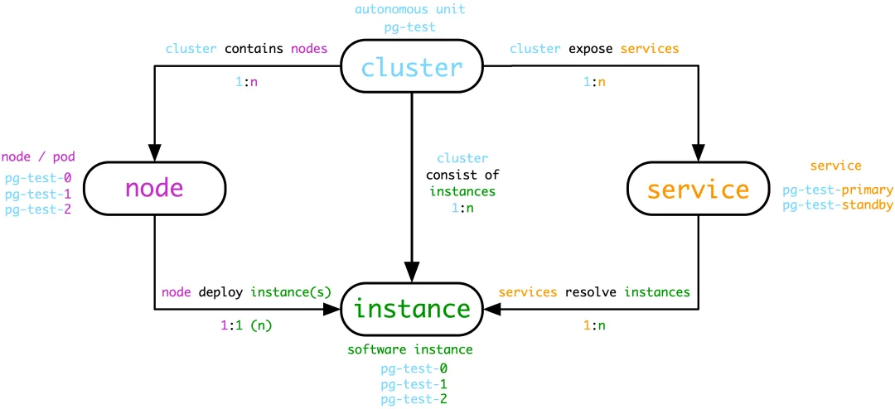

监控模型分为集群、服务、实例、数据库与节点五层。此版本把服务指标纳入集群面板，把数据库指标纳入实例面板，因此主要视图是集群、实例与节点。

- `cls` 标识集群，例如 `pg-test-tt`。
- `ins` 标识实例，例如 `pg-test-tt-0`，由集群名和实例序号组成。在本部署中，序号为 0 的实例通常是主库。
- `ip` 标识节点。

此外还有全局概览、分片集群、单个数据库、连接池、单条查询与 PgBouncer 专用面板。本文主要介绍核心视图。

## 功能

系统用于日常巡检、故障诊断与性能优化，包含以下面板：

- PostgreSQL 全局概览。
- PostgreSQL 分片集群监控。
- PostgreSQL 集群监控。
- PostgreSQL 实例监控。
- PostgreSQL 实例故障排查视图。
- PostgreSQL 主机监控。
- 慢查询分析。
- Redis 全局概览。
- Redis 集群监控。
- Redis 实例监控。
- PostgreSQL 集群健康评估。

## 首页与导航

首页包含 PostgreSQL 和 Redis 两部分。左侧显示全局指标，右侧提供集群导航，中间显示告警与事件。点击导航链接，或分片名、集群名、实例名、IP 地址，可以打开对应面板。

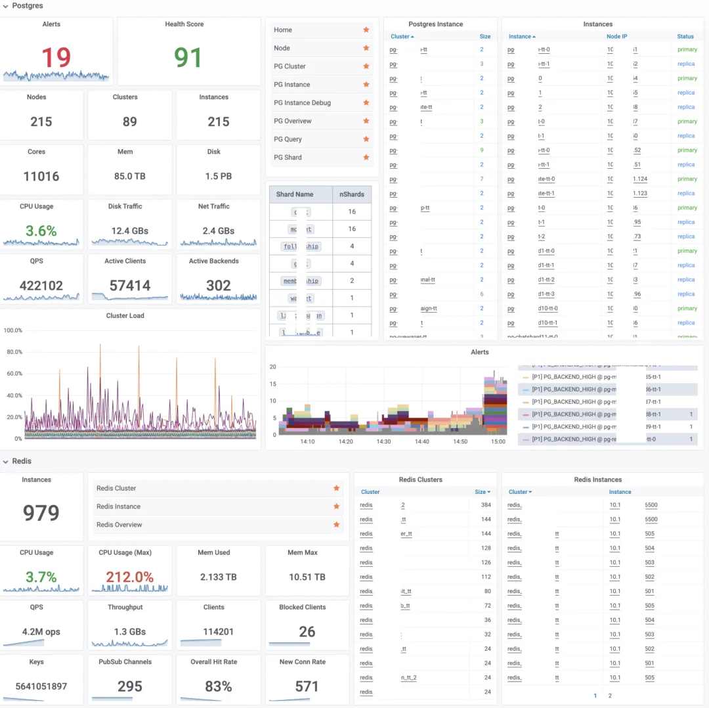

## 数据库指标

### 指标覆盖范围

当时每个实例约有 3300 个指标，其中包括：

- 约 1000 个数据库与连接池指标，其中 250 个由记录规则计算。
- 约 2000 个节点指标，其中 700 个由记录规则计算。

例如，QPS 按不同维度聚合后，产生近 30 个相关指标：

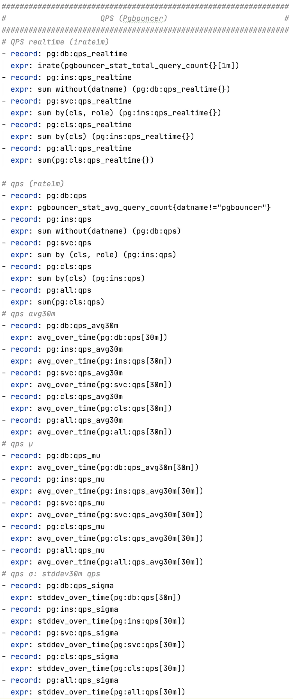

下面介绍一些常用指标。

### 四类黄金指标

按 Google SRE 的四类黄金指标组织如下。

**错误**

- 配置检查：数据校验和、NUMA、透明大页、同步提交等设置。
- 内存错误、TCP 错误与时钟偏移。
- 主机、数据库、连接池或监控组件不可用。
- 客户端排队、`idle in transaction` 连接、长事务、死锁、复制中断、大量回滚与监控错误。

**饱和度**

- PostgreSQL 负载与主机负载。
- CPU、内存、磁盘与网络利用率，缓存命中率，后端连接与连接池使用率。

**流量**

- QPS、TPS 与按语句类别统计的 QPS。
- 连接池流量、WAL 生成量、行读写量、块访问量与缓冲区访问量。
- 主机磁盘与网络 I/O，以及内存页面换入换出量。

**延迟**

- 事务平均响应时间（Xact RT）。
- 查询平均响应时间（Query RT）。
- 按语句统计的平均响应时间。
- 磁盘读写平均延迟。
- 以秒和字节衡量的复制延迟。
- 监控查询耗时。

## PostgreSQL 实例监控

### 实例概览

- 实例身份：集群名、ID、主机、软件版本与其他集群成员。
- 关键配置：目录、端口与配置文件路径。
- 健康状态与角色，例如主库或从库。
- 核心指标：PostgreSQL 负载、复制延迟、活跃后端数、排队连接数、查询延迟、TPS 与数据库年龄。
- 实时负载，以及 1、5、15 分钟平均负载。
- 数据库告警与事件。

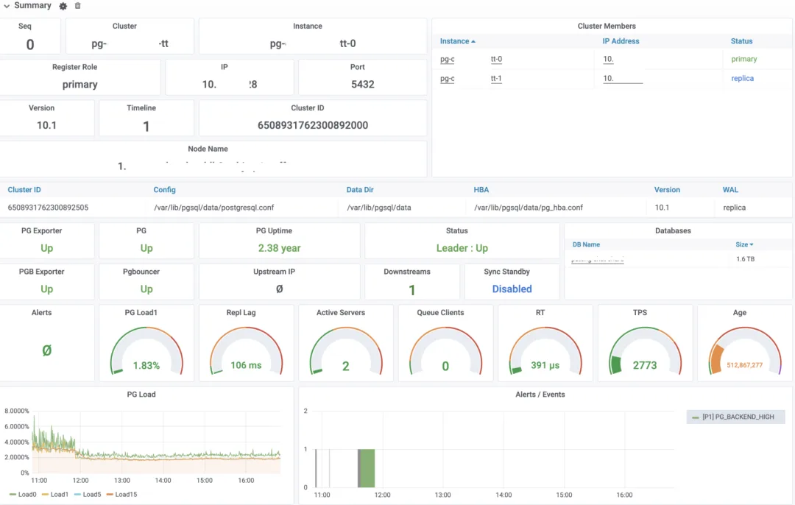

PG Load 的定义见我之前的文章[《如何给 PostgreSQL 定 KPI》](/zh/article/pg-load/)。

### 节点概览

节点概览显示 CPU、内存、磁盘与网卡的规格、关键设置和主要指标，右侧列出磁盘与网卡详情。

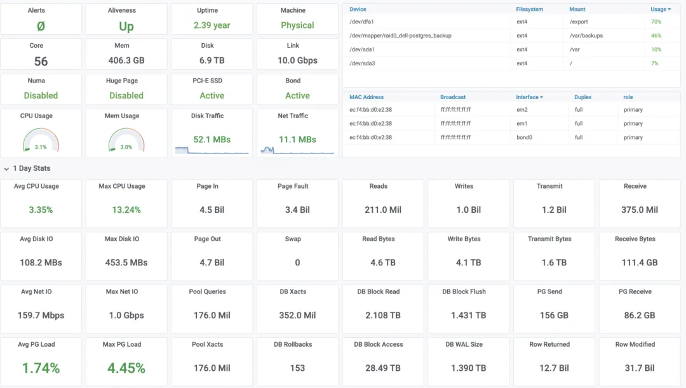

#### 单日统计

这一部分汇总过去 24 小时的查询数、返回行数等。上面两行是节点统计，下面两行主要是 PostgreSQL 统计，可用于用量计量和容量评估。

#### 复制

复制区域显示：

- 当前节点的复制配置。
- 以秒和字节衡量的复制延迟，以及复制槽保留的 WAL 量。
- 下游节点对应的 WAL sender 统计。
- 各阶段的 LSN，反映复制进度与持久化状态。
- 下游节点数量，用于发现复制连接中断。

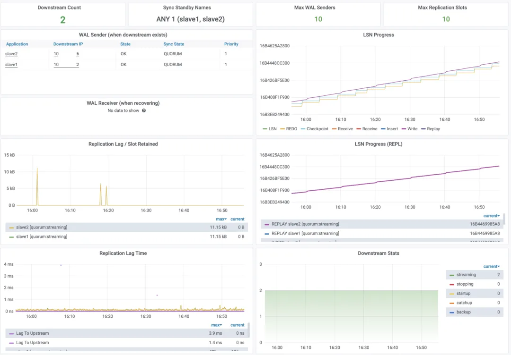

#### 事务

事务区域通过 TPS、响应时间与锁展示实例活动：

- TPS、与前两天的同期比较，以及事务数与回滚数。
- 回滚数量与回滚率。
- TPS 详情：绿色条带为均值上下 1 个标准差，黄色为上下 3 个标准差，使用前 30 分钟的数据计算。超出黄色条带表示相对这段时间出现了较大波动。
- 从连接池采集的事务平均响应时间，使用同样的条带。
- TPS 与响应时间的相对波动，可用无量纲指标 `(σ/μ)²` 衡量；值越大，表示相对均值的波动越大。
- 按数据库统计的 TPS 与事务响应时间。本部署中多数实例只有一个数据库，少量实例有多个。
- 直接从 PostgreSQL 采集的事务与回滚计数，用于配合连接池提供的 TPS。
- 按八种表锁模式，以及读、写、排他等大类聚合的锁数量。

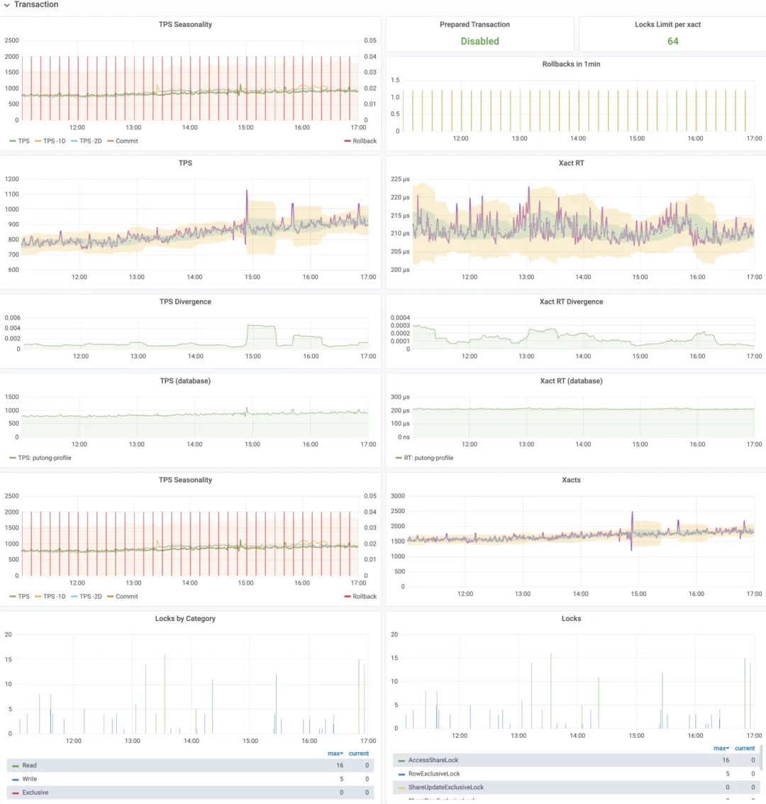

#### 查询

查询区域的指标与事务区域类似，但统计单位是语句。它用于分析慢查询和定位性能瓶颈。

- QPS、查询平均响应时间、两者的波动程度，以及与历史同期的比较。
- 本文以查询平均响应时间 1 毫秒作为警戒线、100 毫秒作为重点排查值的示例。实际阈值按工作负载设置。

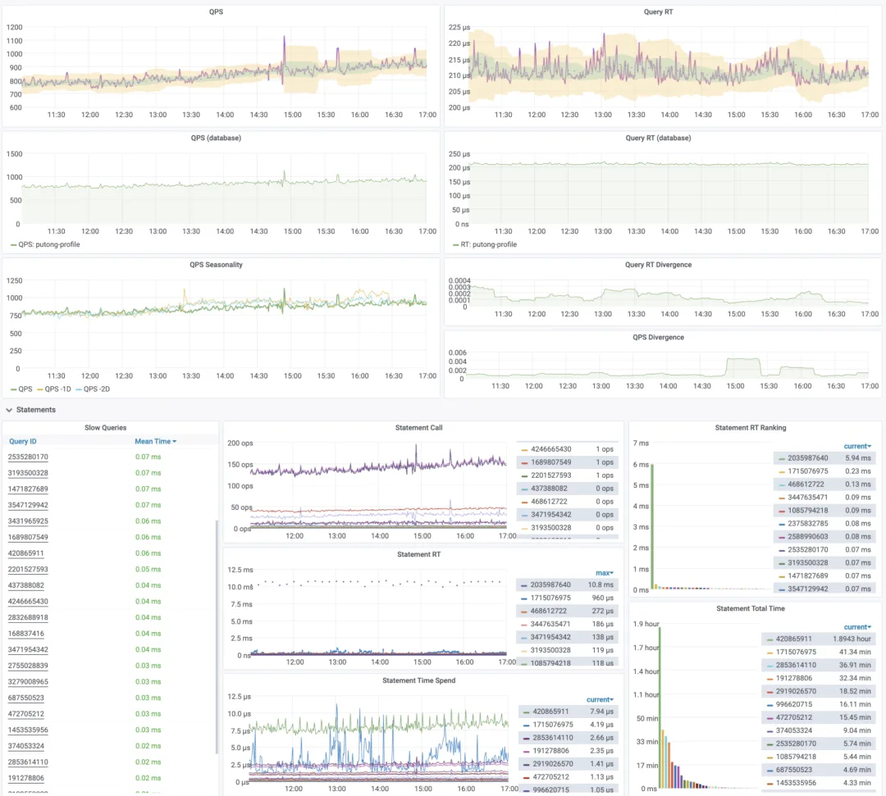

#### 语句

语句区域按归一化查询展示指标。去除常量后具有相同解析结构的语句归入同一类查询，并以查询 ID 标识。慢查询视图提供对应的 SQL 和统计数据。

- 左侧列表按 `pg_stat_statements` 的平均响应时间降序排列。点击查询 ID 打开详情。
- 候选列表选取累计执行时间最长的 32 条查询，排除监控查询和只有零星调用的长查询。
- 右侧显示各查询的实时 QPS、平均响应时间，以及按响应时间和累计耗时的排名。

#### 后端进程

后端指标描述 PostgreSQL 连接。按不同维度分组，有助于排查连接突增、慢查询与等待问题。

- 按后端类型、状态、数据库与等待事件类型统计数量。
- 活跃连接、`idle in transaction` 连接与长事务。

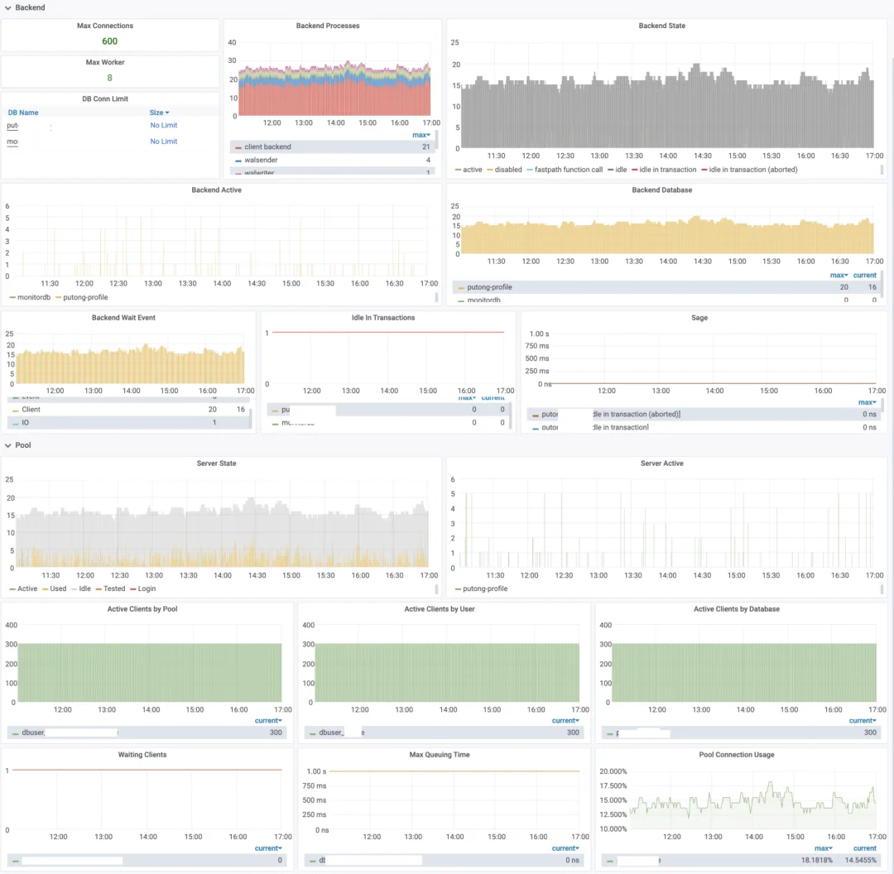

#### 连接池

这一部分的指标来自 PgBouncer：

- 后端连接状态：活跃、刚用过、空闲、已测试、登录中。
- 按用户、数据库与连接池（`user:database`）统计的前端连接数。
- 等待客户端数量与队首客户端的等待时间，用于判断连接是否积压。
- 可用池连接的使用比例。

#### 数据库概览

这一部分主要使用 `pg_stat_database` 与 `pg_database`，并展示 WAL 指标：

- 每秒生成的 WAL 字节数，反映写入活动。
- shared buffers 命中率。未命中的请求可能由操作系统文件缓存或存储设备处理。
- 每秒读取、插入、更新与删除的行数。
- 临时文件数量与大小，用于分析大查询的影响。

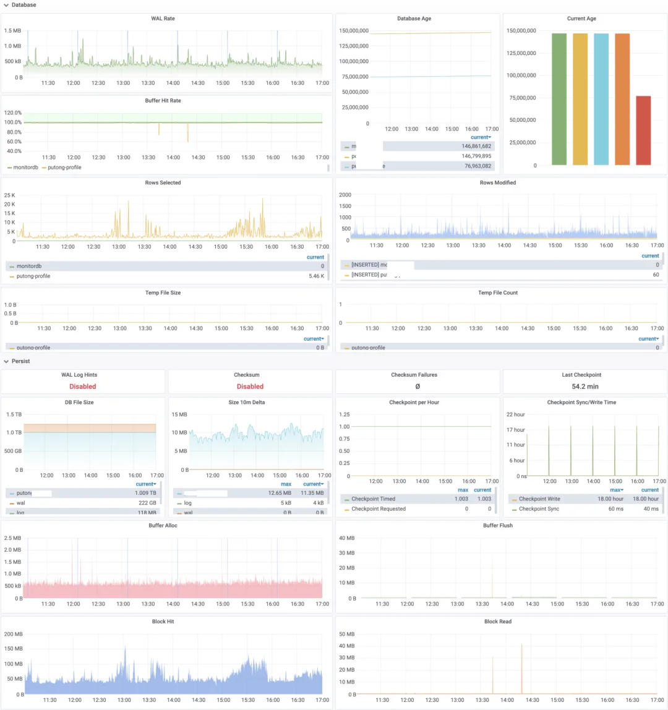

#### 持久化

持久化指标包括写入、检查点与块访问：

- 关键持久化配置，以及启用数据校验和后的校验失败情况。
- 数据库文件、WAL 与日志的大小及增速。
- 检查点次数与耗时。
- 每秒分配、写出、访问和从存储读取的块数，以及对应字节量。本部署的 PostgreSQL 页面为 8192 字节，文件系统块为 4096 字节。

#### Exporter

这一部分监控 Exporter 自身：

- 存活状态、运行时长与每分钟被抓取的次数。
- 每条监控查询的耗时、输出指标数与错误数。

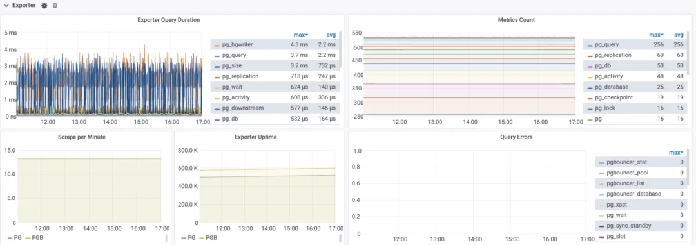

## PostgreSQL 集群监控

我最常使用集群面板。这套部署以集群为单位提供数据库服务，因此把各实例和服务的指标放在一起，更方便检查服务状态。

多数图表沿用实例面板的指标，增加实例间的对比，以及集群和服务层面的汇总。

### 集群概览

相对实例概览，集群概览增加了：

- 时间线与主库身份。故障切换或主动切换会更换主库，并推进时间线。
- 复制拓扑，以及同步或异步复制方式。
- 集群实时负载与 1、5、15 分钟平均负载，以及各节点的 1 分钟平均负载。
- 集群告警与事件。

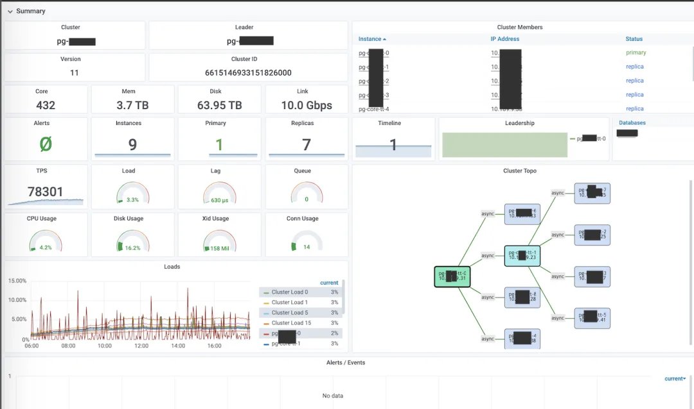

### 集群复制

集群面板汇总了整个复制拓扑，包括：

- 主库与级联复制节点、同步提交配置、同步从库名称、下游节点数量与从库数量上限配置。
- 每条复制链路成对出现的 WAL sender 与 WAL receiver。
- 以秒和字节衡量的复制延迟，以及复制槽保留的 WAL 量。例如，WAL 写入速率为 10–100 MB/s 时，1 秒延迟约对应 10–100 MB WAL。
- 从库视角的复制延迟。
- 从库数量，用于检查备份或初始化从库时的拓扑变化。
- 全集群的 LSN，反映复制进度与持久化状态。

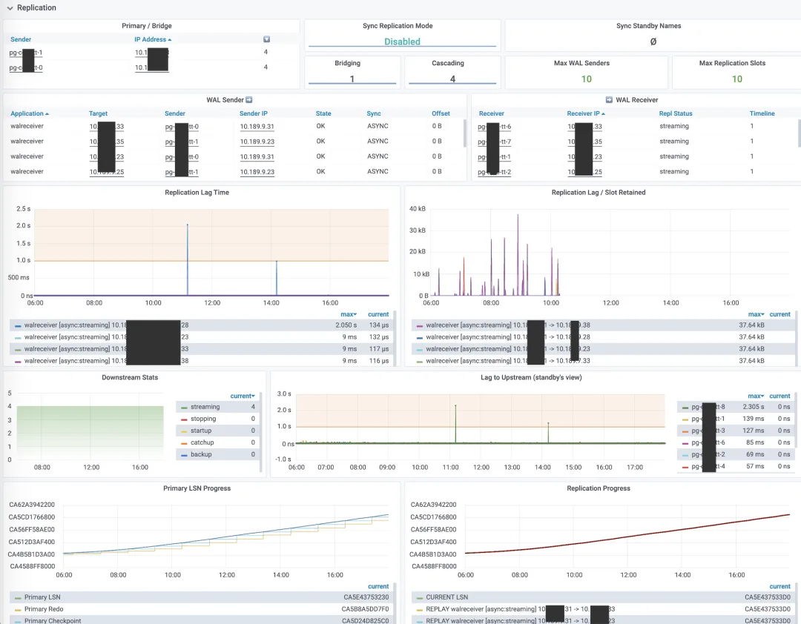

### 节点指标

主机指标按 PostgreSQL 集群组织。

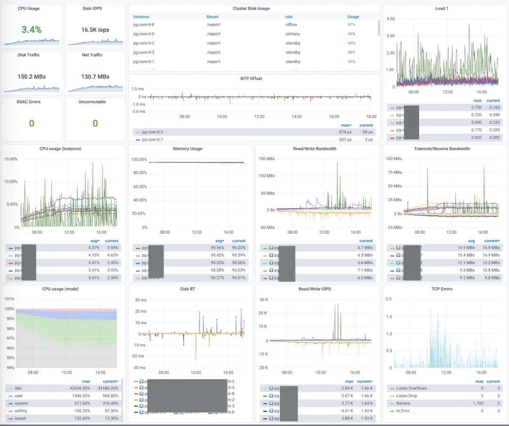

### 事务与查询

图表与实例视图相似，增加了服务层面的汇总。本部署通常为每个集群提供 `primary` 与 `standby` 两种服务。

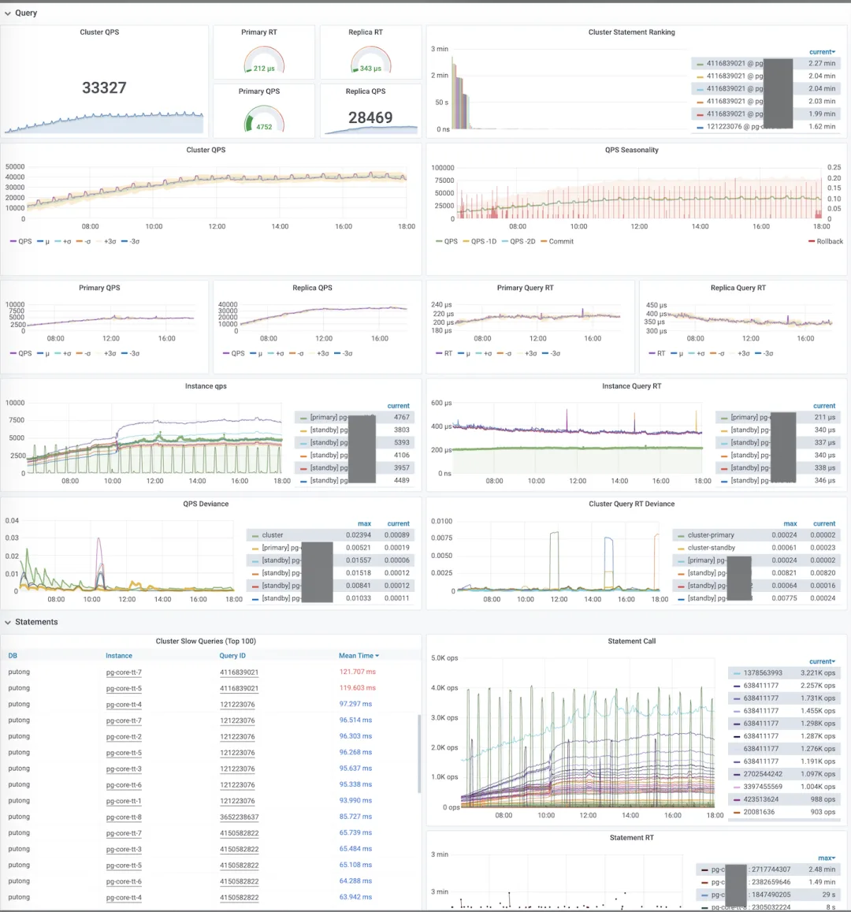

其他指标与实例面板相近。

## 慢查询分析

慢查询视图上方显示实例的查询概览。将鼠标移到查询 ID 上可以查看 SQL，点击 ID 打开 Query Detail。

详情左侧是格式化的 SQL，右侧显示：

- 每秒查询数。
- 当前平均响应时间。
- 每次调用平均返回的行数。
- 每次调用平均块 I/O 耗时。
- 统计周期内响应时间的均值、标准差、最小值与最大值。
- 过去一天的调用次数、返回行数与执行时间，以及自统计重置以来的总调用次数。

下方图表显示所选时间范围内的指标变化。

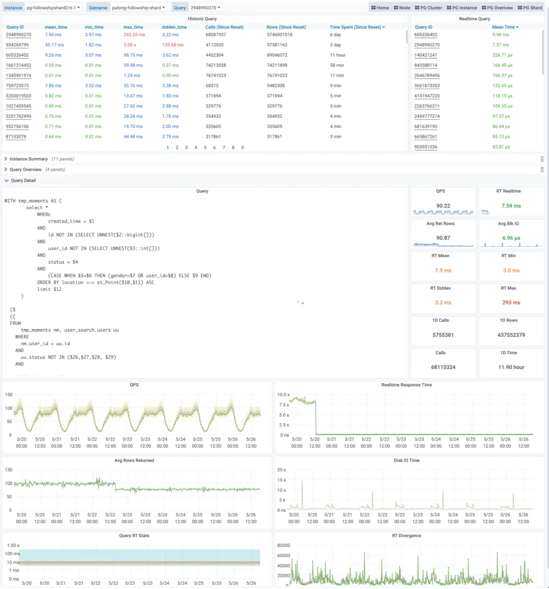
