This article describes a monitoring system from December 2018. Its dashboard layout and statistics-collector details belong to that period.

## Using monitoring to manage PostgreSQL

Managing PostgreSQL requires an understanding of its operating state. Monitoring brings this information together for routine checks, fault diagnosis, and performance tuning. I planned a series of articles about the design, implementation, and use of this monitoring system.

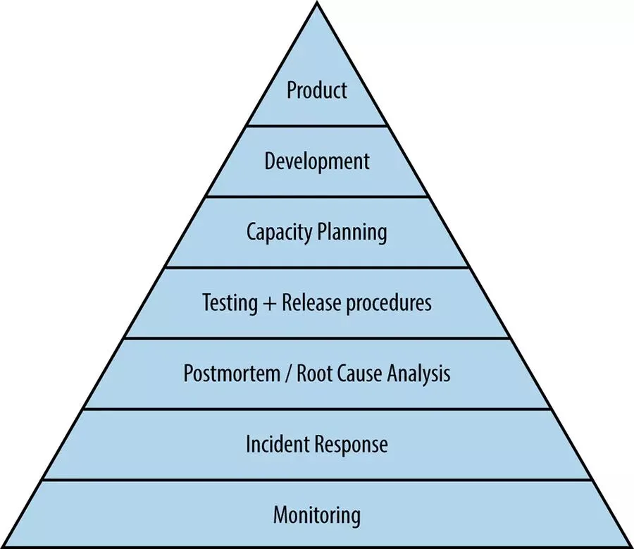

## The PostgreSQL dashboard

These are the dashboards I used in a working environment. The most frequently used view monitored one database instance. It had seven main sections: overview, operating system, database activity and sessions, replication, checkpoints and WAL, conflicts, and database object statistics.

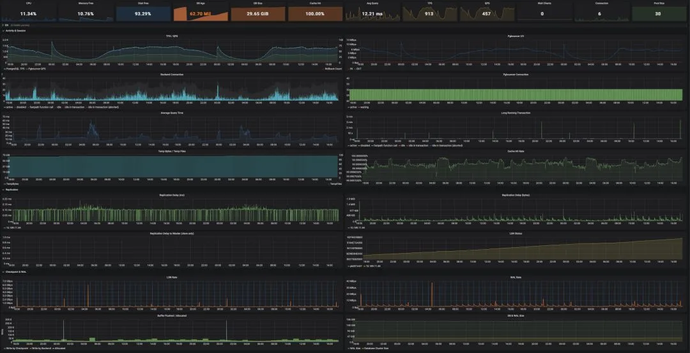

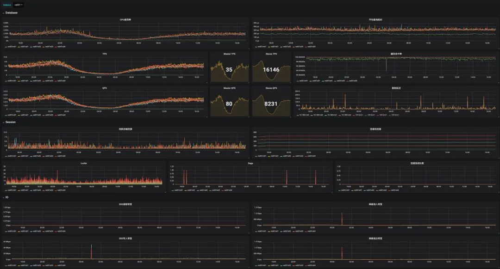

## System architecture

This system uses Prometheus, Grafana, Consul, and exporters.

Exporters read metrics from databases, connection pools, and hosts. Prometheus discovers exporters through Consul and scrapes their metrics. Grafana displays the data, while Alertmanager handles alerts.

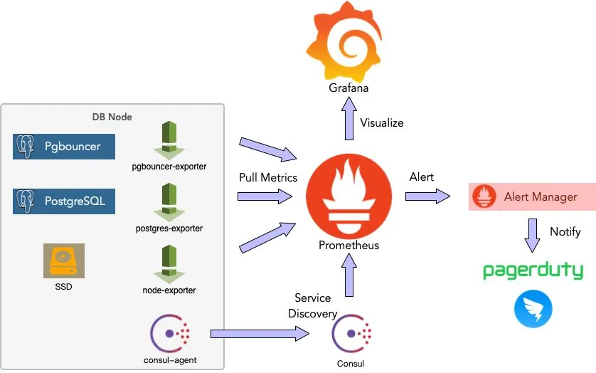

## Monitoring metrics

For each metric, identify the question it answers, its data source, and the meaning of changes in its value. This helps interpret charts and guides command-line investigation. The following sections describe the main metrics in the single-instance dashboard.

### Overview

The overview contains key metrics that help narrow down a problem at a glance:

- CPU utilization, average query time, TPS, QPS, queued pool clients, and active connections indicate load.
- Free memory helps identify pressure that can lead to processes being killed.
- Free disk space shows whether storage is close to full.
- Database age indicates proximity to transaction ID wraparound limits.
- Database size and cache hit ratio help identify changes in activity.

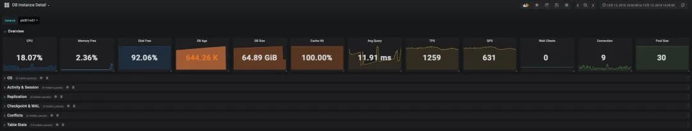

### Operating system

The operating-system section includes:

- CPU utilization and system load.
- Memory usage, including changes in the operating-system cache.
- Network and disk throughput, and disk IOPS.

Compare these metrics with database activity to identify resource pressure and investigate possible hardware faults.

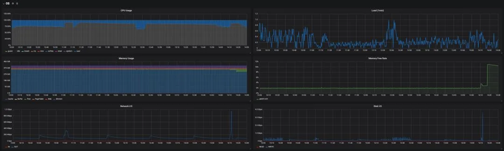

### Database activity and sessions

Activity and session metrics show the database's current workload:

- TPS, QPS, and average response time describe traffic and latency.
- The cache hit ratio here refers to PostgreSQL's shared buffers. It excludes the operating-system file cache.
- Connection counts by state show how sessions are being used. Active connections show work in progress; inspect `idle in transaction` sessions to find why their transactions remain open.
- Complex or large queries can create temporary files. Heavy temporary-file I/O can reduce performance.

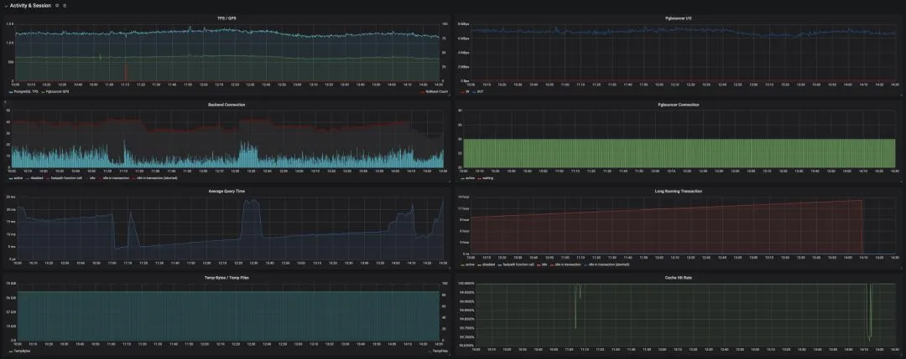

### Replication

Replication lag helps assess replica freshness and investigate replication faults.

The primary reports how far replicas lag in bytes of WAL and, from PostgreSQL 10, replication lag times. A replica can also report the time since its last replayed transaction, although this is not an exact measure of current lag: it can increase while an idle primary produces no new transactions.

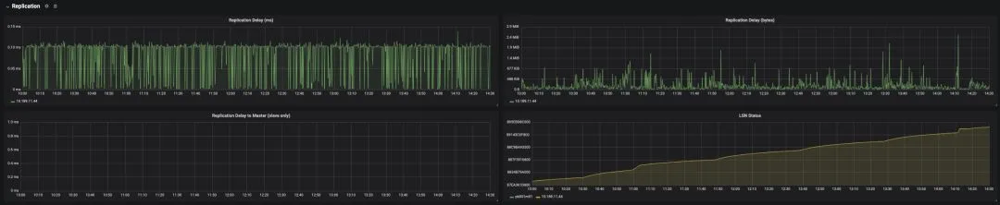

### Checkpoints and WAL

Checkpoints consume I/O by writing dirty pages. With `full_page_writes` enabled, the first change to a page after a checkpoint also writes a full-page image to WAL. This can increase disk and network traffic and contribute to performance problems.

Useful metrics include:

- WAL generation rate.
- LSN growth rate.
- Buffers written by checkpoints and by backends. Heavy backend writes can indicate that checkpoint or background-writing settings need review.
- Database and WAL size.

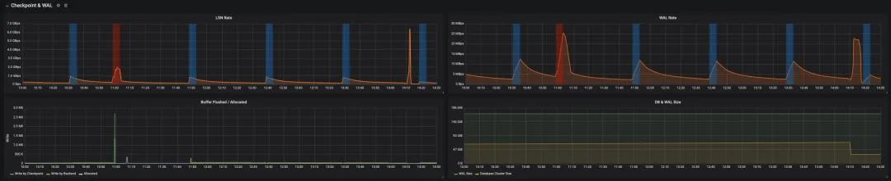

### Locks and conflicts

Counts by lock type help explain database activity and investigate lock conflicts.

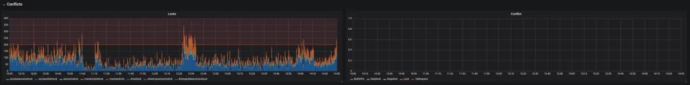

### Object statistics

Object-level statistics help locate the source of a problem:

- Index and sequential scan counts per table. For frequent sequential scans on large tables, use query plans to check whether the indexes suit the workload.
- Tuple reads and writes, table size, and table age.
- The proportion of dead tuples, which indicates vacuum demand and can help investigate bloat. It is not the same as the physical bloat ratio; statistics-based bloat estimates provide another view.
- Function call counts and execution time.

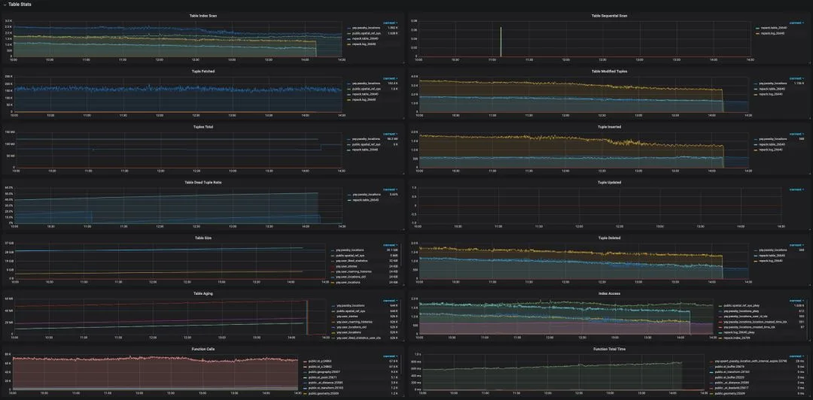

## Metric sources

### The statistics collector

In the PostgreSQL versions discussed here, many metrics came from the built-in statistics collector. System views expose the data through SQL; the PostgreSQL documentation defines each view. Some common views are listed below.

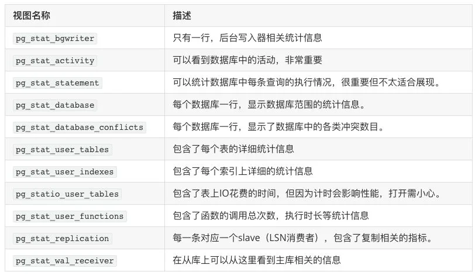

The [PostgreSQL 11 statistics documentation](https://www.postgresql.org/docs/11/monitoring-stats.html) describes several details to account for:

- Cumulative statistics were not updated continuously. Backends reported their counts before becoming idle, so work still in progress was not yet fully reflected in those totals.
- Statistics reports were normally spaced at least 500 ms apart (`PGSTAT_STAT_INTERVAL`). Current activity, controlled by `track_activities`, followed a separate mechanism.
- Repeated statistics queries within one transaction could reuse the same snapshot. `pg_stat_clear_snapshot()` cleared it so the next query could fetch a new one.
- The required `track_*` settings had to be enabled in `postgresql.conf`.

These details describe the older collector process. [PostgreSQL 15 replaced it with shared-memory cumulative statistics](https://www.postgresql.org/docs/15/release-15.html); use the documentation for your server version when interpreting update and snapshot behavior.

### Catalogs and other system views

Other catalogs and views provide useful data too. For example, `pg_database` supplies database metadata used to assess transaction ID age, and `pg_locks` shows locks and waits. Built-in functions provide further measurements, including database size.

## Further articles

This article introduces the architecture and main metrics. Later articles cover implementation details and how to use the metrics to investigate problems.
