本文记录 2018 年 12 月的监控系统，面板与统计收集器机制对应当时版本。

## 用监控管理 PostgreSQL

管理 PostgreSQL 需要了解数据库的运行状态。监控系统集中展示这些信息，为日常检查、故障诊断与性能优化提供依据。我计划通过一系列文章，介绍这套监控系统的设计、实施与使用。

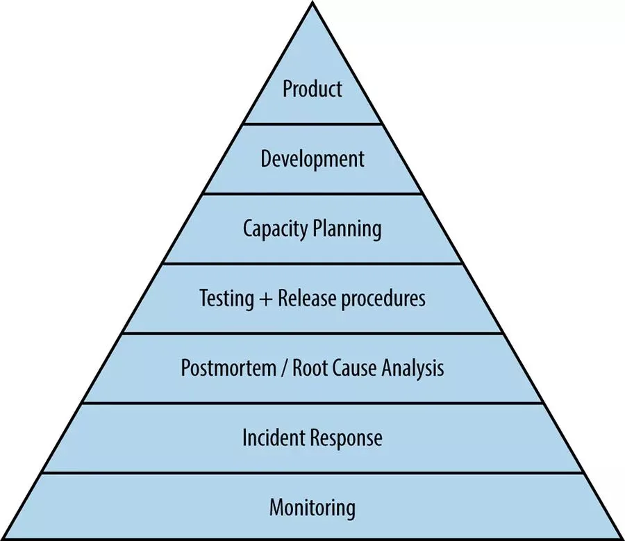

## PostgreSQL 监控面板

下面是我在实际环境中使用的监控面板。最常用的单实例面板分为七个区域：概览、操作系统、数据库活动与会话、复制、检查点与 WAL、数据库冲突、数据库对象统计。

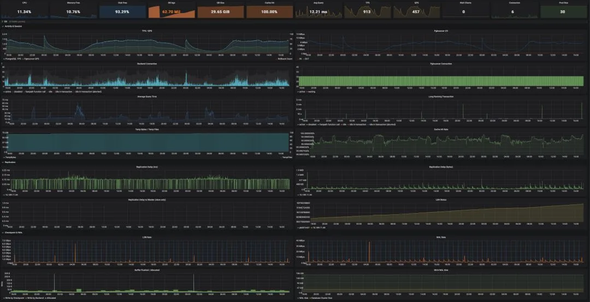

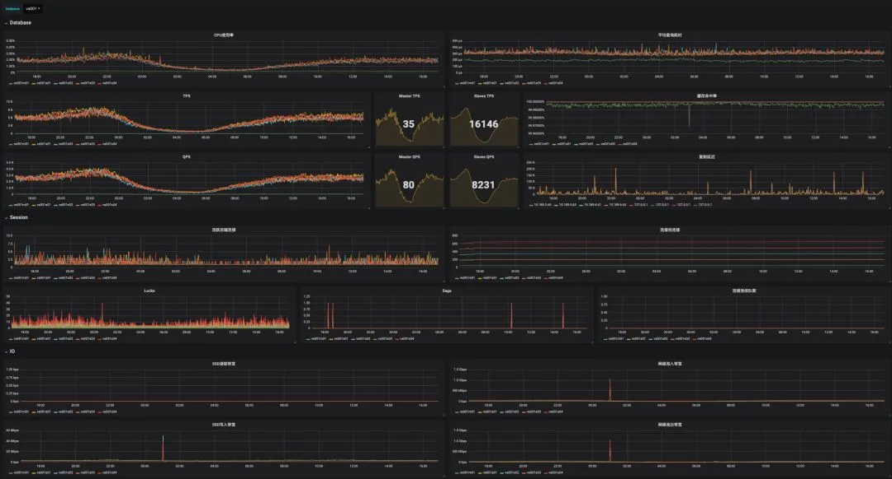

## 系统架构

这套系统使用 Prometheus、Grafana、Consul 与各类 Exporter。

Exporter 从数据库、连接池与主机获取指标。Prometheus 通过 Consul 发现 Exporter，再抓取并保存指标。Grafana 展示数据，Alertmanager 处理告警通知。

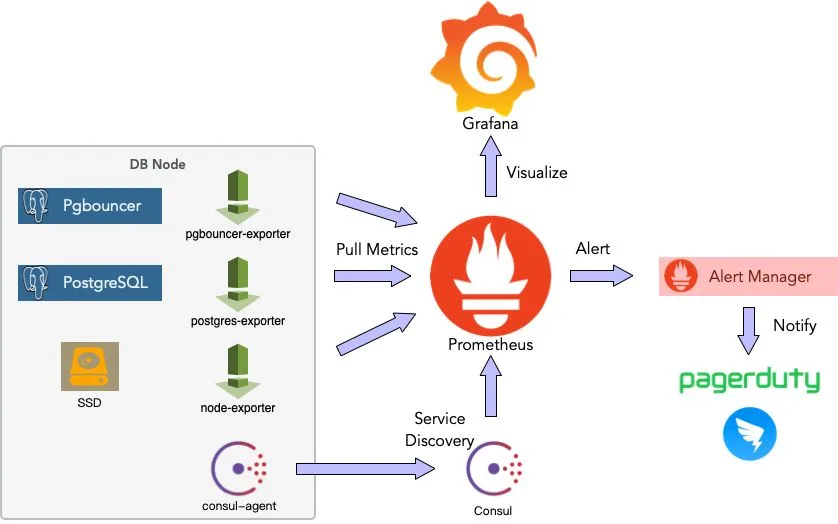

## 监控指标

选择指标时，需要明确它回答什么问题、数据来自哪里、数值变化意味着什么。这些信息决定了如何解读图表，也可以指导命令行排查。下面按单实例面板的区域介绍主要指标。

### 概览

概览用于缩小排查范围，包含以下指标：

- CPU 使用率、平均查询时间、TPS、QPS、连接池排队数与活跃连接数：了解负载水平。
- 内存空闲率：识别可能导致进程被终止的内存压力。
- 磁盘空闲率：检查存储空间是否接近用尽。
- 数据库年龄：评估距离事务 ID 回卷限制还有多远。
- 数据库大小与缓存命中率：观察数据规模和访问模式的变化。

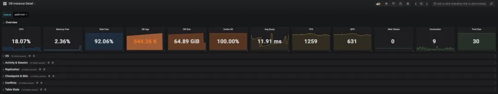

### 操作系统

操作系统指标包括：

- CPU 使用率与系统负载。
- 内存使用量，特别是操作系统缓存的变化。
- 网络与磁盘吞吐量，以及磁盘 IOPS。

将这些指标与数据库活动放在一起，可以判断资源压力来自哪里，并为硬件故障排查提供线索。

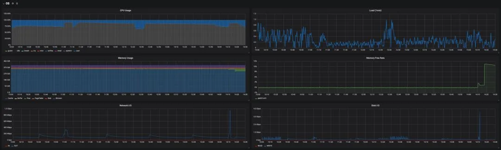

### 数据库活动与会话

这些指标描述数据库当前的工作负载：

- TPS、QPS 与平均响应时间：请求量和延迟。
- 缓存命中率：这里只统计 PostgreSQL 的 shared buffers，不包含操作系统文件缓存。
- 各状态的连接数：`active` 连接反映执行中的工作；`idle in transaction` 连接则需要检查事务为何未结束。
- 临时文件数量与大小：复杂查询或大查询可能产生临时文件，大量临时文件 I/O 会影响性能。

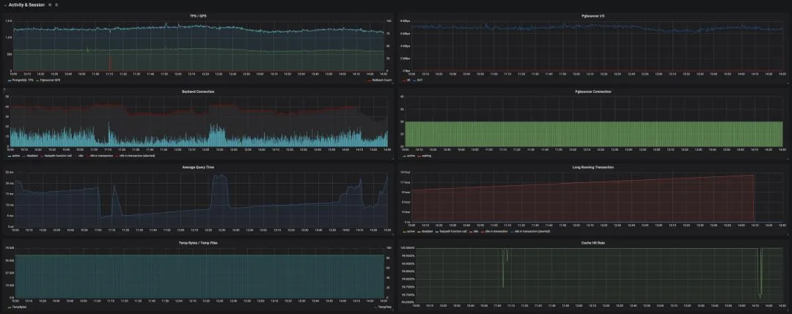

### 复制

复制延迟有助于判断从库的数据新鲜度，也为复制故障排查提供线索。

主库可以报告从库落后的 WAL 字节数；从 PostgreSQL 10 起，还提供复制延迟时间。从库上可以用最后重放事务的时间估算滞后，但主库空闲时该值也会增长，不能直接等同于实际复制延迟。

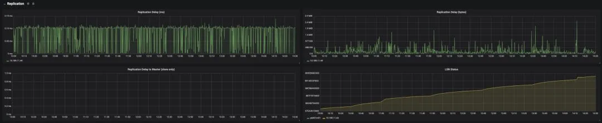

### 检查点与 WAL

检查点写出脏页，会消耗磁盘 I/O。启用 `full_page_writes` 后，检查点之后对页面的首次修改还会把完整页面映像写入 WAL，增加磁盘与网络流量。排查写入压力时，可以观察：

- WAL 生成速率。
- LSN 增长速度。
- 检查点与后端进程写出的缓冲区数量。如果后端进程承担大量写出工作，需要检查检查点和后台写入相关配置。
- 数据库与 WAL 的大小。

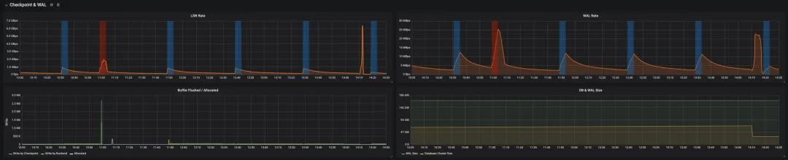

### 锁与数据库冲突

按类型统计锁，可以了解数据库正在进行的操作，并为锁冲突排查提供线索。

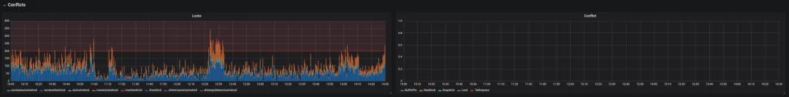

### 对象级统计

对象级统计用于进一步定位问题：

- 每张表的索引扫描与顺序扫描次数。大表上频繁出现顺序扫描时，结合查询计划检查索引是否适用。
- 元组读写数量、表大小与表年龄。
- 死元组比例：反映清理需求，可辅助排查膨胀，但不等于物理膨胀率。也可以使用统计数据估算表膨胀率。
- 函数调用次数与执行时间。

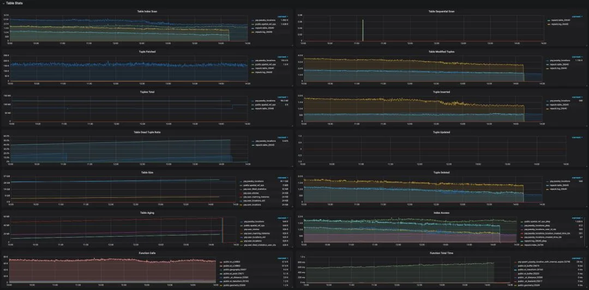

## 指标来源

### 统计收集器

本文涉及的 PostgreSQL 版本通过内置统计收集器提供许多监控指标。系统视图以 SQL 接口暴露这些数据，具体定义见 PostgreSQL 文档。下面列出了一些常用视图。

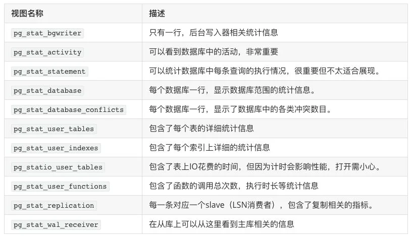

[PostgreSQL 11 统计文档](https://www.postgresql.org/docs/11/monitoring-stats.html)说明了统计数据的更新与快照机制：

- 后端进程在进入空闲前报告累计计数，仍在执行的工作尚未完整反映在累计统计中。
- 收集器生成新报告的间隔至少为 `PGSTAT_STAT_INTERVAL`，默认 500 毫秒。由 `track_activities` 控制的当前活动使用另一套机制。
- 同一事务中的统计查询会复用快照。调用 `pg_stat_clear_snapshot()` 清除快照后，下次查询可以取得新快照。
- 在 `postgresql.conf` 中启用所需的 `track_*` 选项。

这些规则属于旧版统计收集进程。[PostgreSQL 15 改用共享内存保存累计统计](https://www.postgresql.org/docs/15/release-15.html)；解释更新与快照行为时，使用对应服务器版本的文档。

### 系统目录与其他视图

其他系统目录和视图也提供监控数据。例如，`pg_database` 包含计算数据库年龄所需的元数据，`pg_locks` 提供锁和锁等待信息。数据库大小等指标则由内置函数提供。

## 后续内容

本文介绍了监控系统的架构和主要指标。后续文章将继续说明具体实现，以及如何用这些指标排查问题。
