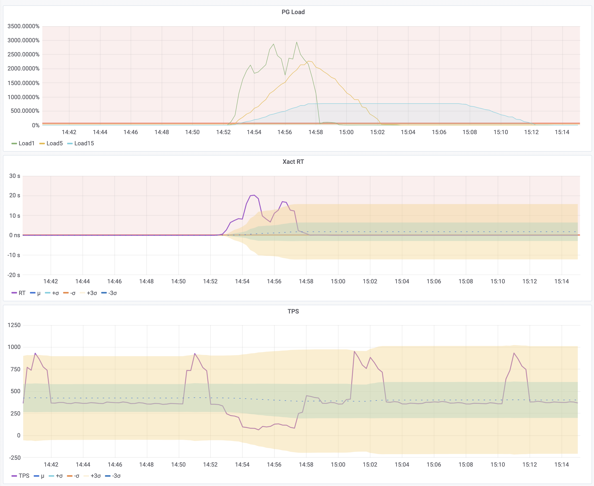
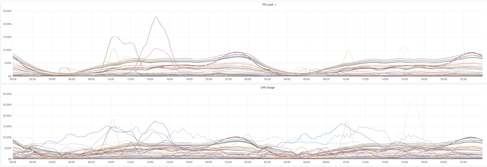

> Written in 2020. This article develops a load indicator from PgBouncer transaction time.

**PG Load** measures accumulated transaction time per second, divided by a chosen concurrency value. It combines the amount of work a database handles with the time that work takes. I use it to track load changes and identify instances that need investigation or a capacity review.

## What existing metrics tell us

Database load is usually assessed through several kinds of metrics:

* Traffic: queries per second (QPS) and transactions per second (TPS).
* Latency: query response time (Query RT) and transaction response time (Xact RT).
* Resource use: machine load, CPU utilization, disk I/O, and network I/O.
* Failures and contention: errors and clients waiting for database connections.

Each answers a different question. Errors show failures; a growing connection-pool queue shows contention for connections. Neither alone measures spare capacity. A short queue can coexist with a resource bottleneck, while a long queue can result from a small pool limit.

CPU and I/O metrics show pressure on the host. They help explain database performance when those resources are the bottleneck. But database work can also be limited by locks or occupied connections while CPU utilization remains low. We need a database-level measure to compare with the host metrics.

QPS and TPS count completed work, not its cost. A 10-microsecond query and a 10-second query each count as one call. Throughput is useful when compared with the query mix, latency, and resource use. Load tests can establish a baseline for a known workload.

RT measures service quality. For example, an OLTP service might have a 1 ms response-time target. Rising latency can indicate contention, but does not measure saturation by itself. An average can also hide slow requests; P99 or P99.9 helps show the tail when duration distributions are available.

PG Load combines transaction count and duration into a measure of concurrent work. To derive it, start with two familiar host metrics: load average and CPU utilization.

## Deriving PG Load

### Linux load average

The first line of `top` shows load averages for the last 1, 5, and 15 minutes:

```bash
$ top -b -n 1
top - 19:27:38 up 18:49,  1 user,  load average: 1.15, 0.72, 0.71
```

Linux load average counts runnable tasks and tasks in uninterruptible sleep, often waiting for I/O. For CPU-bound work on one core, a load near 1 suggests full CPU demand; values above 1 suggest queuing. On n cores, the corresponding reference is n. Dividing by the number of cores gives a normalized value for comparison.

For CPU-bound work, 0.7 and 1.0 per core can serve as starting points for warning and investigation thresholds. Adjust them to the workload. Because uninterruptible waits also contribute to load, read this value alongside CPU and I/O metrics; it is not a CPU-utilization percentage.

### CPU utilization

For one CPU core, utilization can be calculated from its accumulated idle time:

```promql
1 - irate(node_cpu_seconds_total{mode="idle"}[1m])
```

`node_cpu_seconds_total{mode="idle"}` counts idle seconds. `irate` uses the last two samples to calculate idle seconds per second. Subtracting that fraction from 1 gives the fraction of time the core was busy. For a multi-core CPU, average the utilization of its cores.

This suggests a similar measure for a PostgreSQL backend: the fraction of time it is active. Load average also suggests how to extend that measure to multiple backends: add their active time and normalize by concurrency.

### From backend time to database load

Start with a one-second window and normalize by the number of available backends:

| Scenario | Calculation | Result |
| --- | --- | --- |
| One backend executes queries for 0.6 seconds | `0.6 / 1 / 1` | 60% |
| Two available backends execute for 0.6 and 0.8 seconds | `(0.6 + 0.8) / 1 / 2` | 70% |
| One backend executes queries for 0.6 seconds and is idle in a transaction for 0.2 seconds, measured by transaction time | `(0.6 + 0.2) / 1 / 1` | 80% |
{.wide .expand}

The third example raises a choice: count only query execution, or count the whole transaction, including time between statements. We will use transaction time and explain that choice below. Client time waiting for a backend is separate and is not included.

For a longer window or more backends, the calculation is the same:

`pg_load = pg_active_seconds / time_period / parallel`

* `pg_active_seconds` is the sum of active seconds across the observed backends during the window.
* `time_period` is the window duration in seconds.
* `parallel` is the concurrency value used for normalization.

A value of 0 means no observed activity. A value of 100% means one second of active time per second per unit of chosen concurrency. It does not, by itself, establish a capacity limit.

If active seconds are available as a cumulative counter, use its rate of increase:

`rate(pg_active_seconds[time_period]) / parallel`

The remaining choices are how to measure active time and which concurrency value to use.

## Calculating PG Load

### Count query time or transaction time?

For a single query in an autocommit transaction, query time and transaction time are close. For a transaction with several statements, they can differ substantially. In the example above, 0.6 seconds of query execution plus 0.2 seconds `idle in transaction` gives 60% by query time and 80% by transaction time.

Query time measures execution. Transaction time measures how long the transaction occupies its backend. An idle transaction may use little CPU, but it still occupies a connection and can retain locks or snapshots. I use transaction time here to include that occupancy in the load measure.

### Obtain accumulated transaction time

`pg_stat_activity` shows the current state of PostgreSQL backends. Repeated samples can estimate how many backends are active over time, but the view itself is a snapshot, not an accumulated duration counter.

PgBouncer provides the counters needed for this calculation. Its `SHOW STATS` command reports statistics for each database, including:

* `total_xact_count`: completed transactions.
* `total_query_count`: executed queries.
* `total_xact_time`: accumulated transaction time.
* `total_query_time`: accumulated query time.

The raw time counters use microseconds. The exported `pgbouncer_stat_total_xact_time` series used below is already in seconds. See [PgBouncer statistics](https://www.pgbouncer.org/usage.html#show-stats).

Apply `rate` to that counter to obtain transaction seconds per second over 1, 5, or 15 minutes. For the most recent interval, `irate` uses the last two samples. Then sum across databases with `sum without (datname)` to obtain an instance-level value:

```yaml
- record: pg:ins:xact_time_realtime
  expr: sum without (datname) (irate(pgbouncer_stat_total_xact_time{}[1m]))
- record: pg:ins:xact_time_rate1m
  expr: sum without (datname) (rate(pgbouncer_stat_total_xact_time{}[1m]))
- record: pg:ins:xact_time_rate5m
  expr: sum without (datname) (rate(pgbouncer_stat_total_xact_time{}[5m]))
- record: pg:ins:xact_time_rate15m
  expr: sum without (datname) (rate(pgbouncer_stat_total_xact_time{}[15m]))
```

The result estimates concurrent transaction work. One continuously occupied backend contributes one transaction second per second; 64 contribute 64. This lets us compare periods on the same instance, but comparison across instance sizes needs a normalization factor.

### Normalize by CPU count

This method uses CPU count as the concurrency reference. It is useful for CPU-bound work, but is not a measured limit on PostgreSQL concurrency. Connection limits, parallel workers, lock waits, and I/O also affect how much work an instance can sustain.

On a 64-core host, 64 backends continuously occupied by transactions produce a load of `64 / 64 = 100%`. With 128 such backends, the result is `128 / 64 = 200%`.

Divide the transaction-time rates by CPU count to obtain the PG Load series:

```yaml
- record: pg:ins:load0
  expr:  pg:ins:xact_time_realtime / on (ip) group_left()  node:ins:cpu_count
- record: pg:ins:load1
  expr: pg:ins:xact_time_rate1m  / on (ip) group_left()  node:ins:cpu_count
- record: pg:ins:load5
  expr: pg:ins:xact_time_rate5m  / on (ip) group_left()  node:ins:cpu_count
- record: pg:ins:load15
  expr: pg:ins:xact_time_rate15m  / on (ip) group_left()  node:ins:cpu_count
```

### The relationship with throughput and latency

Active seconds per second can also be approximated by TPS × average transaction RT, or QPS × average query RT. Use the same observation window and express RT in seconds. For example, 1,000 queries per second at 1 ms each accumulate `1000 × 0.001 = 1` query second per second.

With transaction time and CPU normalization, this gives:

`tps * xact_rt / cpu_count`

TPS alone ignores the cost of each transaction; RT alone ignores how many transactions run. Their product accounts for both. The recording rules above obtain that accumulated work directly from the time counter.

## Using PG Load

### Alerting: slow queries occupy the connection pool

In the production incident below, an application change introduced a slow query. Slow queries occupied the connection pool, and requests accumulated. Both PG Load and RT rose clearly; the drop in TPS was less conspicuous. After this incident, we added PG Load1 and PG Load0 to our alerting rules.

The example thresholds are 50% for a warning and 70% for an alert. Choose thresholds from the workload baseline and response-time target. A value of 500% means accumulated transaction time is five times the CPU-normalized reference; latency, queue length, and wait metrics help locate the cause.



### Capacity assessment

For capacity planning, compare 15-minute PG Load averages and peaks with the cluster's historical baseline, response-time targets, and expected growth. This helps identify clusters that need more detailed review of capacity, query cost, or resource limits.

Compare PG Load with CPU utilization as well. The transaction counter excludes CPU time spent directly on unrelated host work. Backups and maintenance can still increase transaction duration through resource contention, so their effect can appear in PG Load.

Sustained load of 30%–50% can be a starting point for a capacity review. Whether to expand capacity depends on peak demand and the headroom needed for that workload.


