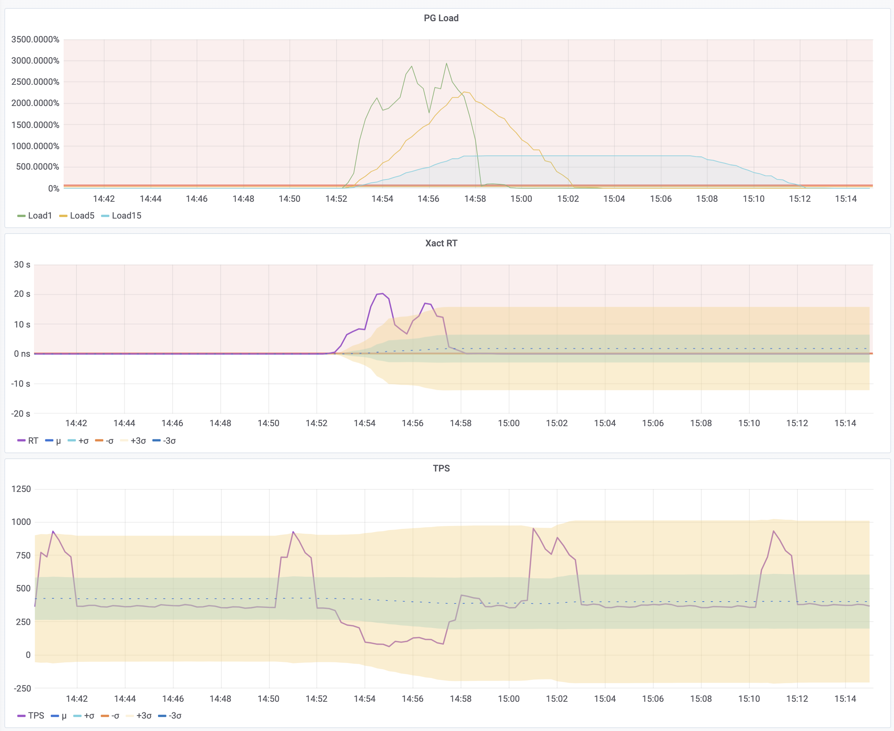
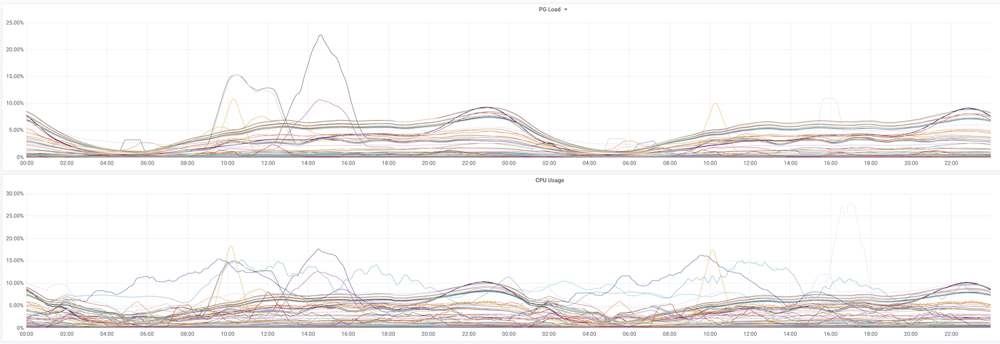

> 本文写于 2020 年，从 PgBouncer 事务耗时推导负载指标。

**PG Load（PG 负载）** 将每秒累积的事务耗时除以选定的并发数，同时考虑数据库处理的工作量与耗时。我用它观察负载变化，识别需要排查问题或重新评估容量的实例。

## 现有指标能说明什么

评估数据库负载，通常需要观察几类指标：

* 流量：每秒查询数（QPS）和每秒事务数（TPS）。
* 延迟：查询响应时间（Query RT）和事务响应时间（Xact RT）。
* 资源使用：机器负载、CPU 利用率、磁盘 I/O 和网络 I/O。
* 故障与争用：错误，以及等待数据库连接的客户端。

每类指标回答的问题不同。错误反映故障，连接池队列增长反映连接争用，但两者都不能单独衡量剩余容量。队列较短时仍可能存在资源瓶颈；队列较长也可能是连接池上限过小。

CPU 和 I/O 指标反映主机压力。当这些资源成为瓶颈时，它们有助于解释数据库性能。但锁或被占用的连接也可能限制数据库工作，此时 CPU 利用率未必很高。因此，还需要数据库自身的指标，与主机指标对照。

QPS 和 TPS 衡量完成的工作量，不衡量每次调用的成本。耗时 10 微秒和 10 秒的查询都只算一次调用。应结合查询类型、延迟和资源使用情况比较吞吐量，并通过压测为已知工作负载建立基线。

RT 衡量服务质量。例如，某类 OLTP 服务可能要求 1 ms 的响应时间。延迟上升可能表示资源争用，但不能单独用于测量饱和度。平均值也可能掩盖慢请求；有耗时分布数据时，P99、P99.9 有助于观察尾部延迟。

PG Load 将事务数量与耗时结合起来，衡量并发工作量。它的推导可以从两个熟悉的主机指标开始：平均负载和 CPU 利用率。

## 推导 PG Load

### Linux 平均负载

`top` 的第一行显示最近 1、5、15 分钟的平均负载：

```bash
$ top -b -n 1
top - 19:27:38 up 18:49,  1 user,  load average: 1.15, 0.72, 0.71
```

Linux 平均负载统计可运行任务和不可中断睡眠任务，后者常在等待 I/O。对单核 CPU 密集型负载，接近 1 表示 CPU 需求接近满载，大于 1 意味着排队。在 n 核上，对应的参考值是 n。除以核数，就能得到用于比较的归一化值。

对于 CPU 密集型负载，可将每核 0.7 和 1.0 作为预警与调查阈值的参考，再根据工作负载调整。不可中断等待也会抬高负载，因此需要结合 CPU 和 I/O 指标判断；它不是 CPU 利用率百分比。

### CPU 利用率

单个 CPU 核的利用率可以通过累积空闲时间计算：

```promql
1 - irate(node_cpu_seconds_total{mode="idle"}[1m])
```

`node_cpu_seconds_total{mode="idle"}` 统计累积空闲秒数。`irate` 用最近两个采样点计算每秒空闲时长，用 1 减去这个比例，就得到 CPU 核处于忙碌状态的时间占比。对于多核 CPU，对各核利用率求平均即可。

可以用类似的方式衡量 PostgreSQL 后端：计算它处于活跃状态的时间占比。平均负载则给出了扩展到多个后端的思路：累加它们的活跃时长，再按并发数归一化。

### 从后端时间到数据库负载

先以 1 秒为统计窗口，按可用后端数归一化：

| 场景 | 计算 | 结果 |
| --- | --- | --- |
| 一个后端执行查询 0.6 秒 | `0.6 / 1 / 1` | 60% |
| 两个可用后端分别执行 0.6 秒、0.8 秒 | `(0.6 + 0.8) / 1 / 2` | 70% |
| 一个后端执行查询 0.6 秒，事务内空闲 0.2 秒，按事务时间统计 | `(0.6 + 0.2) / 1 / 1` | 80% |

第三个例子涉及一个选择：只统计查询执行，还是统计整个事务，包括语句之间的空闲时间？本文采用事务耗时，下文会解释原因。客户端等待后端的时间另行统计，不计入这里的事务耗时。

统计窗口更长或后端更多时，计算方式不变：

`pg_load = pg_active_seconds / time_period / parallel`

* `pg_active_seconds` 是统计窗口内，所观测后端的活跃秒数之和。
* `time_period` 是统计窗口的秒数。
* `parallel` 是用于归一化的并发数。

0 表示没有观测到活动；100% 表示每单位选定并发能力，在每秒内累计了一秒活跃时间。这个值本身并不表示容量上限。

如果活跃秒数以累积计数器提供，就使用它的增长速率：

`rate(pg_active_seconds[time_period]) / parallel`

接下来需要确定如何统计活跃时间，以及用什么并发数归一化。

## 计算 PG Load

### 统计查询时间还是事务时间？

对于自动提交事务中的单条查询，查询耗时和事务耗时接近。对于包含多条语句的事务，两者可能相差很大。上面的例子有 0.6 秒查询执行和 0.2 秒 `idle in transaction`：按查询时间统计得到 60%，按事务时间统计得到 80%。

查询时间衡量执行过程，事务时间衡量后端被事务占用多久。空闲事务可能很少消耗 CPU，但仍占用连接，也可能保留锁或快照。这里采用事务时间，将这种占用也计入负载。

### 获取累积事务耗时

`pg_stat_activity` 显示 PostgreSQL 后端的当前状态。反复采样可以估算一段时间内有多少后端活跃，但这个视图本身是状态快照，不是累积耗时计数器。

PgBouncer 提供了计算所需的计数器。它的 `SHOW STATS` 命令按数据库返回统计信息，包括：

* `total_xact_count`：完成的事务数。
* `total_query_count`：执行的查询数。
* `total_xact_time`：累积事务耗时。
* `total_query_time`：累积查询耗时。

原始时间计数器使用微秒。下文使用的导出序列 `pgbouncer_stat_total_xact_time` 已经转换为秒。参见 [PgBouncer 统计说明](https://www.pgbouncer.org/usage.html#show-stats)。

对该计数器应用 `rate`，得到最近 1、5、15 分钟内的每秒事务耗时。`irate` 则使用最近两个采样点，反映最近一个采样间隔的情况。再用 `sum without (datname)` 对各数据库求和，得到实例级指标：

```yaml
- record: pg:ins:xact_time_realtime
  expr: sum without (datname) (irate(pgbouncer_stat_total_xact_time{}[1m]))
- record: pg:ins:xact_time_rate1m
  expr: sum without (datname) (rate(pgbouncer_stat_total_xact_time{}[1m]))
- record: pg:ins:xact_time_rate5m
  expr: sum without (datname) (rate(pgbouncer_stat_total_xact_time{}[5m]))
- record: pg:ins:xact_time_rate15m
  expr: sum without (datname) (rate(pgbouncer_stat_total_xact_time{}[15m]))
```

结果估算了并发事务工作量。一个后端持续被事务占用，每秒就贡献一秒事务时间；64 个这样的后端，每秒贡献 64 秒。这个值可以用于比较同一实例的不同时段，比较不同规格的实例则还需要归一化。

### 按 CPU 核数归一化

这种方法使用 CPU 核数作为并发参考，适合 CPU 密集型负载，但不是 PostgreSQL 并发能力的实测上限。连接限制、并行工作进程、锁等待和 I/O 也会影响实例能承受的工作量。

在 64 核主机上，64 个后端持续被事务占用，负载为 `64 / 64 = 100%`；128 个这样的后端，负载为 `128 / 64 = 200%`。

将每秒事务耗时除以 CPU 核数，就得到 PG Load 序列：

```yaml
- record: pg:ins:load0
  expr:  pg:ins:xact_time_realtime / on (ip) group_left()  node:ins:cpu_count
- record: pg:ins:load1
  expr: pg:ins:xact_time_rate1m  / on (ip) group_left()  node:ins:cpu_count
- record: pg:ins:load5
  expr: pg:ins:xact_time_rate5m  / on (ip) group_left()  node:ins:cpu_count
- record: pg:ins:load15
  expr: pg:ins:xact_time_rate15m  / on (ip) group_left()  node:ins:cpu_count
```

### 与吞吐量、延迟的关系

每秒活跃时长也可以近似表示为 TPS × 平均事务 RT，或 QPS × 平均查询 RT。两者应使用相同的统计窗口，RT 的单位为秒。例如，每秒 1,000 次查询，每次耗时 1 ms，累积查询时间就是每秒 `1000 × 0.001 = 1` 秒。

采用事务时间并按 CPU 核数归一化后，得到：

`tps * xact_rt / cpu_count`

TPS 不包含每个事务的成本，RT 不包含事务数量，两者相乘则同时考虑了这两点。上面的记录规则直接从耗时计数器获取这种累积工作量。

## 使用 PG Load

### 告警：慢查询占满连接池

下图是一次生产事故。某次应用变更引入了慢查询，慢查询占用了连接池，请求随之堆积。PG Load 和 RT 都明显上升，TPS 的下降则不太显眼。这次事故后，我们将 PG Load1 和 PG Load0 纳入了告警规则。

本文以 50% 预警线和 70% 告警线为例，具体阈值应根据工作负载基线和响应时间目标设定。达到 500% 意味着累积事务耗时是按 CPU 核数归一化后参考值的五倍；延迟、队列长度和等待指标有助于定位原因。



### 容量评估

规划容量时，将集群 15 分钟 PG Load 的均值与峰值，同历史基线、响应时间目标和预期增长比较。由此识别需要进一步评估容量、查询成本或资源限制的集群。

同时对照 CPU 利用率。事务计数器不直接包含主机其他任务消耗的 CPU 时间，但备份和维护仍可能通过资源争用增加事务耗时，其影响也就会反映在 PG Load 上。

可将长期处于 30%～50% 作为评估容量的参考起点。是否扩容，还取决于峰值需求和该工作负载所需的余量。



> [WeChat Column](https://mp.weixin.qq.com/s/bG6KG7mmu4K7JMYMI34zCQ)
