This is a June 2024 conference report. Roles, package counts, and proposals reflect that event.

PGCon, the predecessor to PGCon.Dev, was held in Ottawa from 2007 through 2023. It brought PostgreSQL developers together to discuss the project’s direction.

In 2024, a new organizing team took over from Dan Langille and moved the event to SFU’s Harbour Centre in Vancouver.

[Peter Eisentraut](https://peter.eisentraut.org/blog/2024/06/04/how-engaging-was-pgconfdev-really) found a gap of six days, twelve hours, and forty-nine minutes between PostgreSQL commits around the conference. It was the longest gap in more than twenty years. The developers had plenty to discuss in person.

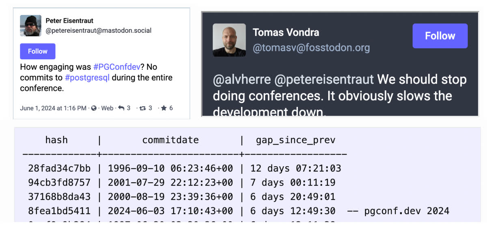

> The three longer gaps all occurred early in the project’s history.

I’ve been embracing PostgreSQL for a decade, but attending a global PG Hacker conference in person was a first for me, and I’m immensely grateful for the organizer's efforts.
PGCon.Dev 2024 wrapped up on May 31st, though this post comes a bit delayed as I’ve been exploring Vancouver and Banff National Park ;)

-------

## Day Zero: Extension Summit

Day zero was for leadership meetings, and I signed up for the afternoon's Extension Ecosystem Summit.

Maybe this summit is somewhat subtly related to my recent post, "[Postgres is eating the database world](https://medium.com/@fengruohang/postgres-is-eating-the-database-world-157c204dcfc4),"  highlighting PostgreSQL's thriving extension ecosystem as a unique and critical success factor and drawing the community's attention.

[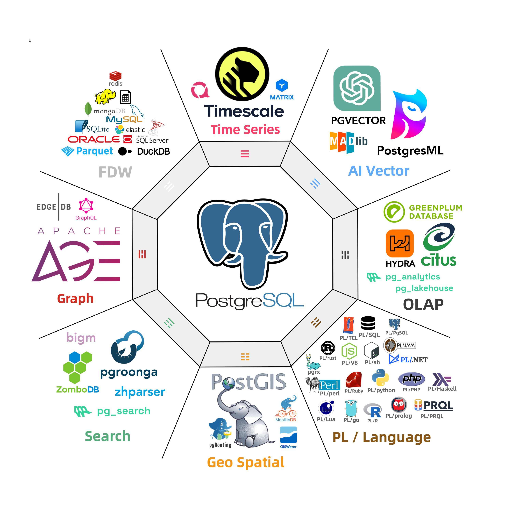](https://medium.com/@fengruohang/postgres-is-eating-the-database-world-157c204dcfc4)

I joined David Wheeler's Binary Packaging session with the RPM and APT maintainers. They questioned the need for new distribution standards such as PGXN v2. In the second half, I attended Yurii Rashkovskii's discussion of extension directories, metadata, naming conflicts, versioning, and binary distribution.

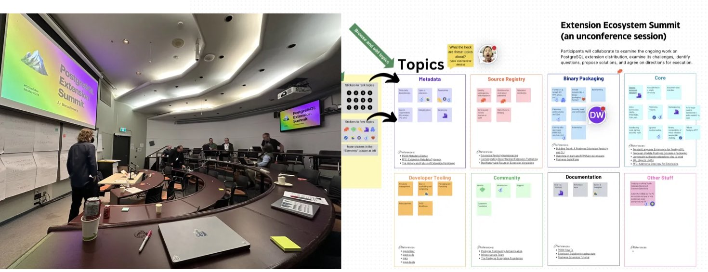

Prior to this summit, the PostgreSQL community had held [six mini-summits](https://www.eventbrite.com/e/postgres-extension-ecosystem-mini-summit-tickets-851127263557) discussing these topics intensely, with visions for the extension ecosystem's future development shared by various speakers. Recordings of these sessions are available on [YouTube](https://www.youtube.com/playlist?list=PL11N188AYb_aT6ulbJfrQJJziWb012jG3).

And after the summit, I had a chance to chat with Devrim, the RPM maintainer, about extension packaging, which was quite enlightening.

> "Keith Fan Group" -- from Devrim on Extension Summit

-------

## Day One: Brilliant Talks and Bar Social

The core of PGCon.Dev lies in its sessions. Unlike some China domestic conferences with mundane product pitches or irrelevant tech details, PGCon.Dev presentations are genuinely engaging and substantive. The official program kicked off on May 29th, after a day of closed-door leadership meetings and the Ecosystem Summit on the 28th.

The opening was co-hosted by [Jonathan Katz](https://jkatz05.com/), 1 of the 7 core PostgreSQL team members and a chief product manager at AWS RDS, and [Melanie Plageman](https://postgresql.life/post/melanie_plageman/), a recent PG committer from Microsoft. A highlight was when Andres Freund, the developer who uncovered the famous `xz` backdoor, was celebrated as a superhero on stage.

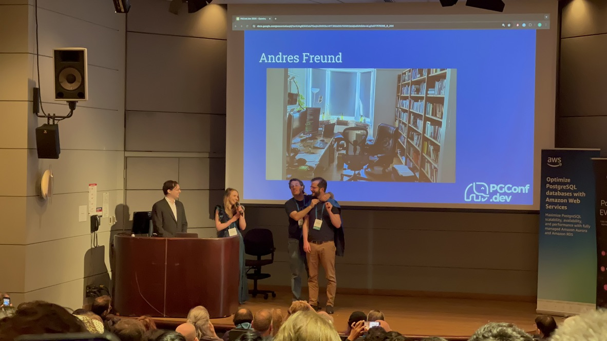

Following the opening, the regular session tracks began. Although conference videos aren't out yet, I'm confident they'll "soon" be available on YouTube. Most sessions had three tracks running simultaneously; here are some highlights I chose to attend.

---------

### Pushing the Boundaries of PG Extensions

Yurii's talk, "[Pushing the Boundaries of PG Extensions](https://slides.omnigr.es/pushing-boundaries-pgconfdev2024/1)," tackled what kind of extension APIs PostgreSQL should offer. PostgreSQL boasts robust extensibility, but the current extension API set is decades old, from the 9.x era. Yurii's proposal aims to address issues with the existing extension mechanisms. Challenges such as installing multiple versions of an extension simultaneously, avoiding database restarts post-extension installations, managing extensions as seamlessly as data, and handling dependencies among extensions were discussed.

Yurii and Viggy, founders of [Omnigres](https://omnigres.com/), aim to transform PostgreSQL into a full-fledged application development platform, including hosting HTTP servers directly within the database. They designed a new extension API and management system for PostgreSQL to achieve this. Their innovative improvements represent the forefront of exploration into PostgreSQL's core extension mechanisms.

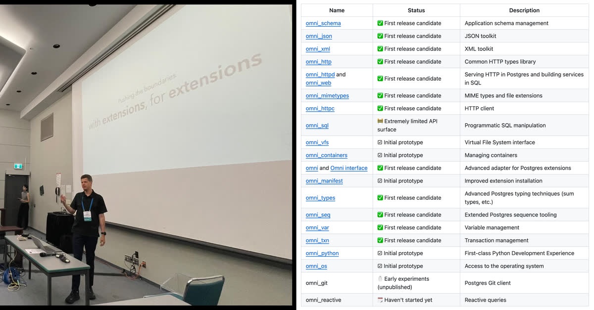

I had a great conversation with Viggy and Yurii. Yurii walked me through compiling and installing Omni. I plan to support the Omni extension series in the next version of Pigsty, making this powerful application development framework plug-and-play.

---------

### Anarchy in DBMS

Abigale Kim from CMU, under the mentorship of celebrity professor Andy Pavlo, delivered the talk "[Anarchy in the Database—A Survey and Evaluation of DBMS Extensibility](https://abigalekim.github.io/assets/pdf/Anarchy_in_the_Database_PGConfDev2024.pdf)." This topic intrigued me since Pigsty's primary value proposition is about PostgreSQL's [**extensibility**](https://pigsty.io/docs/reference/extension/).

In Kim’s comparison, PostgreSQL supported nine of the ten extension points studied, the broadest coverage among the surveyed systems. Her survey listed more than 375 PostgreSQL extensions.

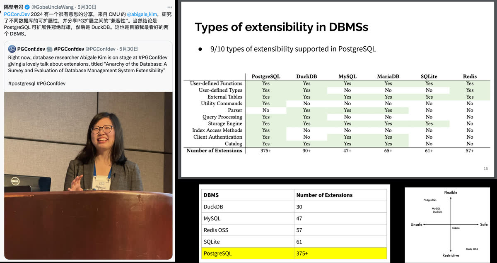

Kim's quantitative analysis of compatibility levels among these extensions resulted in a compatibility matrix, unveiling conflicts—most notably, powerful extensions like TimescaleDB and Citus are prone to clashes. This information is very valuable for users and distribution maintainers. [Read the detailed study](https://abigalekim.github.io/assets/pdf/Anarchy_in_the_Database_PGConfDev2024.pdf).

I told Kim that her research provided concrete data for comparing database extensibility.

---------

### How PostgreSQL is Misused and Abused

[Karen Jex](https://postgresql.life/post/karen_jex/) from Crunchy Data brought a user’s perspective to the first afternoon session. She described mistakes commonly made by PostgreSQL beginners. The examples were familiar to me, but useful for developers who rarely see how newcomers use the database.

### PostgreSQL and the AI Ecosystem

The second-afternoon session by [Bruce Momjian](https://postgresql.life/post/bruce_momjian/), co-founder of the PGDG and a core committee member from the start, was unexpectedly about using PostgreSQL's multi-dimensional arrays and queries to implement [neural network inference and training](https://momjian.us/main/writings/pgsql/AI.pdf).

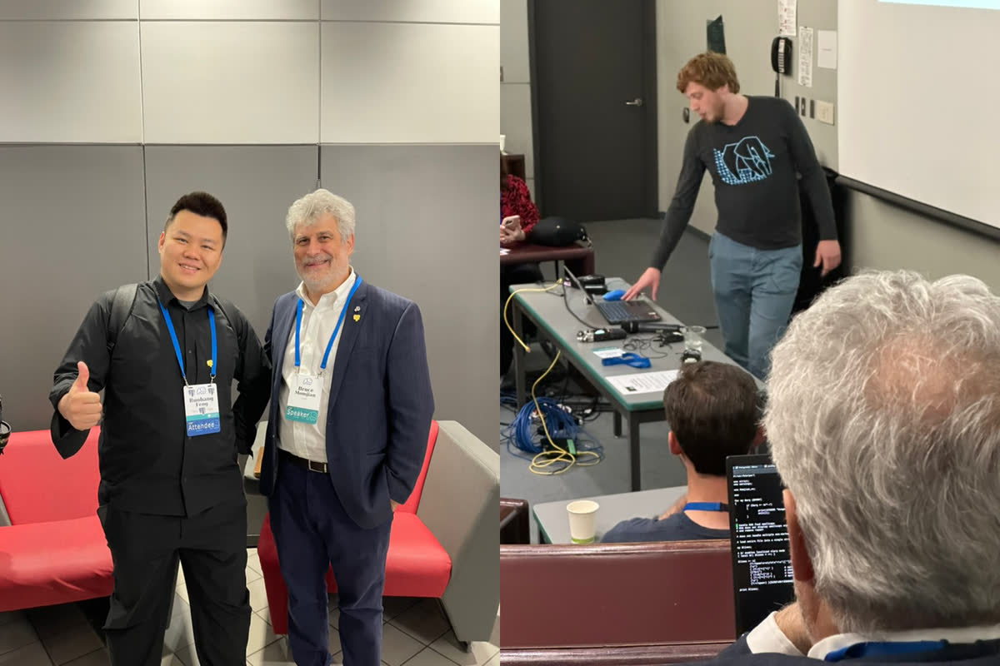

> Haha, some ArgParser code. I see it

During the lunch, Bruce explained that Jonathan Katz needed a topic to introduce the vector database extension PGVector in the PostgreSQL ecosystem, so Bruce was roped in to "fill the gap."

### PB-Level PostgreSQL Deployments

[Chris Travers](https://postgresql.life/post/chris_travers/) reported moving a workload from Elasticsearch to a partitioned and sharded PostgreSQL deployment. The earlier system retained 1 PB for 30 days; the PostgreSQL deployment described in his [slides](https://www.pgevents.ca/events/pgconfdev2024/sessions/session/135/slides/30/) stored 10 PB. I found the operating experience at that scale particularly interesting.

------

### Highlight: When Hardware and Database Collide

My favorite talk at this conference was Margo Seltzer's "[When Hardware and Database Collide](https://www.pgevents.ca/events/pgconfdev2024/schedule/session/192-keynote-when-hardware-and-databases-collide/)".

Margo Seltzer is a professor at UBC, formerly at Harvard, a member of the National Academy of Engineering, and one of the authors of BerkeleyDB. She discussed challenges facing databases today. She pinpointed that the bottleneck for databases has shifted from disk I/O to main memory speed. Emerging hardware technologies like **HBM** and **CXL** could be the solution, posing new challenges for PostgreSQL hackers to tackle.

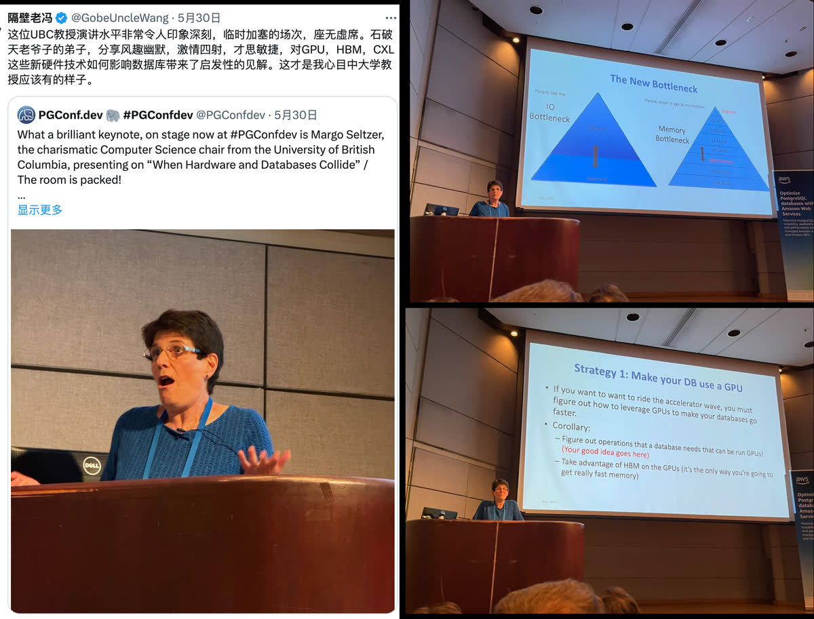

I enjoyed Margo's direct and engaging presentation. I would like to watch it again when the conference video is available.

------

### WetBar Social

Following Margo's session, the official Social Event took place at Rogue Kitchen & Wetbar, just a street away from the venue at Waterfront Station, boasting views of the Pacific and iconic Vancouver landmarks.

The informal setting was perfect for engaging with new and old peers. Conversations with notable figures like Devrim, Tomasz, Yurii, and Keith were particularly enriching. As an RPM maintainer, I had an extensive and fruitful discussion with Devrim, resolving many longstanding queries.

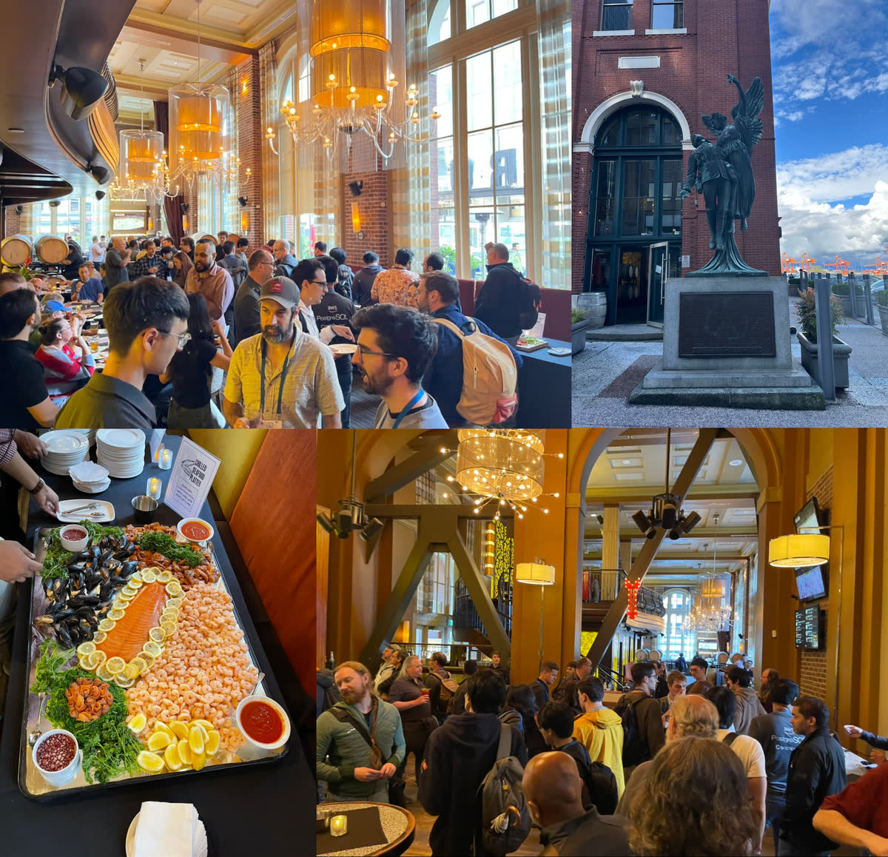

The atmosphere was warm and familiar, with many reconnecting after long periods. A couple of beers in, conversations flowed even more freely among fellow PostgreSQL enthusiasts. The event concluded with an invitation from Melanie for a board game session, which I regretfully declined due to my limited English in such interactive settings.

---------

## Day 2: Debate, Lunch, and Lightning Talks

### Multi-Threading Postgres

The warmth from the previous night's socializing carried over into the next day, marked by the eagerly anticipated session on "**Multi-threaded PostgreSQL**," which was packed to capacity. The discussion, initiated by Heikki, centered on the pros and cons of PostgreSQL's process and threading models, along with detailed implementation plans and current progress.

Heikki described potential benefits of a threading model: cheaper connections, shared relation and plan caches, adjustable shared memory, and easier memory limits. The discussion also covered isolation, bugs, and compatibility changes that extension authors would need to handle.

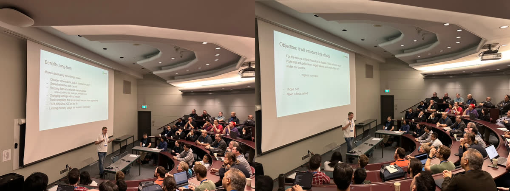

Heikki laid out a detailed plan to transition to the threading model over five to seven years, aiming for a seamless shift without intermediate states. Intriguingly, he cited Tom Lane's critical comment in his presentation:

> For the record, I think this will be a disaster. There is far too much code that will get broken, largely silently, and much of it is not under our control. -- regards, tom lane

Although Tom Lane smiled benignly without voicing any objections, the strongest dissent at the conference came not from him but from an extension maintainer. The elder developer, who maintained several extensions, raised concerns about compatibility, specifically regarding memory allocation and usage. Heikki suggested that extension authors should adapt their work to a new model during a transition grace period of about five years. This suggestion visibly upset the maintainer, who left the meeting in anger.

Given the proposed threading model's significant impact on the existing extension ecosystem, I'm skeptical about this change. At the conference, I consulted on the threading model with Heikki, Tom Lane, and other hackers. The community's overall stance is one of curious & cautious observation. So far, the only progress is in PG 17, where the fork-exec-related code has been refactored and global variables marked for future modifications. Any real implementation would likely not occur until at least PG 20+.

------

### Hallway Track

The sessions on the second day were slightly less intense than the first, so many attendees chose the "Hallway Track"—engaging in conversations in the corridors and lobby. I'm usually not great at networking as an introvert, but the vibrant atmosphere quickly drew me in. Eye contact alone was enough to spark conversations, like triggering NPC dialogue in an RPG. I also managed to subtly promote Pigsty to every corner of the PG community.

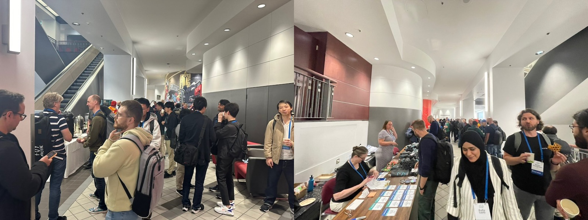

Despite being a first-timer at PGCon.Dev, I was surprised by the recognition and attention I received, largely thanks to the widely read article, "[PostgreSQL is eating the Database world](https://medium.com/@fengruohang/postgres-is-eating-the-database-world-157c204dcfc4)." Many recognized me by my badge [Vonng](https://vonng.com/en/) / [Pigsty](https://pigsty.io).

A simple yet effective networking trick is never to underestimate small gifts' effect. I handed out gold-plated Slonik pins, PostgreSQL's mascot, which became a coveted item at the conference. Everyone who talked with me received one, and those who didn't have one were left asking where to get one. LOL

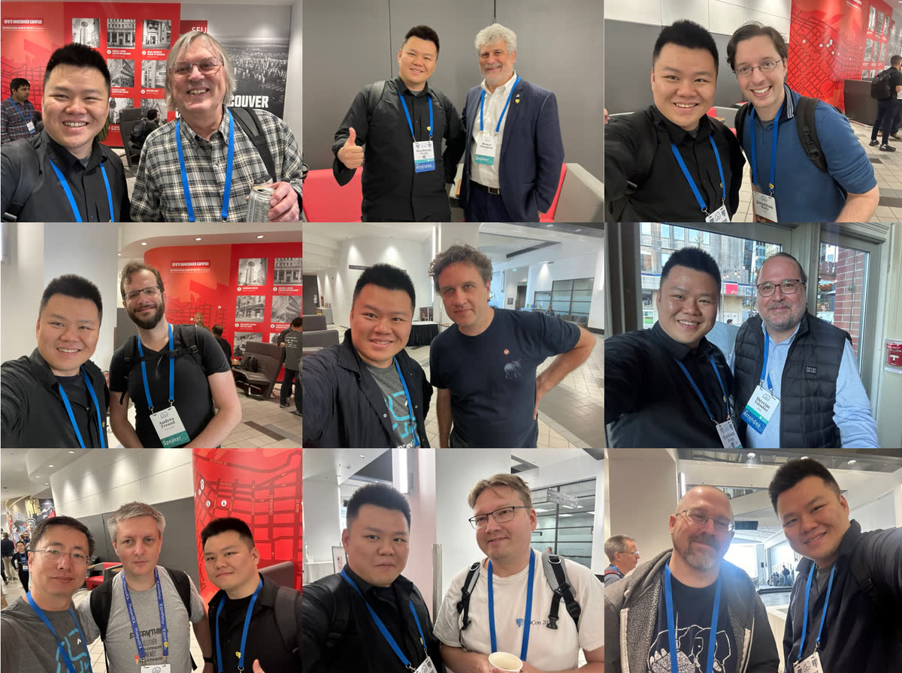

Anyway, I'm glad to have made many new friends and connections.

---------

### Multinational Community Lunch

As for lunch, HighGo hosted key participants from the American, European, Japanese, and Chinese PostgreSQL communities at a Cantonese restaurant in Vancouver. The conversation ranged from serious technical discussions to lighter topics. I met Tatsuro Yamada, who gave the talk "[Advice is seldom welcome but efficacious](https://www.pgevents.ca/events/pgconfdev2024/schedule/session/62-advice-is-seldom-welcome-but-efficacious/)", and Kyotaro Horiguchi, a core contributor to PostgreSQL known for his work on WAL replication and multibyte string processing and the author of pg_hint_plan.

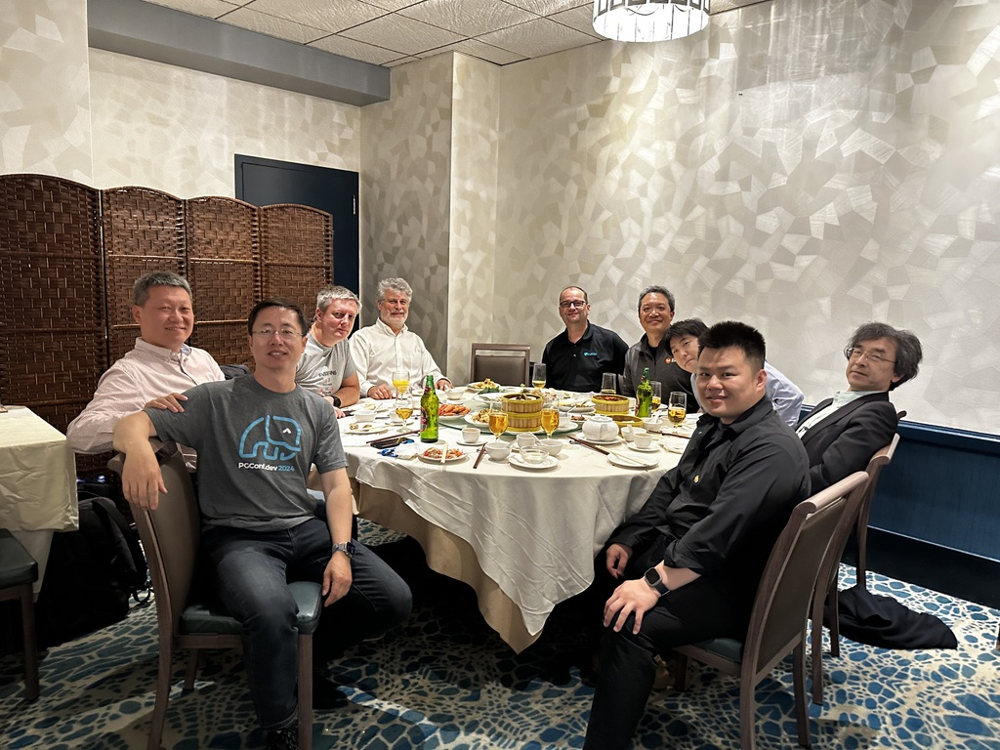

Another major contributor to the PostgreSQL community, **Mark Wong** organizes PGUS and has developed a series of PostgreSQL monitoring extensions. He also manages community merchandise like contributor coins, shirts, and stickers. He even handcrafted a charming yarn elephant mascot, which was so beloved that one was sneakily "borrowed" at the last PG Conf US.

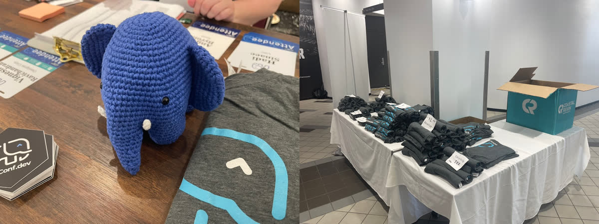

Bruce, already a familiar face in the PG Chinese community, Andreas Scherbaum from Germany, organizer of the European PG conferences, and Miao Jian, founder of Han Gao, representing the only Chinese database company at PGCon.Dev, all shared insightful stories and discussions about the challenges and nuances of developing databases in their respective regions.

On returning to the conference venue, I had a conversation with [Jan Wieck](https://www.crunchydata.com/news/jan-wieck-former-postgres-core-team-member-joins-crunchy-data), a former PostgreSQL core team member. He shared his story of participating in the PostgreSQL project from the early days and encouraged me to get more involved in the PostgreSQL community, reminding me its future depends on the younger generation.

---------

### Making PG Hacking More Inclusive

At PGCon.Dev, a special session on community building chaired by Robert Haas, featured three new PostgreSQL contributors sharing their journey and challenges, notably the barriers for non-native English speakers, timezone differences, and emotionally charged email communications.

Robert emphasized in a post-conference blog [his desire to see more developers from India and Japan rise to senior positions within PostgreSQL's ranks](https://rhaas.blogspot.com/2024/06/2024pgconfdev-and-growing-community.html), noting the underrepresentation from these countries despite their significant developer communities.

> While we're at it, I'd really like to see more people from India and Japan in senior positions within the project. We have very large developer communities from both countries, but there is no one from either of those countries on the core team, and they're also underrepresented in other senior positions. At the risk of picking specific examples to illustrate a general point, there is no one from either country on the infrastructure team or the code of conduct committee. We do have a few committers from those countries, which is very good, and I was pleased to see Amit Kapila on the 2024.pgconf.dev organizing commitee, but, overall, I think we are still not where we should be. Part of getting people involved is making them feel like they are not alone, and part of it is also making them feel like progression is possible. Let's try harder to do that.

The discussion mentioned India and Japan but not China, which left me with mixed feelings. I would like to see more sustained upstream participation from Chinese users and developers. Richard Guo from PieCloudDB had become a PostgreSQL committer that year.

As far as I knew, five attendees had come from China: four from HighGo and me.

I hope my participation helps more users and developers in the Chinese-speaking community make connections, share their work with the global community, and find opportunities to collaborate.

----------

### Lightning Talks

The second day ended with lightning talks, each limited to five minutes. Eleven speakers covered their topics in 45 minutes. Keith discussed PG Monitor improvements, and Peter Eisentraut covered SQL standard updates. My highlight was Devrim Gündüz’s talk on PG RPMs: he fitted 75 slides into five minutes, delivering the “big reveal” he had promised at the bar.

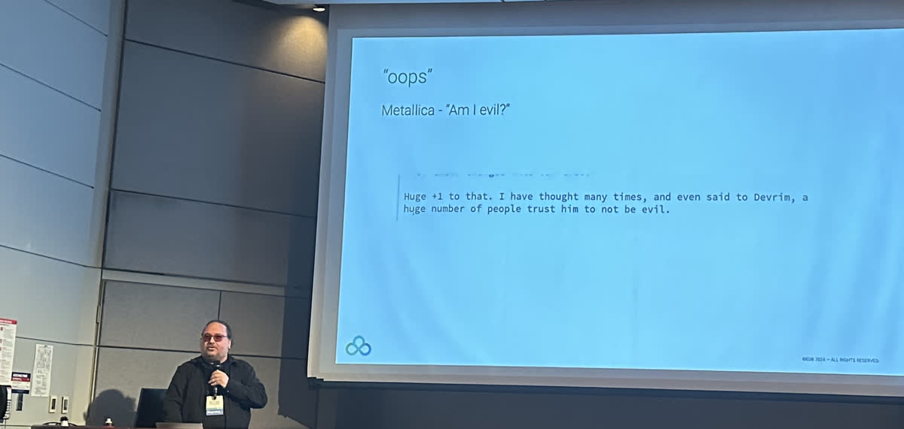

Many PostgreSQL users install binary packages rather than build from source. At the time, I maintained packages for 34 extensions in Pigsty, while Devrim maintained more than a hundred in the PGDG RPM repository. This packaging work makes extensions available to a much wider audience.

Devrim is a fascinating character — a Turkish native living in London, a part-time DJ, and the maintainer of the PGDG RPM repository, sporting a PostgreSQL logo tattoo. After an engaging chat about the PGDG repository, he shared insights on how extensions are added, highlighting the community-driven nature of PGXN and recent popular additions like `pgvector`, ([which I made the suggestion haha](https://github.com/pgvector/pgvector/issues/76)).

Interestingly, with the latest Pigsty v2.7 release, four of my maintained (packaging) extensions (`pgsql-http`, `pgsql-gzip`, `pg_net`, `pg_bigm`) were adopted into the PGDG official repository. Devrim admitted to scouring Pigsty's [extension list](https://pigsty.cc/docs/reference/extension) for good picks, though he humorously dismissed any hopes for my Rust pgrx extensions making the cut, reaffirming his commitment to not blending Go and Rust plugins into the official repository. Our conversation was so enriching that I've committed myself to becoming a "PG Extension Hunter," scouting and recommending new plugins for official inclusion.

--------

## Day 3: Unconference

One of the highlights of PGCon.Dev is the Unconference, a self-organized meeting with no predefined agenda, driven by attendee-proposed topics. On day three, Joseph Conway facilitated the session where anyone could pitch topics for discussion, which were then voted on by participants. My proposal for a **Built-in Prometheus Metrics Exporter** was merged into a broader **Observability** topic spearheaded by Jeremy.

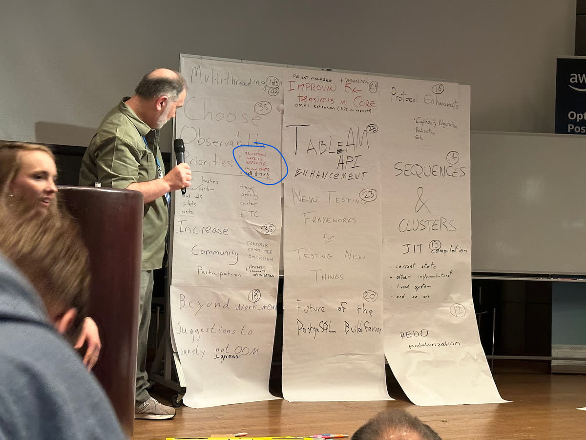

The top-voted topics were Multithreading (42 votes), Observability (35 votes), and Enhanced Community Engagement (35 votes). Observability features were a major focus, reflecting the community's priority. I proposed integrating a contrib monitoring extension in PostgreSQL to directly expose metrics via HTTP endpoint, using `pg_exporter` as a blueprint but embedded to overcome the limitations of external components, especially during crash recovery scenarios.

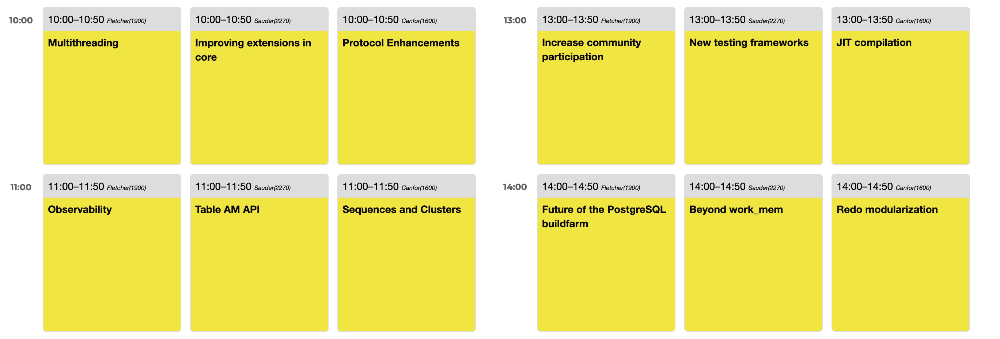

There's a clear focus on observability among the community. As the author of [pg_exporter](https://github.com/pgsty/pg_exporter), I proposed developing a first-party monitoring extension. This extension would integrate Prometheus monitoring endpoints directly into PostgreSQL, exposing metrics via HTTP without needing external components.

The proposal aimed to reduce the need to manage a separate exporter and expose internal state while SQL connections were unavailable, such as during crash recovery. Those capabilities would require implementation and testing in PostgreSQL.

The suggested implementation involves a background worker process similar to the `bgw_replstatus` extension. This process would listen on an additional port to expose monitoring metrics through HTTP, using pg_exporter as a blueprint. Metrics would primarily be defined via a Collector configuration table, except for a few critical system indicators.

This idea garnered attention from several PostgreSQL hackers at the event. Developers from EDB and CloudNativePG are evaluating whether [`pg_exporter`](https://github.com/pgsty/pg_exporter) could be directly integrated into their distributions as part of their monitoring solutions. And finally, an Observability Special Interest Group (SIG) was formed by attendees interested in observability, planning to continue discussions through a mailing list.

---------------

### Issue: Support for LoongArch Architecture

During the last two days, I have had some discussions with PG Hackers about some Chinese-specific issues.

One suggestion was to add LoongArch builds to the PGDG repositories, with build infrastructure offered by Chinese chip and operating-system vendors. Devrim said the RPM build distributions did not support the architecture at that time. Tomasz Rybak was open to Debian packages if the architecture became available in Debian 13.

In summary, official PG RPMs might not yet support LoongArch, but APT has a chance, contingent on broader OS support for mainstream open-source Linux distributions.

-------------

### Issue: Server-side Chinese Character Encoding

Jeremy Schneider’s talk on collation described problems caused by changes in sorting rules. His preference for simple, stable ordering matched my own [practice](https://vonng.com/en/pg/collate/). His [slides](https://www.pgevents.ca/events/pgconfdev2024/sessions/session/95/slides/26/pgcon24_collation.pdf) explain the tradeoffs.

After the talk, Jeremy, Peter Eisentraut, and I discussed GB18030 compatibility. PostgreSQL supported this encoding for clients and conversion functions, but not as a server encoding. I also raised a possible mapping problem affecting about twenty added Chinese characters in `convert_to(..., 'gb18030')`. They agreed to investigate.

---------

### Closing

The event closed with Jonathan Katz and Melanie Plageman wrapping up an exceptional conference that leaves us looking forward to next year's PGCon.Dev 2025 in Canada, possibly in Vancouver, Toronto, Ottawa, or Montreal.

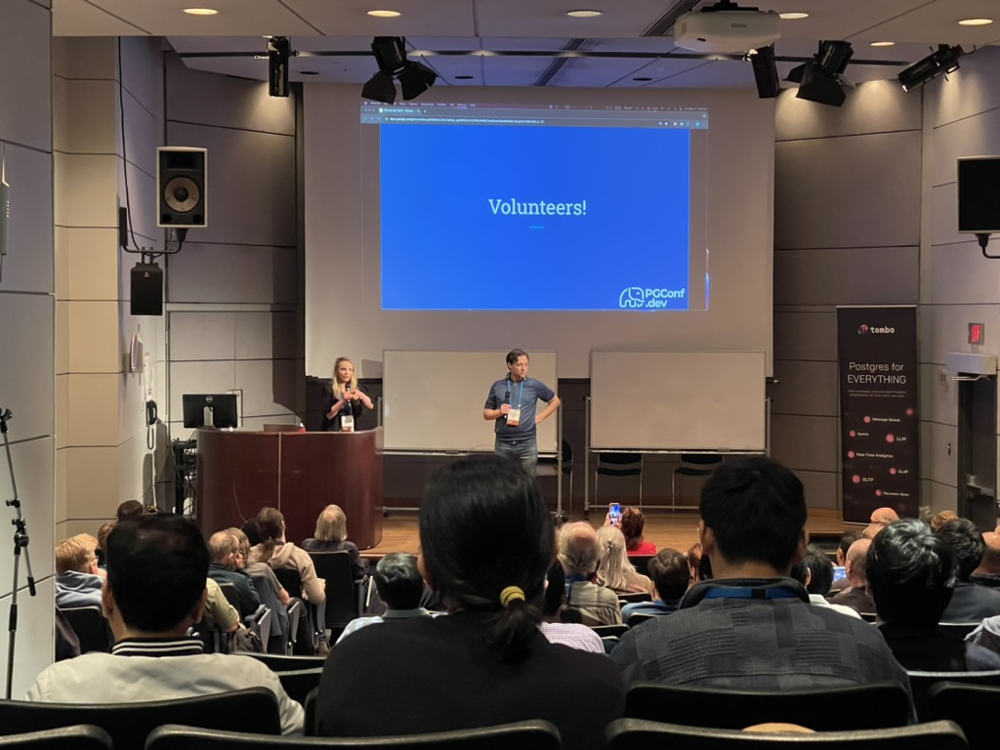

Inspired by the engagement at this conference, I'm considering presenting on Pigsty or PostgreSQL observability next year.

------

Notably, following the conference, Pigsty's international CDN traffic spiked significantly, highlighting the growing global reach of our PostgreSQL distribution, which really made my day.

[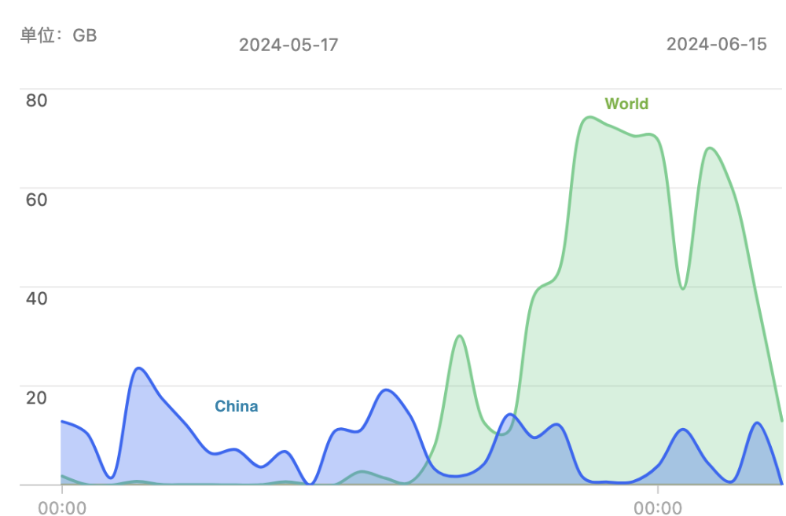](https://pigsty.io/)

> Pigsty CDN Traffic Growth after PGCon.Dev 2024

------------

The [official session archive](https://www.pgevents.ca/events/pgconfdev2024/sessions/) contains slides. Other reports include:

- [Andreas Scherbaum PostgreSQL Development Conference 2024 - Review](https://andreas.scherbaum.la/post/2024-06-14_postgresql-development-conference-2024-review/)

- [PgCon 2024 Developer Meeting](https://wiki.postgresql.org/wiki/PgCon_2024_Developer_Meeting)

- [Robert Haas: 2024.pgconf.dev and Growing the Community](https://rhaas.blogspot.com/2024/06/2024pgconfdev-and-growing-community.html)

- [How engaging was PGConf.dev really?](https://peter.eisentraut.org/blog/2024/06/04/how-engaging-was-pgconfdev-really)

- [PGConf.dev 2024: Shaping the Future of PostgreSQL in Vancouver](https://www.highgo.ca/2024/06/11/pgconf-dev-2024-shaping-the-future-of-postgresql-in-vancouver/)

- [PGCon.Dev Extension Summit Notes @ Vancouver](https://mp.weixin.qq.com/s/C0YyE52KbLLbnG1C2FqGRg)

- [PGCon 2024 Opening](https://mp.weixin.qq.com/s/4t1thBCDVS8y9dHiOxPZaA)
