This article describes the Pigsty v4 beta in December 2025.

While preparing Pigsty v4.0, I replaced the default Prometheus and Loki services with VictoriaMetrics and VictoriaLogs. I also added VictoriaTraces. The aim was to reduce storage and memory use and improve dashboard and log-query response time.

## Previous experience

At Tantan, we monitored about 50 million time series with twelve Prometheus nodes, each with 64 CPU cores and 256 GB of memory. In my tests, a three-node VictoriaMetrics cluster handled the workload; a larger single server also handled it. Memory and disk use were roughly one quarter of the previous setup, and queries were about four times faster.

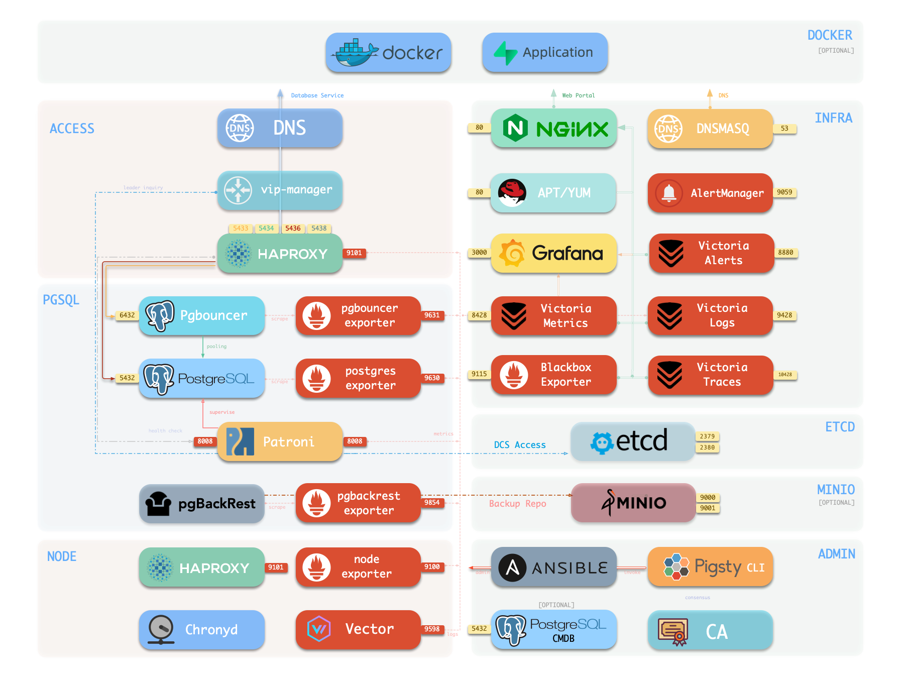

Pigsty initially offered VictoriaMetrics as an optional module. A deployment for the video production team Media Storm (影视飓风), together with the planned retirement of Promtail, prompted the infrastructure update. Promtail was the log collection agent; Loki itself was not being retired.

Aliaksandr Valialkin's work on allocation control and efficient storage also prompted me to test the system.

## Ten-node test

For the v4 beta, I collected metrics and logs from ten nodes. After one day, the test showed:

| Measurement | Observed value |
| --- | --- |
| Time series | About 120,000 |
| VictoriaMetrics memory | About 600 MB |
| Stored metric samples | About 1.1 billion |
| Metric storage | About 440 MB |
| Log records | About 500,000 |
| Log storage | Less than 6 MB |
| Entire monitoring stack, including Grafana and Alertmanager | About 0.2 vCPU and 1 GB memory |

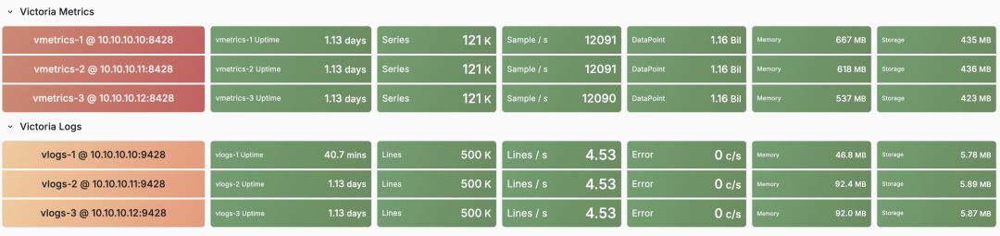

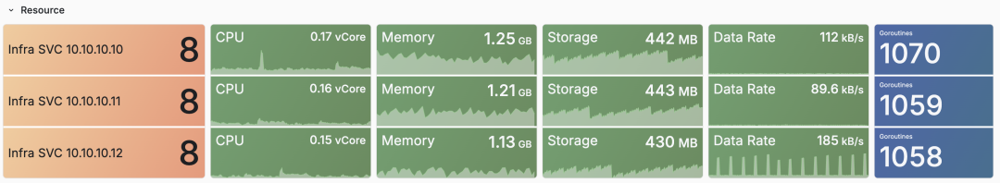

I also ran the Pigsty v3.7 Prometheus and Loki setup on ten nodes. After ten hours, its resource use was near or above the Victoria setup. The readings cover different collection periods: ten hours for Prometheus and Loki, and one day for Victoria.

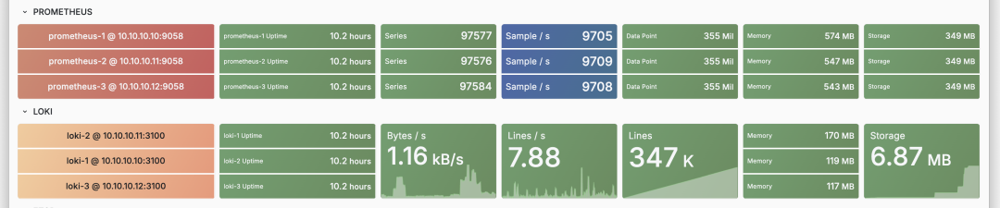

The practical improvement was faster dashboard loading and log searches in this environment.

## Metrics, logs, and traces

VictoriaMetrics accepts Prometheus metrics and provides a compatible query API. PG Exporter continues to expose the same `/metrics` endpoint. Existing dashboards can use VictoriaMetrics as their data source; check query results when migrating because MetricsQL has differences from PromQL. Recording and alert rules are evaluated by the separate `vmalert` service.

VictoriaMetrics supports both single-server and cluster deployments.

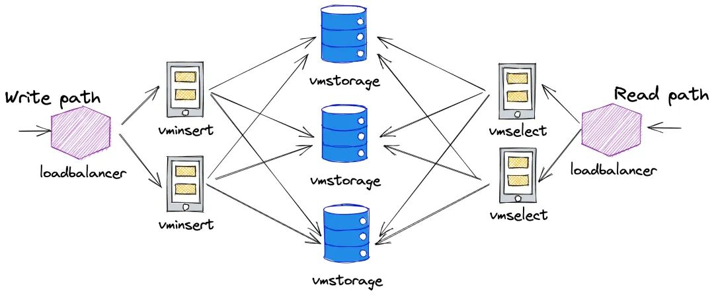

For this workload, one server had enough capacity. I used independent single-server replicas to provide redundancy without managing distributed storage. Each replica collected and stored the metrics separately.

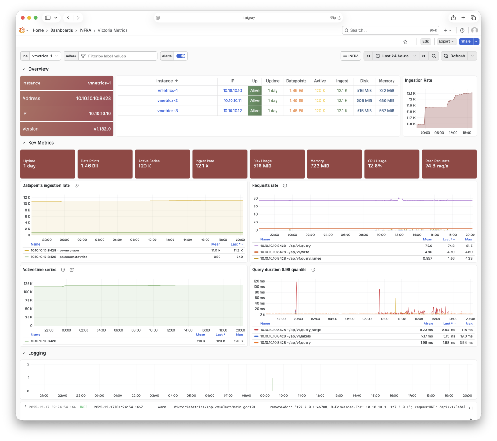

In the previous setup, expanding the log search interval could make Loki queries time out. Faster log searches were a main reason for adopting VictoriaLogs.

VictoriaLogs stores logs and uses LogsQL. Moving from Loki requires changing LogQL queries and the log collection configuration. In this deployment, Vector replaced Promtail.

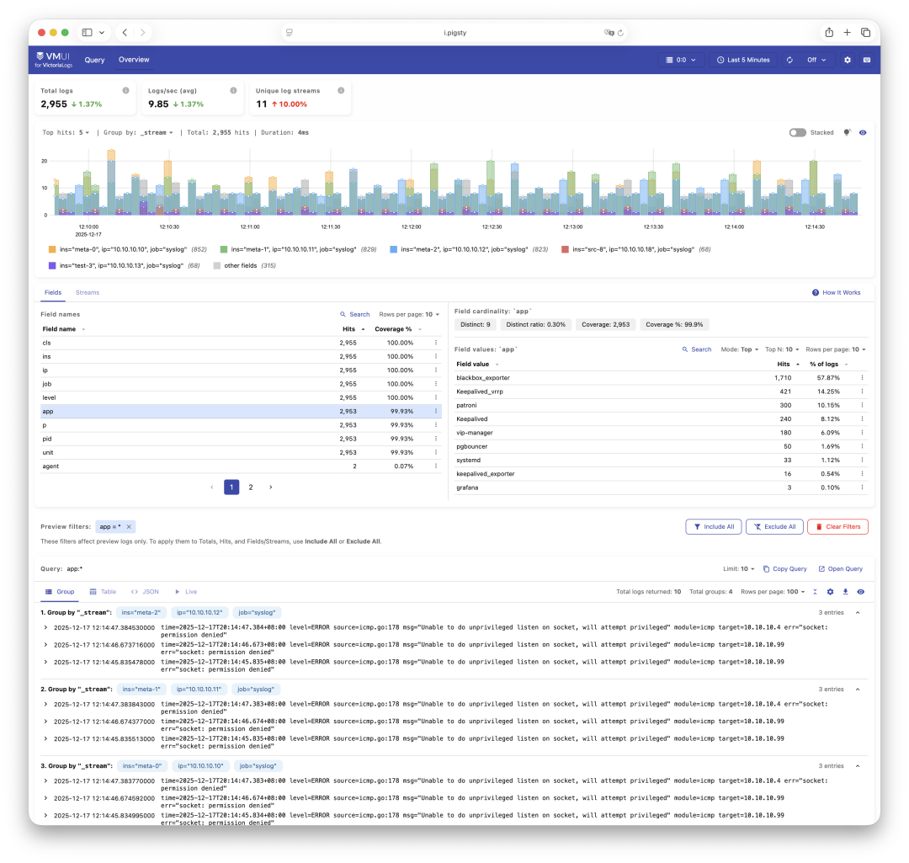

LogsQL allows a search without a stream selector. For example, `"error" "timeout"` searches for log entries containing both terms. This is useful when the affected service is not yet known. See the [VictoriaLogs documentation](https://docs.victoriametrics.com/victorialogs/).

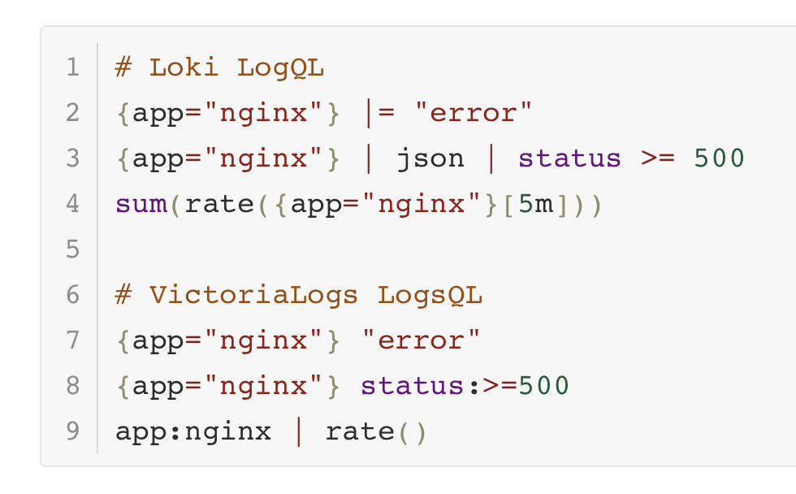

VictoriaTraces supplies trace storage. This beta test covered metrics and logs.

## Pigsty integration

The Pigsty infrastructure repository provides RPM and DEB packages for Victoria components, tools, and Grafana plugins. The `infra` deployment configures storage directories, services, Grafana data sources, dashboards, and Nginx routes.

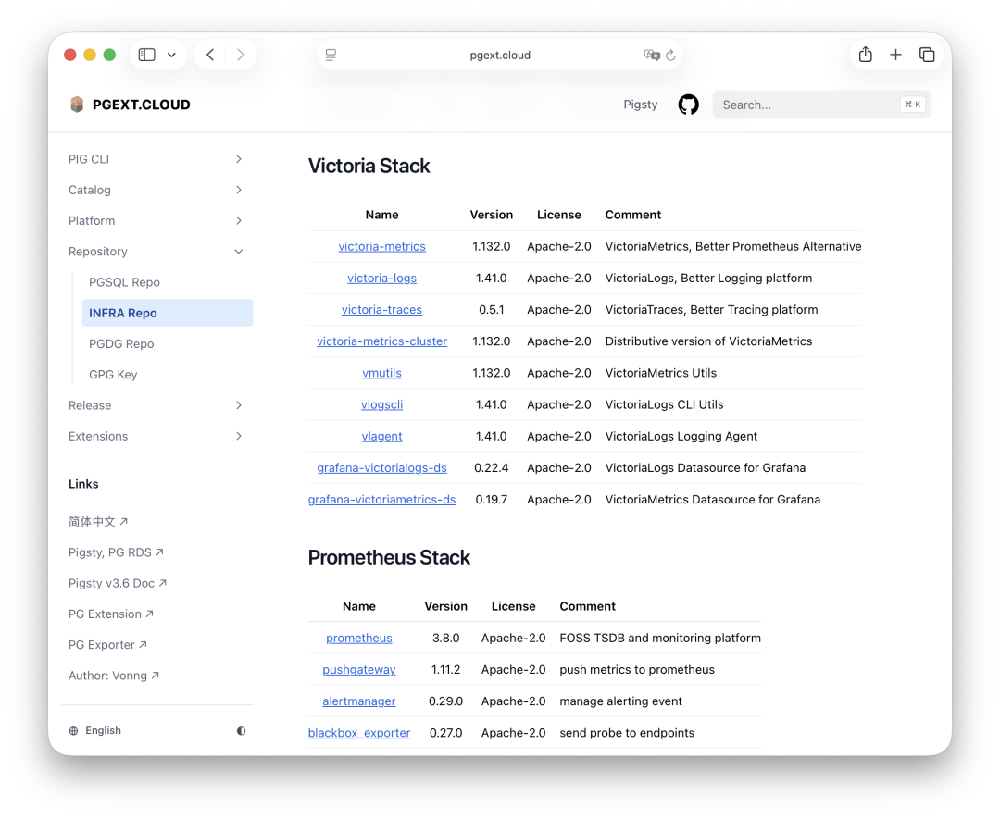

Nginx exposes the services through the configured infrastructure domain. The stack includes VictoriaMetrics, VictoriaLogs, VictoriaTraces, Grafana, vmalert, and Alertmanager.

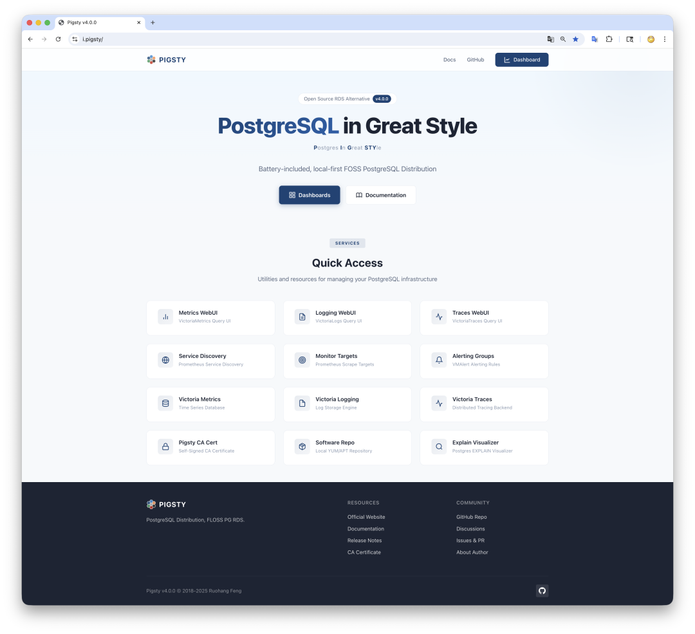

The deployment also configures service monitoring. Additional application targets can be added through scrape configuration.

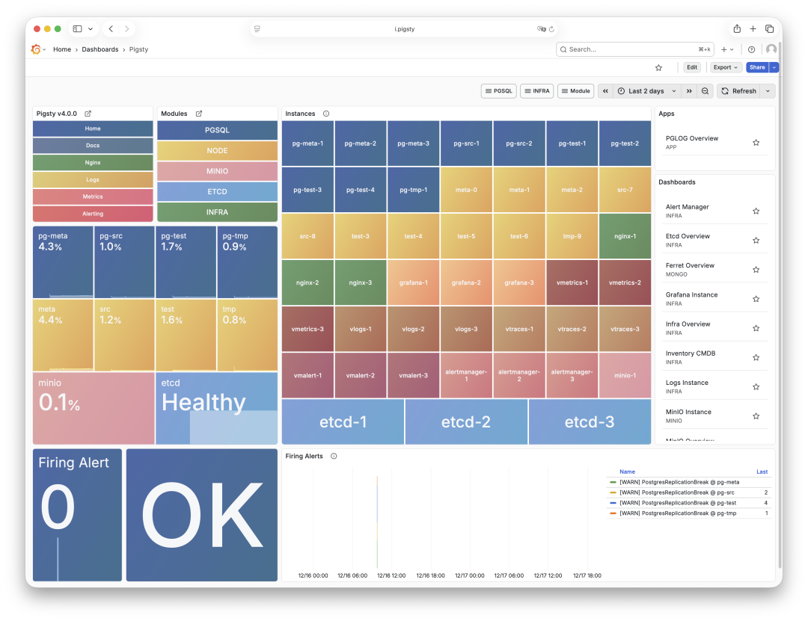

## The beta deployment

The December 2025 beta used the `infra` configuration template to install monitoring services without PostgreSQL or etcd. The commands below show that workflow. For a new host, use the current [Pigsty infrastructure guide](https://pigsty.io/docs/infra/).

```bash
curl -fsSL https://repo.pigsty.cc/beta | bash
cd ~/pigsty
./configure -c infra
./infra.yml
```

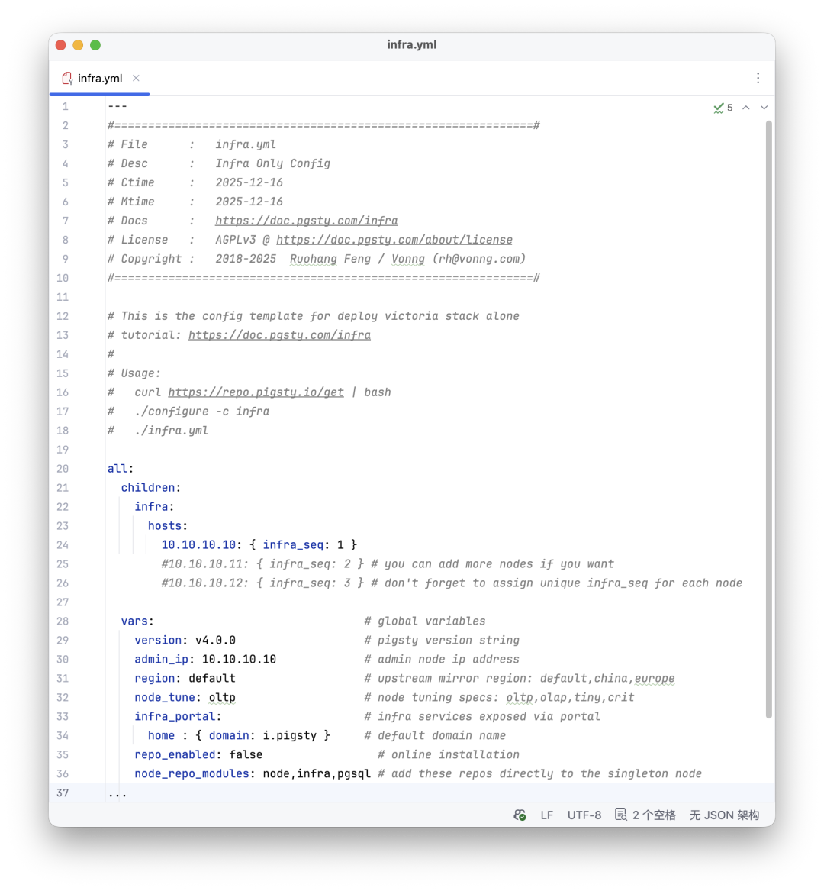

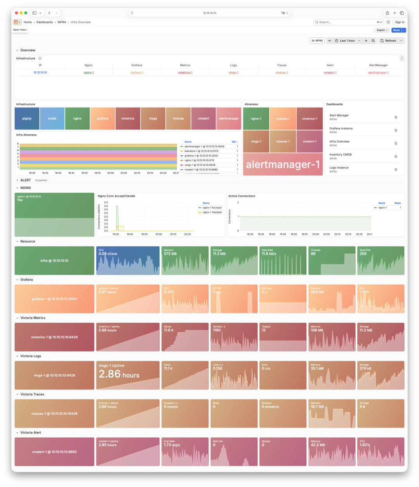

With three infrastructure nodes, the template deployed three independent replicas.

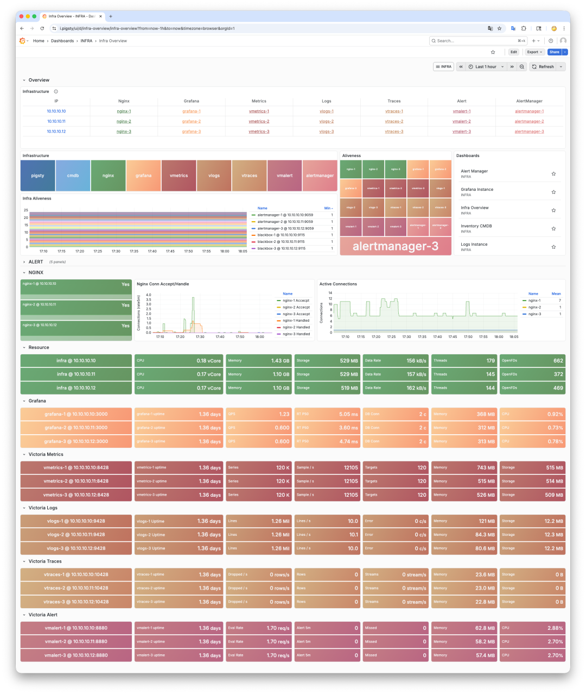

At the time of writing, the remaining v4.0 work included dashboards and documentation, with a stable release planned for January 2026. Native distributed Victoria deployment was a later task.

This migration gave me a monitoring stack that used fewer resources and responded faster under our workload. Those were the reasons to make it the Pigsty default.
