本文记录 2025 年 12 月的 Pigsty v4 测试版。

准备 Pigsty v4.0 时，我将默认的 Prometheus 和 Loki 服务替换为 VictoriaMetrics 与 VictoriaLogs，并加入 VictoriaTraces。目标是降低存储与内存消耗，改善仪表盘和日志查询的响应时间。

## 之前的使用经验

在探探时，我们用十二台 64 核、256 GB 内存的 Prometheus 节点监控约五千万个时间序列。我的测试中，三节点 VictoriaMetrics 集群可以处理这些负载，一台配置更高的服务器也能承载。内存和磁盘用量约为原方案的四分之一，查询速度约快四倍。

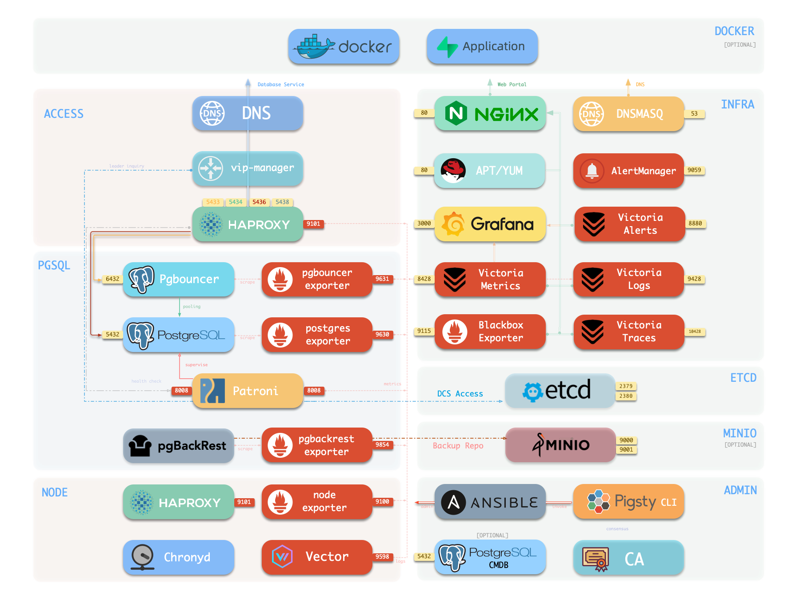

Pigsty 起初将 VictoriaMetrics 作为可选模块。为影视飓风部署监控系统，加上 Promtail 计划停止维护，促成了这次基础设施更新。Promtail 是日志采集代理，Loki 本身并未停止维护。

Aliaksandr Valialkin 在内存分配控制和存储效率上的工作，也是我测试这套系统的原因。

## 十节点测试

在 v4 测试版中，我收集了十个节点的指标与日志。运行一天后的结果如下：

| 项目 | 观测值 |
| --- | --- |
| 时间序列 | 约 12 万 |
| VictoriaMetrics 内存 | 约 600 MB |
| 已存储指标样本 | 约 11 亿 |
| 指标存储 | 约 440 MB |
| 日志记录 | 约 50 万行 |
| 日志存储 | 不到 6 MB |
| 整套监控服务，含 Grafana 与 Alertmanager | 约 0.2 vCPU、1 GB 内存 |

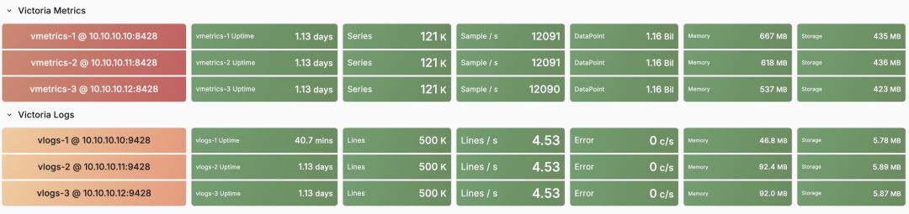

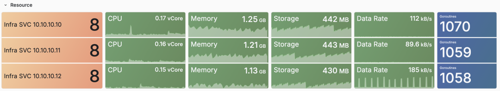

我还在十节点环境运行了 Pigsty v3.7 的 Prometheus 与 Loki 方案。十小时后，其资源使用已接近或超过 Victoria 方案。两组读数的采集时长不同：Prometheus 与 Loki 为十小时，Victoria 为一天。

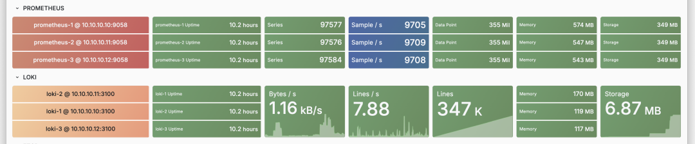

对日常使用更直接的改善，是这套环境中的仪表盘加载和日志查询变快了。

## 指标、日志与追踪

VictoriaMetrics 接收 Prometheus 指标，并提供兼容的查询 API。PG Exporter 继续暴露同一个 `/metrics` 端点。已有仪表盘可以改用 VictoriaMetrics 数据源；迁移时需核对查询结果，因为 MetricsQL 与 PromQL 存在差异。记录规则与告警规则由独立的 `vmalert` 服务计算。

VictoriaMetrics 支持单机与集群部署。

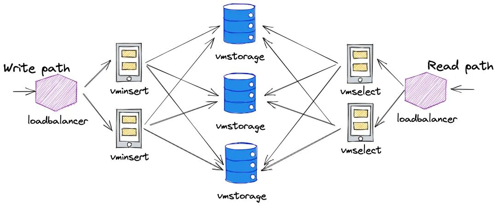

单台服务器足以处理本次负载，因此我采用独立的单机副本提供冗余，省去了分布式存储的管理。每个副本分别采集、存储指标。

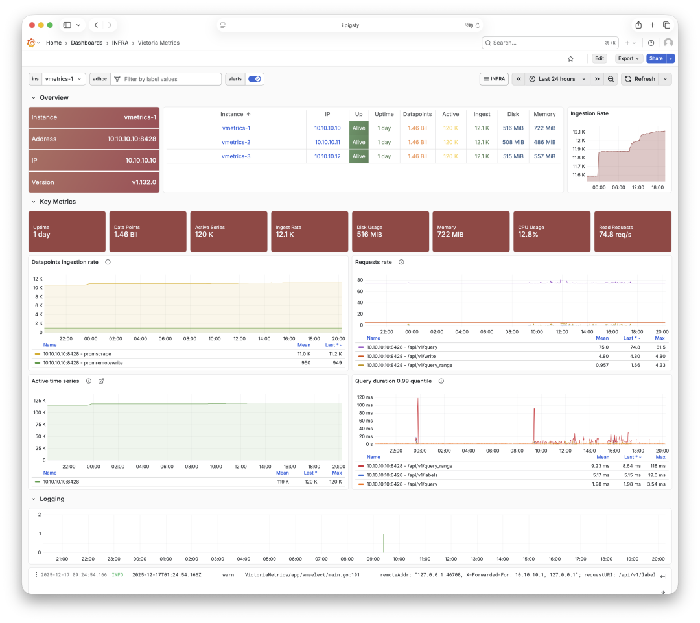

在原有部署中，扩大日志查询的时间范围，有时会使 Loki 查询超时。改善日志查询速度是此次采用 VictoriaLogs 的主要原因之一。

VictoriaLogs 存储日志，使用 LogsQL。由 Loki 迁移时，需要修改 LogQL 查询和日志采集配置。本次部署使用 Vector 替代 Promtail。

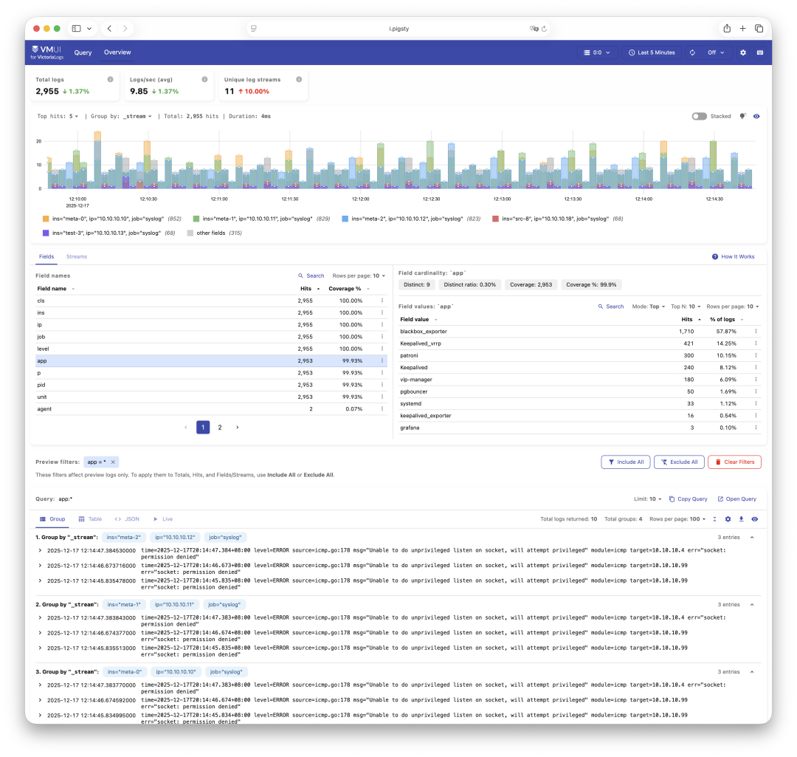

LogsQL 允许不指定流选择器就进行搜索。例如，`"error" "timeout"` 可以查找同时包含两个词的日志。这适合尚不清楚哪个服务出错的排查场景，语法见 [VictoriaLogs 文档](https://docs.victoriametrics.com/victorialogs/)。

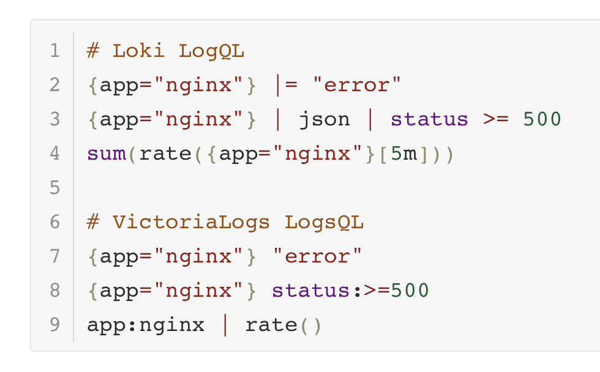

VictoriaTraces 提供追踪数据存储。本次 Beta 测试覆盖指标与日志。

## Pigsty 集成

Pigsty 基础设施仓库提供 Victoria 组件、工具和 Grafana 插件的 RPM 与 DEB 软件包。`infra` 部署负责配置存储目录、服务、Grafana 数据源、仪表盘与 Nginx 路由。

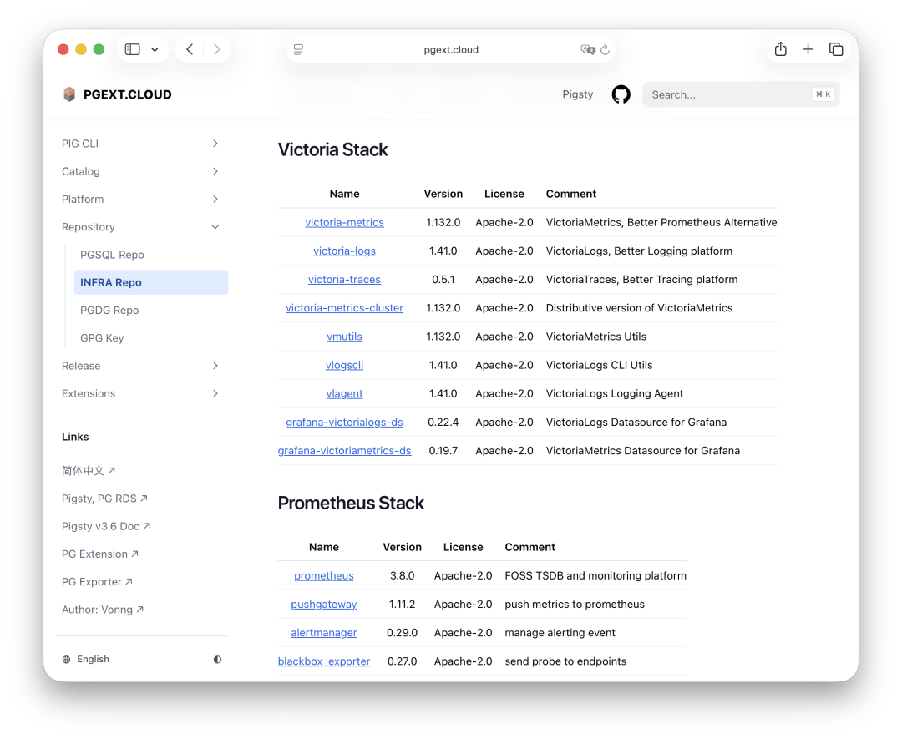

Nginx 通过配置的基础设施域名暴露服务。监控栈包括 VictoriaMetrics、VictoriaLogs、VictoriaTraces、Grafana、vmalert 与 Alertmanager。

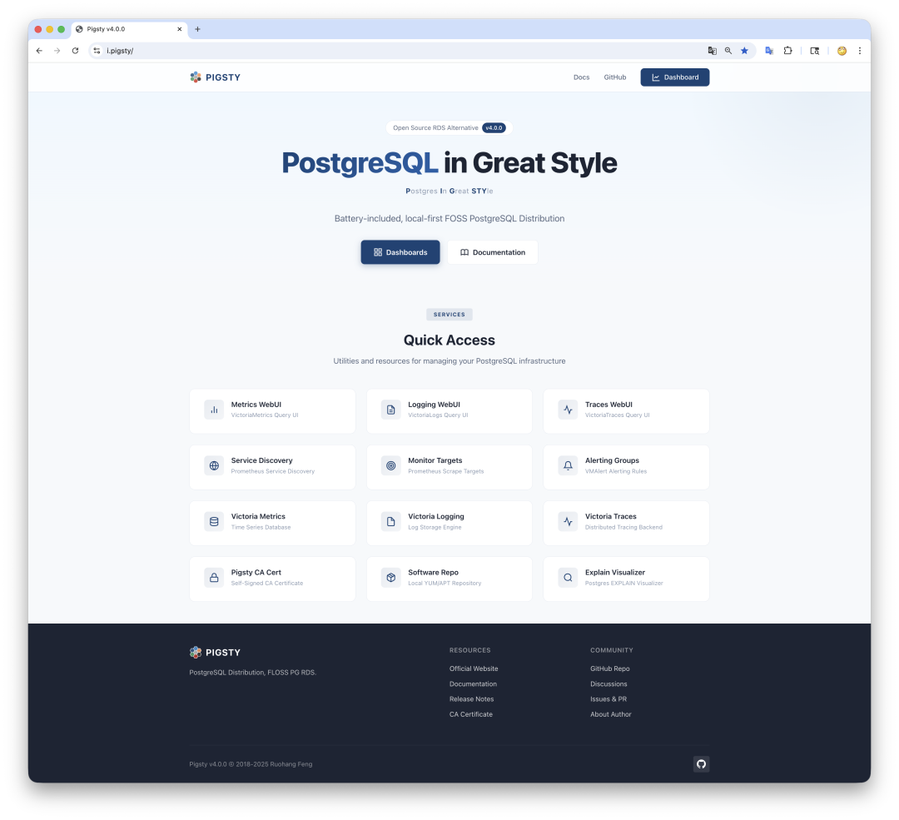

部署也配置了这些服务的自监控。新增应用目标可通过抓取配置接入。

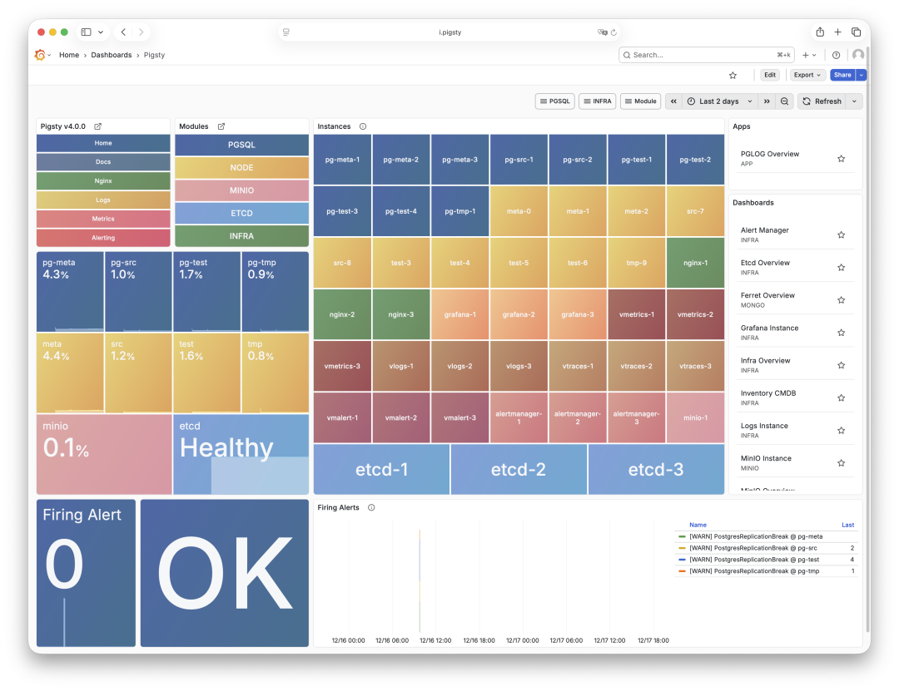

## 当时的测试版部署

2025 年 12 月的测试版使用 `infra` 配置模板，仅安装监控服务，不安装 PostgreSQL 或 etcd。下方命令展示当时的流程。在新主机上部署，请使用当前 [Pigsty 基础设施指南](https://pigsty.cc/docs/infra/)。

```bash
curl -fsSL https://repo.pigsty.cc/beta | bash
cd ~/pigsty
./configure -c infra
./infra.yml
```

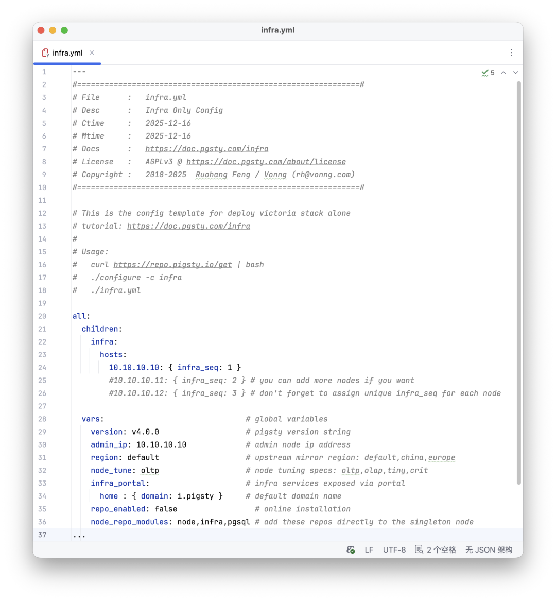

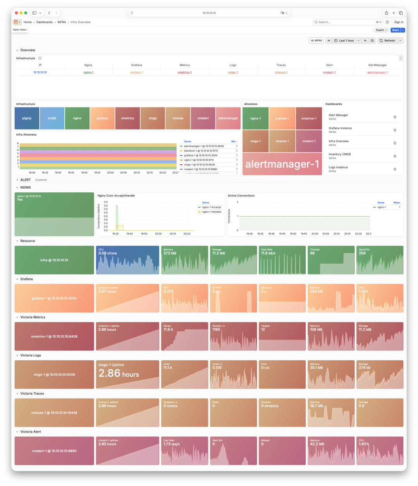

配置三个基础设施节点时，模板会部署三个相互独立的副本。

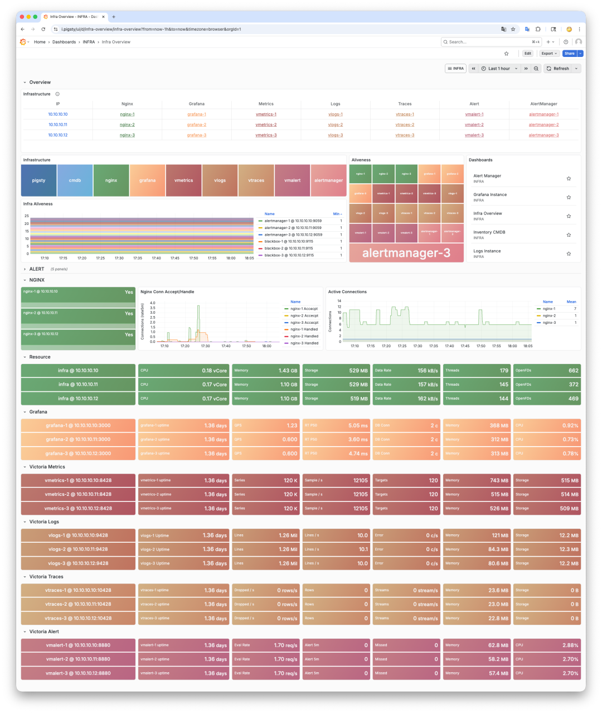

文章写作时，v4.0 剩余工作包括仪表盘和文档，正式版计划在 2026 年 1 月发布。Victoria 原生分布式部署属于后续任务。

这次迁移降低了我们负载下的资源消耗，并改善了查询响应。这是我选择将其作为 Pigsty 默认监控栈的原因。
